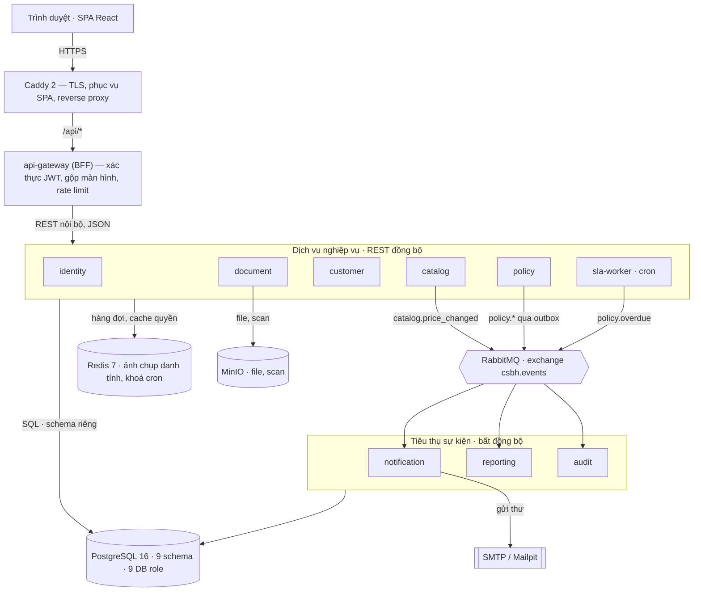
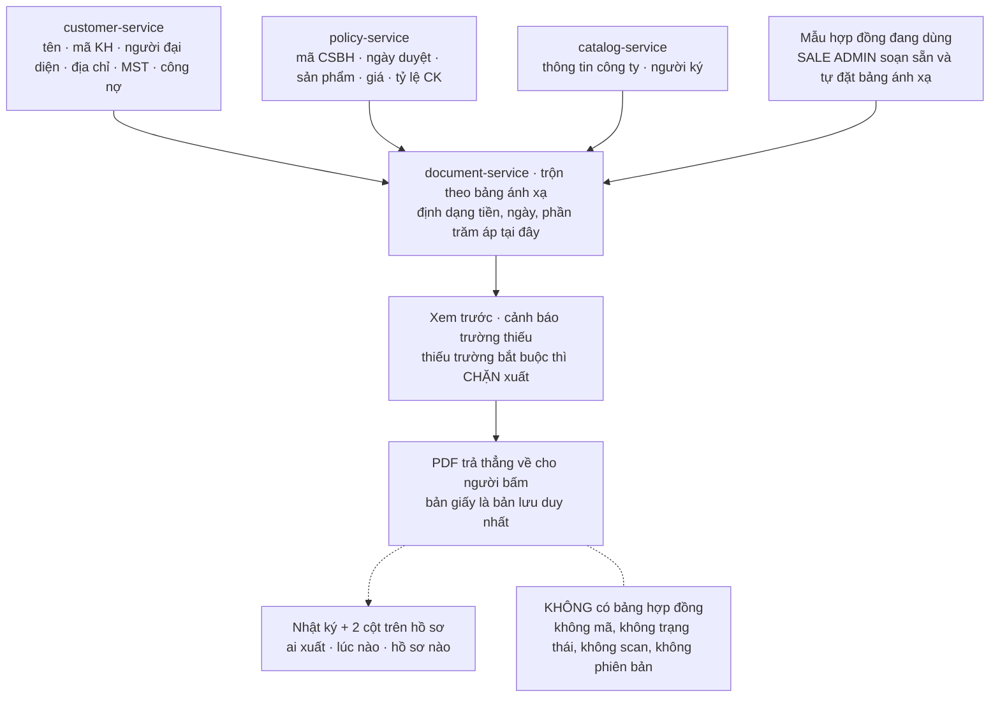
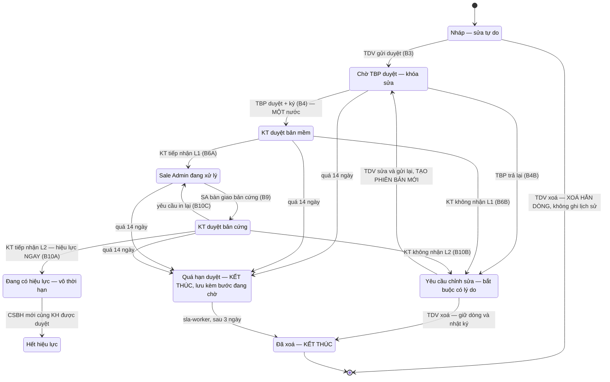
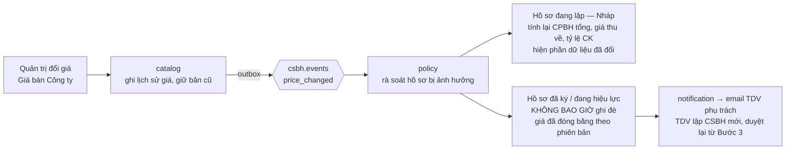
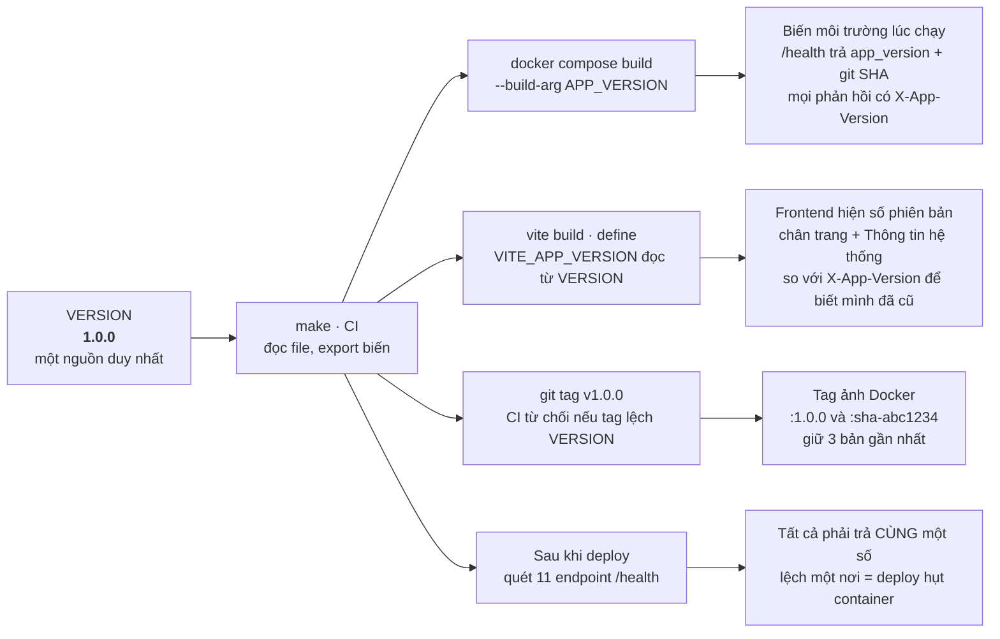

# Kiến trúc & kế hoạch kiểm thử — Phần mềm Chính sách bán hàng

| | |
|---|---|
| **Đơn vị yêu cầu** | Công ty TNHH Dược phẩm Nutricare |
| **Phiên bản phần mềm** | **1.0.2** — bản giao thứ ba, sau vòng sửa theo phản hồi khách hàng; xem mục 16 |
| **Phiên bản tài liệu** | **1.2 · 06/09/2026** — rà soát toàn văn theo triển khai thật (`0178`) |
| **Nguồn nghiệp vụ** | `YEU-CAU-NGHIEP-VU-CSBH.md` v4.1 — khi mâu thuẫn, **tài liệu nghiệp vụ có hiệu lực cao hơn** |
| **Bản web** | `../artifacts/kien-truc-csbh.html` · https://claude.ai/code/artifact/d9e72525-6df5-475d-8b76-52f8a3202aea |

> **BẢN `.md` NÀY LÀ BẢN CHÍNH.** `sửa 06/09` — ghi chú cũ nói nó *"sinh tự động từ HTML bằng `python3 tools/html2md.py`, đừng sửa tay"*. Câu ấy đã sai sự thật từ lâu và là một cái bẫy: **script ấy không tồn tại** (`tools/` chỉ còn `figs/`), còn `../artifacts/kien-truc-csbh.html` đông cứng ở
> ngày 07/08 và không mang một mã thay đổi nào. Từ `0021` trở đi mọi cập nhật đều viết thẳng vào file này. Bản web chỉ là ảnh chụp lúc bàn giao lần đầu.

Bản thiết kế triển khai cho YCNV v4.1: phân rã microservice chạy bằng Docker Compose, techstack kèm
lý do chọn, thiết kế giao diện chạy được trên cả máy tính lẫn điện thoại, danh mục test case
cho backend lẫn frontend, và quy trình kiểm thử local trước khi lên production.

| | | | |
|---|---|---|---|
| **10** service ứng dụng | **1998** ca kiểm đang chạy | **10** trạng thái hồ sơ | **6** vai trò |
| **10** tài khoản mẫu | **71** migration | **8 GB** RAM một VM là đủ | **~50** người dùng |

## Mục lục

| # | Mục | # | Mục |
|---|---|---|---|
| 01 | [Tóm tắt & quyết định nền](#01-tóm-tắt--quyết-định-nền) | 10 | [Docker Compose](#10-docker-compose) |
| 02 | [Nghiệp vụ ràng buộc kiến trúc như thế nào](#02-nghiệp-vụ-ràng-buộc-kiến-trúc-như-thế-nào) | 11 | [Frontend: responsive, thương hiệu, hiệu năng](#11-frontend-responsive-thương-hiệu-hiệu-năng) |
| 03 | [Kiến trúc tổng thể](#03-kiến-trúc-tổng-thể) | 12 | [Danh mục test case](#12-danh-mục-test-case) |
| 04 | [Phân rã service](#04-phân-rã-service) | 13 | [Chiến lược kiểm thử](#13-chiến-lược-kiểm-thử) |
| 05 | [Techstack & lý do chọn](#05-techstack--lý-do-chọn) | 14 | [Chạy test local trước khi lên production](#14-chạy-test-local-trước-khi-lên-production) |
| 06 | [Mô hình dữ liệu](#06-mô-hình-dữ-liệu) | 15 | [Vận hành & CI/CD](#15-vận-hành--cicd) |
| 07 | [Máy trạng thái hồ sơ](#07-máy-trạng-thái-hồ-sơ) | 16 | [Phiên bản & phát hành](#16-phiên-bản--phát-hành) |
| 08 | [Giao tiếp giữa service & sự kiện](#08-giao-tiếp-giữa-service--sự-kiện) | 17 | [Lộ trình & rủi ro](#17-lộ-trình--rủi-ro) |
| 09 | [Bảo mật & phân quyền](#09-bảo-mật--phân-quyền) | | |

---

## 01. Tóm tắt & quyết định nền

Hệ thống số hóa vòng đời CSBH: 10 bước tuần tự, 6 vai trò, mỗi khách hàng đúng một chính sách còn hiệu lực. Kiến trúc dưới đây chia thành 10 service chạy bằng Docker Compose trên một máy chủ duy nhất, dùng chung một instance PostgreSQL với schema tách riêng cho từng service.

> **Ghi chú thẳng thắn về quy mô**
>
> Với 50 người dùng nội bộ và tải thực tế vài trăm hồ sơ mỗi tháng, một **modular monolith** sẽ rẻ hơn microservice khoảng 30–40% công sức vận hành: một tiến trình, một transaction, không cần bus sự kiện, không cần xử lý nhất quán cuối cùng. Yêu cầu đã chốt là microservice nên bản thiết kế này đi theo microservice, nhưng **cố ý giữ mọi cửa thoát hiểm**: monorepo một ngôn ngữ, một instance Postgres nhiều schema, giao tiếp mặc định là REST đồng bộ, sự kiện chỉ dùng ở đúng bốn chỗ cần. Nếu sau 6 tháng thấy chi phí vận hành lớn hơn lợi ích, gộp service lại chỉ là gộp module — không phải viết lại.

### Năm quyết định kiến trúc nền

| Mã | Quyết định | Lý do |
|---|---|---|
| AD-01 | 10 service, biên giới cắt theo *nhịp thay đổi* chứ không theo bảng dữ liệu | Danh mục sản phẩm và luồng duyệt thay đổi với tần suất rất khác nhau. Cắt theo bảng sẽ tạo ra 25 service vô nghĩa ở quy mô này. |
| AD-02 | Một instance PostgreSQL, mỗi service một schema + một DB role riêng | Giữ được ranh giới sở hữu dữ liệu (service khác không SELECT chéo được vì không có quyền) mà không phải vận hành 10 database, 10 bản sao lưu, 10 lần vá lỗi. |
| AD-03 | Đọc bằng REST đồng bộ, ghi phát sự kiện qua outbox | Màn hình danh sách cần dữ liệu ngay và đúng. Chỉ 4 việc thực sự bất đồng bộ: email, nhật ký, read-model báo cáo, rà soát khi đổi giá. |
| AD-04 | Bất biến nghiệp vụ quan trọng nhất được cưỡng chế ở tầng CSDL, không chỉ ở code | “Mỗi khách hàng đúng một CSBH hiệu lực” và “nhật ký chỉ ghi thêm” là yêu cầu bắt buộc (§5, §10). Ràng buộc ở code sẽ vỡ khi có hai request đồng thời hoặc khi ai đó sửa tay. |
| AD-05 | Một ngôn ngữ duy nhất: TypeScript trên Node 22 | Đội nhỏ. Kiểu dữ liệu của hợp đồng API dùng chung giữa backend, worker và frontend; không phải viết lại DTO ba lần. |

---

## 02. Nghiệp vụ ràng buộc kiến trúc như thế nào

Mười điều khoản dưới đây không phải “yêu cầu chung chung” — mỗi điều ép một lựa chọn kỹ thuật cụ thể. Đây là bảng cần đọc trước khi viết dòng code đầu tiên.

| YCNV | Điều khoản | Hệ quả bắt buộc lên thiết kế |
|---|---|---|
| §5.1 | Mỗi khách hàng chỉ có đúng một CSBH còn hiệu lực | `CREATE UNIQUE INDEX … ON policy(customer_id) WHERE status='DANG_CO_HIEU_LUC'`. Vô hiệu bản cũ và kích hoạt bản mới nằm trong *một* transaction. |
| §5.2 | Mọi CSBH vô thời hạn | Không có cột `expired_at`, không có job cảnh báo hết hạn. Trạng thái `HET_HIEU_LUC` chỉ do bản mới được duyệt gây ra. |
| §5.4 | Phiên bản mới thừa kế toàn bộ sản phẩm cũ, và **rút bớt được** `sửa 08/09` | Hiệu lực quản lý ở *cấp hồ sơ*. Phép kiểm `tập SP(v_n) ⊇ tập SP(v_{n-1})` **đã gỡ** (`0186`). Dòng bị rút mang cột `da_xoa` — nằm lại bảng dưới nhãn *Đã xoá* suốt luồng duyệt, xoá hẳn khi hồ sơ sang `DANG_CO_HIEU_LUC`. Đây là cột trạng thái DUY NHẤT của bảng dòng sản phẩm; ba trạng thái kia vẫn là dẫn xuất. |
| §5.3 | Có hiệu lực ngay khi kế toán tiếp nhận lần 2 | `effective_from` = đúng timestamp của hành động L2, ghi trong cùng transaction chuyển trạng thái. Không có job nền “kích hoạt theo ngày”. |
| §7 | Tỷ lệ CK làm tròn 2 số, so ngưỡng *sau khi* làm tròn | Kiểu `numeric(5,2)`, làm tròn một lần duy nhất tại tầng domain; UI, file in và bộ so sánh cùng đọc một giá trị đã lưu. |
| §7 | Đóng băng giá khi gửi duyệt | Snapshot giá bán Công ty và ngưỡng CK vào từng dòng hồ sơ tại thời điểm gửi duyệt. Không join sang catalog khi hiển thị hồ sơ đã gửi. |
| §10 | Nhật ký chỉ ghi thêm, chặn ở tầng CSDL | Bảng `audit_log` thuộc role riêng: `REVOKE UPDATE, DELETE` + trigger `RAISE EXCEPTION`. Service ứng dụng chỉ có quyền INSERT. |
| §10 | Mốc thời gian là cột riêng trên hồ sơ | SLA và báo cáo truy vấn thẳng các cột `*_at`/`*_by`. Nhật ký chỉ dùng truy vết — sập audit-service không làm sai báo cáo. |
| §9.1 | SLA 14 ngày, tính cả cuối tuần, nhắc trước 1 ngày | Không cần thư viện lịch làm việc. Một worker cron quét cột `sla_due_at`; `QUA_HAN_DUYET` lưu kèm `pending_step` để nói hồ sơ chết ở bước nào, và `overdue_at` để đếm 3 ngày trước khi tự xoá (`0047`). |
| §12 | Giai đoạn 2 nhập CSBH cũ từ Excel | Cột `source` (`NORMAL`/`LEGACY`) và `import_batch_id` có mặt *từ ngày đầu*; mọi cột mốc thời gian và người duyệt phải nullable. Báo cáo SLA loại trừ `LEGACY`. |

> **Bẫy dễ làm sai**
>
> Mười ba chỗ đội lập trình hay làm ngược với tài liệu: **(1)** đặt nút xuất hợp đồng ở màn hình Trưởng bộ phận — phải là **Kế toán hoặc Sale Admin**, sau tiếp nhận L1; **(2)** làm nghiệp vụ thu hồi hồ sơ — **không tồn tại**, muốn đổi thì lập CSBH mới; **(3)** dựng lại trạng thái *Từ chối* — **đã bỏ hẳn `0155`**, TBP chỉ còn *Ký* và *Trả lại*, và đường kết thúc là TDV tự xoá hồ sơ bị trả lại; **(4)** đi tìm cây tổ chức để suy hộp việc — **`user_node` và `approver_user_id` đã `DROP` ở migration `0031`**; phạm vi là bốn cột người trên chính hồ sơ, xem §06; **(5)** đặt giá bán buôn vào danh mục sản phẩm — nó nhập trên **từng dòng của từng hồ sơ**, danh mục chỉ có Giá bán Công ty; **(6)** cho đổi email hoặc vai trò qua `PATCH /auth/me` — đó là tự chuyển đường khôi phục mật khẩu và tự nâng quyền; **(7)** cho `POST .../lines` ghi đè khi trùng sản phẩm để "tiện sửa dòng" — trùng lúc THÊM là một nhầm lẫn và `POL-02` chặn nó có chủ ý, sửa dòng đi đường riêng `PATCH .../lines/:lineId`; **(8)** dựng chỉ mục duy nhất cho phạm vi chiết khấu mà quên `NULLS NOT DISTINCT` — Postgres coi mỗi NULL là một giá trị riêng, nên hai dòng "mọi nhóm, mọi loại KH" vẫn lọt, mà đó chính là cặp dễ khai trùng nhất; **(9)** cho `threshold_source IS NULL` nghĩa là `PRODUCT_DEFAULT` hay `KHONG_CO` — `NULL` là **không rõ** (dòng lập trước `0022`), và gộp chúng lại là tô vàng hàng loạt dòng cũ; **(10)** chặn thêm dòng khi sản phẩm không có ngưỡng nào — ngưỡng chỉ để CẢNH BÁO, vượt ngưỡng còn không chặn gửi duyệt, nên thiếu ngưỡng không thể là lý do từ chối (`0023`); **(11)** thay ngưỡng thiếu bằng số 0 cho "tiện tính" — 0 là "ngưỡng bằng không" và mọi dòng sẽ bị đánh dấu vượt ngưỡng; **(12)** phân biệt hai loại trùng quy định bằng cách dò chuỗi `'code'` trong tên ràng buộc — trùng mã đến từ HAI ràng buộc (`discount_rule_pkey` khi trùng y nguyên, `uq_rule_code_norm` khi khác hoa thường), nên phải nhận diện theo đúng một tên là `uq_rule_pham_vi` rồi coi phần còn lại là trùng mã (`0024`); **(13)** khớp quy định chiết khấu theo kênh, tỉnh hay bệnh viện — ngưỡng chỉ phụ thuộc **nhóm sản phẩm × loại khách hàng**, cả ba danh mục ấy đã rời khỏi phần mềm ở `0026` và không có cột nào để khớp nữa.

---

## 03. Kiến trúc tổng thể



**Hình 1 — Đường đi của một request và của một sự kiện.** Chỉ Caddy mở cổng ra ngoài; mọi service
khác nằm trong mạng Docker nội bộ. Sơ đồ chỉ vẽ ba luồng sự kiện chính — trên thực tế `identity`,
`customer` và `document` cũng phát sự kiện nhật ký.

---

## 04. Phân rã service

Mười service. Cột “sở hữu dữ liệu” là ranh giới cứng: không service nào được SELECT vào schema của service khác — DB role không có quyền, nên vi phạm sẽ lỗi ngay khi chạy chứ không lọt qua review.

| Service | Trách nhiệm | Sở hữu dữ liệu | Vì sao tách riêng |
|---|---|---|---|
| api-gateway | Xác thực JWT, kiểm quyền thô, gộp dữ liệu cho một màn hình, rate limit, gắn trace-id | — | Màn hình “hồ sơ chi tiết” cần dữ liệu từ 4 service; nếu để trình duyệt tự gọi thì mỗi lần mở hồ sơ là 5 vòng mạng và 5 lần kiểm quyền. |
| identity | Tài khoản, 6 vai trò, phát và thu hồi token, giải phạm vi dữ liệu | `idn.*` | Phạm vi dữ liệu được mọi service dùng; tách ra để chỉ có một nơi định nghĩa “ai thấy được gì”. **Cây tổ chức đã bỏ hẳn `16/08`** — phạm vi suy từ bốn cột người trên chính hồ sơ, xem §06. |
| catalog | Sản phẩm, giá bán Công ty, lịch sử giá, chiết khấu quy định, nhóm SP, mẫu bản CSBH, người ký *(không gồm mẫu hợp đồng)* | `cat.*` | Do Quản trị hệ thống nhập, nhịp thay đổi rất chậm và độc lập hoàn toàn với luồng duyệt. Chỉ nó được phát `catalog.price_changed`. |
| customer | Khách hàng, chống trùng mã KH, hồ sơ pháp lý đính kèm, gán TDV phụ trách | `cus.*` | Vòng đời khách hàng dài hơn vòng đời một CSBH; nhiều CSBH tham chiếu tới cùng một khách hàng. |
| policy | Hồ sơ CSBH, dòng sản phẩm, công thức chiết khấu, đóng băng giá, máy trạng thái **10 trạng thái** (`sửa 29/08`), phiên bản, hiệu lực | `pol.*` | Trái tim hệ thống, cũng là nơi thay đổi nhiều nhất. Tách để triển khai lại được mà không đụng danh mục. |
| document | Dựng bản CSBH và hợp đồng từ mẫu `.docx`, băm và lưu file. **Sở hữu nghiệp vụ văn bản mẫu**: ba loại mẫu (`0165`) do Quản trị tải lên, bảng ánh xạ trường, trộn dữ liệu và sinh PDF | `doc.*` — mẫu, ánh xạ và **file**, gồm bản mềm đã lưu (`0167`); **không lưu hợp đồng** | Gọi Gotenberg — ngốn RAM và CPU theo đợt. Tách để giới hạn tài nguyên riêng, không làm chậm API nghiệp vụ. **Ký số nội bộ đã gỡ `0103`**; **xoá scan khi in lại đã bỏ `0050`** — Sale Admin chủ động gỡ và thay. Mẫu nằm ở đây chứ không ở `catalog` vì mẫu và bảng ánh xạ chỉ có nghĩa với đúng cái máy sinh file này. |
| notification | Email theo bảng bước §3, gộp một luồng cho mỗi khách hàng, nhắc SLA, DLQ | `ntf.*` | Phụ thuộc SMTP bên ngoài, hay lỗi và cần retry lâu. Không được để việc gửi thư làm hỏng transaction duyệt hồ sơ. |
| reporting | Read-model phẳng phục vụ **9 tiêu chí lọc** (`sửa 21/08`), báo cáo tiến độ, thống kê (`0094`), xuất Excel chạy nền | `rpt.*` | Bộ lọc trải trên dữ liệu của 3 service. Nếu join chéo thì phá ranh giới; nếu gọi vòng thì chậm. Read-model dựng từ sự kiện là lối thoát đúng. |
| audit | Nhật ký chỉ ghi thêm, giá trị trước/sau, báo cáo nhật ký người dùng | `aud.*` | Cần chế độ quyền CSDL khác hẳn phần còn lại (chỉ INSERT). Tách schema là cách duy nhất cưỡng chế được điều đó. |
| sla-worker | Cron 5 phút: quét hạn 14 ngày, gửi nhắc trước 24 giờ, chuyển `QUA_HAN_DUYET`, tự xoá hồ sơ quá hạn quá 3 ngày (`0047`), rà CSBH bị ảnh hưởng khi đổi giá | dùng `pol.*` (chung mã nguồn với policy) | Là tiến trình nền, cần scale và restart độc lập với API. Dùng chung code với policy nên không phát sinh chi phí đồng bộ mô hình. |

### API chính theo service

| Service | Endpoint tiêu biểu |
|---|---|
| identity | `POST /auth/login` · `POST /auth/refresh` · `GET /me/scope` · `GET /admin/users` · `POST /admin/users` — **không có `/org/{userId}/parent`**, cây tổ chức đã bỏ (`16/08`) |
| catalog | `GET /products` · `POST /products` · `PUT /products/{id}/price` · `GET /discount-rules/resolve?group=&customerType=` |
| customer | `POST /customers` · `GET /customers?q=` · `GET /customers/kiem-tra-mst` (`0175`, khai TRƯỚC `:id`) · `POST /customers/{id}/attachments` |
| policy | `POST /policies` · `POST /policies/{id}/lines` · `PATCH /policies/{id}/lines/{lineId}` · `DELETE /policies/{id}/lines/{lineId}` · **`POST /policies/{id}/actions/{action}`** — MỘT đường cho cả mười một hành động của máy trạng thái, không một đường cho mỗi bước · `GET /policies/{id}/allowed-actions` · `POST /policies/{id}/attachments` · `GET /policies/current` |
| document | `GET /policies/{id}/render` · **`POST /policies/{id}/render/luu`** (lưu bản mềm thành tệp của hồ sơ, `0167` — nhớ khai vào mẫu route của gateway, `0168`) · `GET /files/{id}/content` · `DELETE /files/{id}` · *Mẫu (Quản trị):* `POST|GET /contract-templates` và `POST|GET /policy-templates` — **hai controller, ba loại mẫu** (`0165`) · `POST /{...}-templates/{id}/vo-hieu` — **mẫu chỉ vô hiệu hoá, không xoá** (`0163`) · *Hợp đồng:* `GET /policies/{id}/contract/preview` · `GET /policies/{id}/contract.pdf` — trả thẳng file, **không** có `/contracts/{id}` vì không lưu bản ghi nào. **`POST /policies/{id}/sign-file` ĐÃ GỠ (`0103`)** |
| reporting | `GET /reports/policies?`<9 tham số lọc> · `POST /exports/excel` · `GET /exports/{jobId}` |
| audit | `GET /audit?entity=&id=` · `GET /audit/user-activity` — **không có** PUT/PATCH/DELETE |

---

## 05. Techstack & lý do chọn

Nguyên tắc chọn: ưu tiên thứ đội 3–5 người vận hành được trên một VM, có tài liệu tiếng Anh dồi dào, và không khóa vào nhà cung cấp. Mọi lựa chọn dưới đây đều kèm phương án đã loại và lý do loại.

| Lớp | Chọn | Vì sao chọn | Đã cân nhắc và loại |
|---|---|---|---|
| Ngôn ngữ & runtime | **TypeScript · Node 22 LTS** | Một ngôn ngữ cho backend, worker và SPA. Kiểu dữ liệu của response dùng chung, đổi hợp đồng API là compile lỗi ngay ở frontend. Ảnh Docker ~180MB, khởi động <2s. | *Java/Spring Boot*: mỗi container 400–600MB RAM × 10 = quá nặng cho VM 8GB. *Go*: nhanh nhưng phần lớn công việc ở đây là CRUD + form + báo cáo, boilerplate không đáng. *Python/FastAPI*: tốt, nhưng không chia sẻ được kiểu với frontend. |
| Framework backend | **NestJS 10** | Module hóa sẵn theo đúng biên giới service; guard/interceptor là chỗ tự nhiên để cắm kiểm quyền theo vai trò + phạm vi + trạng thái hồ sơ (§10). Sinh OpenAPI tự động để dùng cho contract test. | *Express thuần*: 10 service sẽ thành 10 kiểu cấu trúc khác nhau. *Fastify thuần*: nhanh hơn nhưng ở 50 user thì tốc độ framework không phải nút cổ chai. |
| CSDL | **PostgreSQL 16** | Ba thứ nghiệp vụ này gần như đòi Postgres: partial unique index cho “một CSBH hiệu lực” và cho “mã số thuế duy nhất giữa khách đang hợp tác” (`0175`), `numeric` chính xác cho tiền và tỷ lệ, và phân quyền cấp schema + trigger để cưỡng chế nhật ký chỉ ghi thêm. (*Recursive CTE cho cây phân quyền* — lý do thứ tư của bản thiết kế — mất theo cây tổ chức `16/08`.) | *MySQL*: không có partial index (phải mô phỏng bằng cột sinh, dễ sai). *MongoDB*: mất transaction đa bảng — mà vô hiệu bản cũ + kích hoạt bản mới bắt buộc phải nguyên tử. |
| Truy cập dữ liệu | **`pg` thuần + SQL viết tay**, 71 migration `.sql` đánh số | **Đảo lựa chọn `Prisma 5` của bản thiết kế.** Phần lớn thứ khó ở đây — partial index, trigger, `REVOKE`, cột sinh, kiểu enum dựng lại — đều nằm ngoài thứ ORM diễn đạt được, nên Prisma sẽ chỉ là một lớp phủ mà mọi chỗ khó đều phải chọc thủng. Migration là **nguồn sự thật của lược đồ**, tên file mang chính mã thay đổi. | *Prisma*: hai nguồn sự thật về lược đồ. *TypeORM*: migration hay lệch với thực tế. |
| Bus sự kiện | **RabbitMQ 3.13**, topic exchange `csbh.events` | Có sẵn DLQ, retry theo TTL, giao diện quản trị để kế toán vận hành nhìn được hàng đợi email lỗi. Chiếm ~120MB RAM. | *Kafka*: thừa mấy bậc cho vài nghìn sự kiện/tháng, tốn ~1GB RAM. *Redis Streams*: đã có Redis nhưng thiếu routing theo topic và DLQ, phải tự viết. *NATS*: nhẹ hơn nhưng đội ít quen, công cụ vận hành mỏng hơn. |
| Hàng đợi việc & cache | **Redis 7** (`ioredis`) | Cache ảnh chụp danh tính cho token (`0090`), khoá phân tán cho cron SLA. **BullMQ đã bỏ khỏi lựa chọn**: xuất Excel và sinh PDF chạy đồng bộ trong lời gọi, còn thư retry đi qua RabbitMQ với DLQ — không còn loại job nào cần lịch trình riêng. | *Dùng RabbitMQ cho cả cache*: sai công cụ. |
| Lưu file | **MinIO** (S3 API) | File ký, bản scan, hợp đồng phải xóa được *thật* khi kế toán yêu cầu in lại (§10) — S3 API cho xóa theo object và bật versioning chọn lọc. Sau này chuyển lên S3/Cloud không đổi code. | *Lưu vào thư mục ổ đĩa*: khó sao lưu nhất quán, khó cấp link có hạn. *BLOB trong Postgres*: phình DB, sao lưu chậm. |
| Sinh bản A4 & PDF | **Gotenberg** (LibreOffice đóng gói sẵn) — MỘT đường duy nhất cho cả bản CSBH lẫn hợp đồng | **Đảo lựa chọn `Playwright + Chromium` của bản thiết kế.** Lập luận cũ — *bản xem và bản PDF dùng chung một HTML/CSS* — mất hiệu lực khi khách hàng chốt rằng **mẫu do người dùng soạn trong Word** (`0051`): nguồn không còn là HTML nữa. Giữ Chromium là phải nuôi hai đường dựng văn bản cho cùng một tờ giấy. Bỏ nó cũng bớt ~900MB RAM lúc bận. | *Chromium*: xem lý do bên trái. *PDFKit/jsPDF*: vẽ tay từng ô, không bao giờ khớp mẫu người dùng soạn. |
| Mẫu văn bản & trộn dữ liệu | **Mẫu `.docx` đọc/ghi bằng mã tự viết** (`contracts/docx.ts`, dùng `fflate` giải nén zip), chuyển PDF bằng **Gotenberg** | Người soạn mẫu là **Quản trị hệ thống, không phải lập trình viên** — họ đã có văn bản trong Word, nên để họ chèn ô trống `{{...}}` ngay trong Word rồi tải lên là con đường ngắn nhất. Hệ thống đọc file, liệt kê ô trống và cho ánh xạ từng ô với một trường nguồn. **`docxtemplater` đã bỏ khỏi lựa chọn**: việc thật hoá ra không phải thay chuỗi mà là **dựng lại `<w:tbl>` bảng sản phẩm** với bề rộng cột đo từ nội dung (`0135`, `0172`) — thứ không thư viện điền-ô-trống nào làm. | *docxtemplater*: xem lý do bên trái. *Hard-code bố cục trong mã nguồn*: mỗi lần sửa một dòng điều khoản lại phải phát hành phần mềm. |
| Xuất Excel | **ExcelJS** chế độ streaming | 5.000 dòng không nạp hết vào RAM; định dạng số tiền, đóng băng dòng tiêu đề, autofilter. | *CSV*: Excel tiếng Việt hay hỏng mã hóa và mất định dạng số. |
| Gửi & kiểm thử email | **Nodemailer** + SMTP công ty · **Mailpit** ở dev và CI | Mailpit là máy chủ SMTP bắt-tất-cả kèm REST API, nên test tự động khẳng định được người nhận và nội dung thư mà **không cần hộp thư thật nào**. Ảnh 20MB, không có trạng thái phải dọn giữa các lần chạy. | *MailHog*: cùng ý tưởng nhưng đã ngừng bảo trì. *Mailtrap* và dịch vụ tương tự: phải có tài khoản, có hạn mức, và làm test CI phụ thuộc vào mạng ra ngoài. |
| Xác thực | **JWT RS256 tự phát hành** ở `identity`, access 15 phút + refresh 8 giờ có xoay vòng | Service khác chỉ cần khóa công khai để xác minh, không phải gọi ngược. Token đi kèm **ảnh chụp danh tính** trong Redis (`0090`) nên vô hiệu tài khoản có hiệu lực ngay. | *Keycloak*: thêm một container ~700MB và một mô hình dữ liệu thứ hai, trong khi phạm vi dữ liệu — phần riêng của nghiệp vụ này — vẫn phải tự làm. |
| Biên mạng | **Caddy 2** | TLS Let's Encrypt tự động, cấu hình 15 dòng, phục vụ luôn SPA tĩnh và thêm header bảo mật. | *Nginx*: TLS và gia hạn phải tự lo. *Traefik*: mạnh về khám phá động — thứ hệ này không cần vì danh sách service cố định. |
| Frontend | **React 18 + Vite, KHÔNG thư viện component** — CSS tự viết trong `app.css` + `tokens.css` | **Đảo lựa chọn `Ant Design 5 + TanStack Query` của bản thiết kế.** Ngân sách gói `FE-38` chặn 250KB, mà riêng Ant Design đã vượt; và giao diện này có nhiều thứ phải vẽ tay tới mức thư viện chỉ đứng chắn đường — bảng mười cột thành thẻ trên điện thoại, khung xem giấy theo tỷ lệ A4 (`0073`), sáu dạng biểu đồ SVG tự vẽ (`0094`). Gọi API bằng `lib/api.ts` mỏng, không TanStack Query. | *Ant Design*: vượt ngân sách gói. *Next.js*: SSR không mang lại gì cho ứng dụng nội bộ sau đăng nhập. |
| Kiểm thử | **Vitest + Supertest + jsdom**, chạy trên **Postgres/RabbitMQ/MinIO THẬT** dựng bằng compose | **Đảo lựa chọn `Jest + Testcontainers + Playwright` của bản thiết kế.** Ý đúng của Testcontainers — *hạ tầng thật, đừng mock* — giữ nguyên, chỉ đổi cách dựng: `deploy/compose.test.yml` đã phải tồn tại cho `make demo`, nên dựng thêm một tầng container thứ hai là hai chỗ khai cùng một hạ tầng. Test chạy **tuần tự** (`fileParallelism: false`) vì dùng chung một Postgres. Giao diện kiểm bằng jsdom; **không có E2E Playwright, không có k6**. | *Mock toàn bộ CSDL*: sẽ không bao giờ bắt được lỗi partial unique index hay trigger nhật ký. |
| Quan sát | **Log JSON ra stdout**, gom bằng `make luu-log` vào `logarchive/` | Ở quy mô 50 người dùng và một VM, một thư mục log có xoay vòng theo tháng (`make nen-log-thang`) trả lời được mọi câu hỏi thực tế. **`pino` và OpenTelemetry → Grafana/Loki/Tempo đã bỏ khỏi lựa chọn** — chưa dựng, và chưa có nhu cầu nào đòi. | *ELK*: nặng hơn nhiều so với nhu cầu 50 người dùng. |

> **Định cỡ tài nguyên**
>
> Một VM **4 vCPU / 8 GB RAM / 100 GB SSD** đủ cho 50 người dùng: 10 service Node × ~250MB = 2,5GB · Postgres 1,5GB · **Gotenberg 700MB** · RabbitMQ 150MB · Redis 260MB · MinIO 200MB · Caddy 30MB ≈ **5,3GB lúc bận nhất**. `sửa` — **Chromium theo đợt 900MB đã bỏ** cùng lựa chọn Playwright, nên biên an toàn rộng hơn con số bản thiết kế ước tính. Container nặng nhất còn lại (Gotenberg) nằm trên đường xuất file; đo lại bằng `PERF-05` trước khi chốt cấu hình.

---

## 06. Mô hình dữ liệu

Chỉ trình bày phần chi phối tính đúng đắn. Toàn bộ số tiền là `bigint` đơn vị đồng — không có số thập phân ở bất kỳ đâu trong tiền.

### Bảng cốt lõi `pol.policy`

```
-- mốc thời gian là CỘT RIÊNG (§10), không suy ra từ nhật ký
id                uuid pk
code              text unique          -- 0198: MÃ DO TDV ĐẶT, hệ thống chỉ ĐỀ XUẤT. Ràng buộc
                                       --   khai inline từ `0001_init.sql`, nên Postgres tự đặt
                                       --   tên `policy_code_key` — cái tên ấy KHÔNG có trong mã
                                       --   nguồn, chỗ duy nhất trả lời được là `pg_constraint`
customer_id       uuid                 -- tham chiếu logic sang cus.customer
version_no        int                  -- tự tăng theo số lần cập nhật của KH đó (§5.6)
status            pol_status           -- enum 10 giá trị, danh sách đóng (§4) `sửa 0155`
pending_step      pol_step null        -- bước đang chờ, dùng khi rơi vào QUA_HAN_DUYET
supersedes_id     uuid null            -- bản bị thay thế
superseded_by_id  uuid null
-- applied_date ĐÃ GỠ HẲN (0180, migration 0116) — ngày áp dụng thuộc về TỪNG DÒNG
--   sản phẩm, xem `pol.policy_line.ngay_ap_dung`. Hồ sơ bốn dòng bốn ngày thì
--   "ngày áp dụng của hồ sơ" là câu KHÔNG có câu trả lời đúng; `rpt.policy_row`
--   dựng một giá trị hiển thị bằng MIN của các dòng, không lưu thành cột.
effective_from    timestamptz null     -- = thời điểm kế toán tiếp nhận L2
deactivated_at    timestamptz null
sla_due_at        timestamptz null
-- 7 cặp mốc, đều nullable để giai đoạn 2 nhập được dữ liệu cũ
created_at/by · submitted_at/by · tbp_signed_at/by · returned_at/by
kt_l1_received_at/by · contract_issued_at/by · sa_handover_at/by · kt_l2_received_at/by
source            pol_source default 'NORMAL'   -- NORMAL | LEGACY (§12)
import_batch_id   uuid null
row_version       int default 0        -- khóa lạc quan cho hai người bấm duyệt cùng lúc
da_qua_tbp        bool default false   -- 0142: đã TỪNG qua bàn TBP. KHÔNG BAO GIỜ bị xoá —
                                       --   ngược với ba cột chữ ký, vốn xoá mỗi lượt trả về
-- ẢNH CHỤP KHÁCH HÀNG, đóng băng lúc gửi duyệt (0101, 0128, 0138, 0177)
kh_ma_snap · kh_ten_snap · kh_ma_so_thue_snap · kh_nguoi_dai_dien_snap
kh_chuc_danh_dai_dien_snap · kh_dien_thoai_snap · kh_cong_no_snap
kh_dia_chi_dang_ky_snap                -- chuỗi GỘP, tầng văn bản in thẳng ra giấy
kh_so_nha_snap · kh_tinh_thanh_snap    -- 0177: HAI Ô nguồn, cạnh chuỗi gộp. NULL với hồ sơ
                                       --   gửi trước 0177 — KHÔNG backfill, KHÔNG đọc sống
kh_noi_nhan_hang_snap                  -- gộp bằng \n; tách ngược ĐƯỢC vì 0154 cấm \n
                                       --   bên trong một địa chỉ
nguoi_de_nghi_snap · tbp_ky_ten_snap   -- tên người, chụp lúc gửi / lúc KÝ
rejected_at/by                         -- 0155 bỏ trạng thái TU_CHOI nhưng GIỮ hai cột này:
                                       --   nhật ký kể chuyện đã xảy ra
-- mau_ho_so_id ĐÃ GỠ HẲN (0163, migration 0111) — mẫu thôi đóng băng theo hồ sơ
```

### Năm ràng buộc phải nằm ở tầng CSDL `sửa 0175`

```
-- 1) Mỗi khách hàng đúng một CSBH còn hiệu lực (§5.1)
CREATE UNIQUE INDEX uq_policy_active_per_customer
  ON pol.policy (customer_id) WHERE status = 'DANG_CO_HIEU_LUC';

-- 2) Không trùng sản phẩm trong cùng một hồ sơ (§5.1)
ALTER TABLE pol.policy_line ADD CONSTRAINT uq_line UNIQUE (policy_id, product_id);

-- 3) ĐÃ GỠ (0155) — trạng thái TU_CHOI không còn, nên RULE no_delete_rejected mất
--    đối tượng. Đường kết thúc giờ là DA_XOA, và nó được canh ở tầng ứng dụng.

-- 4) Nhật ký chỉ ghi thêm, chặn ở CSDL chứ không chỉ ở ứng dụng (§10)
REVOKE UPDATE, DELETE, TRUNCATE ON aud.audit_log FROM csbh_app;
GRANT  INSERT, SELECT              ON aud.audit_log TO   csbh_audit;
CREATE TRIGGER trg_audit_immutable BEFORE UPDATE OR DELETE ON aud.audit_log
  FOR EACH ROW EXECUTE FUNCTION aud.raise_immutable();  -- chặn cả superuser

-- 5) MÃ SỐ THUẾ duy nhất giữa khách ĐANG hợp tác (0175, đảo 0006)
--    Chỉ mục PHẦN, và `findByIdNumber` phải lọc CÙNG điều kiện: lệch phạm vi thì
--    một bên nói "lập được" rồi bên kia trả 23505 — mà khối catch đọc mọi 23505
--    là trùng MÃ KHÁCH.
CREATE UNIQUE INDEX uq_customer_id_number ON cus.customer (id_number)
  WHERE id_number IS NOT NULL AND status <> 'NGUNG_HOP_TAC';

-- 5b) TỈNH/THÀNH là danh sách ĐÓNG 63 đơn vị (0205) — và chốt nằm ở TẦNG ỨNG DỤNG,
--     KHÔNG ở CSDL. `province` vẫn là `text` trơn, không `CHECK`, không migration
--     quy đổi: một `CHECK` 63 vế thì mỗi lượt sửa danh sách thành một migration, và
--     câu lỗi nó ném ra là một tên ràng buộc chứ không phải một câu tiếng Việt nói
--     rõ phải chọn lại ô nào (cùng lý lẽ `0114` đã dùng).
--     `chuanTinhThanh` TRẢ VỀ bản của BẢNG chứ không gật đầu: tiếng Việt viết được
--     bằng HAI dạng Unicode (NFC / NFD) trông giống hệt nhau, nên một hàm boolean
--     sẽ xanh rồi service ghi nguyên chuỗi NFD xuống CSDL — đúng cái lộn xộn mà
--     lượt này dựng ra để dẹp.

-- 6) Địa chỉ NHẬN HÀNG là dòng duy nhất còn được phép trong bảng địa chỉ (0175)
ALTER TABLE cus.customer_address ADD CONSTRAINT chi_noi_nhan_hang
  CHECK (kind = 'NHAN_HANG');

-- 7) MỖI KHÁCH HÀNG CHỈ GIỮ MỘT BẢN NHÁP (0197)
--    Kịch bản sinh ra luật này là người dùng BẤM ĐÚP — hai request song song cùng
--    đọc thấy "chưa có Nháp nào" — nên chỉ mục phần là chốt THẬT; phép kiểm ở
--    service vẫn giữ, vì thứ tự câu hỏi với NEW_VERSION_REQUIRED và vì
--    `saoChepGiayTo` chạy TRƯỚC transaction.
--    CHẶN ĐÚNG `NHAP`: `YEU_CAU_CHINH_SUA` nằm chung hằng `SUA_DUOC` nhưng nó là
--    hồ sơ ĐÃ vào luồng rồi bị trả về — chặn ở đó là cấm lập hồ sơ cho khách đang
--    có hồ sơ bị trả lại, một luật khác hẳn mà không ai yêu cầu.
CREATE UNIQUE INDEX uq_policy_nhap_moi_khach
  ON pol.policy (customer_id) WHERE status = 'NHAP';
```

> **HỆ QUẢ RỘNG HƠN CÂU CHỮ, và bộ nạp demo đã chết vì nó** (`0199`): mọi lượt `POST /policies` đều
> dựng ra một bản Nháp trước, **kể cả lượt lập phiên bản mới** — nên khách đang giữ Nháp thì không
> lập thêm được hồ sơ NÀO nữa, không riêng một bản Nháp thứ hai.
>
> **Hai cột địa chỉ là DẪN XUẤT, không ghi thẳng** (`0154`, `0175`).
> `cus.customer.registered_address` do trigger `tr_dung_dia_chi_dang_ky` dựng (`BEFORE INSERT/UPDATE`,
> gán vào `NEW`) từ `street_ward || ', ' || province`; `delivery_address` do `tr_gop_dia_chi` gộp từ
> `cus.customer_address` ngăn bằng `\n`. Giữ tên hai cột cũ là lý do `policy`/`document`/`reporting`
> **không phải sửa dòng nào** khi địa chỉ thành nhiều dòng — cùng khuôn `0138` dùng cho công nợ.
>
> **Nâng cấp một hệ đang chạy có thể DỪNG** ở migration `0114` nếu dữ liệu còn hai khách trùng mã số
> thuế: nó in ra danh sách mã khách phải xử lý rồi `RAISE EXCEPTION`. Hệ thống không chọn hộ được —
> đó là quyết định nghiệp vụ.

### Văn bản mẫu: ba loại, và ba mẫu MẶC ĐỊNH đi cùng hệ thống `0165`

`doc.contract_template.kind` có **ba** giá trị: `HO_SO` (đầy đủ) · `HO_SO_RUT_GON` · `HOP_DONG`. Hai
loại hồ sơ khác nhau **đúng một chuyện — tập cột bảng sản phẩm** — và tập ấy **suy từ loại**
(`COT_RUT_GON`, sáu cột), không do người soạn khai.

- **Một controller cho hai loại hồ sơ** (`@Controller('policy-templates')`); lý do tách
  `ContractTemplates` ra riêng là *"hai tập vai trò khác hẳn"*, không áp được ở đây.
- **Ô chọn của Sale Admin trộn chung hai loại hồ sơ**, nên mọi đường tra một mẫu hồ sơ phải nhận hằng
  `LOAI_HO_SO` chứ không viết `kind = 'HO_SO'` — `tsc` **không bắt được** chỗ sót ấy: câu truy vấn vẫn
  dịch, vẫn chạy, chỉ là mẫu rút gọn **vô hình**.
- **Ba mẫu mặc định nạp lúc `document` khởi động** từ `templates/default/`, idempotent theo
  `(kind, name)` **tính cả dòng đã vô hiệu hoá** — câu hỏi là *"đã từng nạp chưa"*, không phải *"còn
  mẫu dùng được không"*; nhờ vậy Quản trị vô hiệu một mẫu mặc định thì nó **nằm im**. Tên mẫu bị ghim
  bằng ca kiểm, vì đổi tên là nạp thêm một bản thứ hai trên mọi hệ đang chạy.
- **Mẫu chỉ vô hiệu hoá, không xoá** (`0163`) — xoá một mẫu là lấy đi một cách in của MỌI hồ sơ.

### Tệp của một hồ sơ: ba loại, và bản mềm là một trong số đó `0167`

`pol.attachment_kind` có `HO_SO` · `SCAN` · `BAN_MEM`. Bản mềm đóng băng **byte PDF** trên kho đối
tượng (`doc.file_purpose = 'BAN_CSBH'`), khác hẳn `0098` vốn đóng băng *id của mẫu* — nên vô hiệu hết
mẫu thì lượt DỰNG MỚI trả 404 còn tệp ĐÃ LƯU vẫn tải được.

- Chỉ Sale Admin tạo/gỡ; chỉ nhận **mẫu ĐẦY ĐỦ**; **không tải lên từ máy được** —
  `purpose=BAN_CSBH` cố ý đứng ngoài `oneOf` của `POST /files`, mở ra là cho đính bất kỳ PDF nào dưới
  nhãn bản mềm.
- Khối `HO_SO` **vẫn còn ở máy chủ nhưng KHÔNG còn màn hình nào** đính hay bày nó (`0172`) — tệp cũ
  còn nguyên, đường API giữ.

### Dòng sản phẩm và đóng băng giá

```
pol.policy_line
  policy_id · product_id
  product_code_snap · product_name_snap   -- tên lúc gửi duyệt, không join lại catalog
  company_price_snap  bigint              -- Giá bán Công ty ĐÓNG BĂNG khi submit (§7)
  wholesale_price     bigint              -- Giá bán buôn, TDV nhập
  cpbh                bigint[]            -- VNĐ, không phải tỷ lệ (§7). SỐ KHOẢN TUỲ DÒNG (0021)
  cpbh_total          bigint  GENERATED ALWAYS AS (pol.tong_cpbh(cpbh)) STORED
  net_price           bigint  GENERATED ALWAYS AS (wholesale_price - pol.tong_cpbh(cpbh)) STORED
  discount_rate       numeric(5,2)        -- ĐÃ làm tròn 2 số, ghi một lần
  threshold_snap      numeric(5,2)        -- ngưỡng lúc submit. NULL khi KHONG_CO (0023)
  threshold_source    text                -- RULE | KHONG_CO | (PRODUCT_DEFAULT, NULL: lịch sử)
  rule_code_snap      text                -- MÃ quy định đã cho ra threshold_snap (0022, 0024)
  note                text                -- ghi chú tự do của người lập cho RIÊNG dòng này (0027)
  ngay_ap_dung        date not null       -- 0180: NGÀY ÁP DỤNG của riêng dòng này, thay cho
                                          --   pol.policy.applied_date. Mặc định *hôm nay theo giờ
                                          --   Việt Nam* đặt ở MÁY CHỦ (`ngayVN()`). Nó quyết định
                                          --   bảng giá và ngưỡng được chụp cho chính dòng ấy, nên
                                          --   `create` gom dòng theo NGÀY và tra một lô mỗi ngày
  da_xoa              bool default false  -- 0186: TDV đã rút mặt hàng khỏi phiên bản này. Cột
                                          --   trạng thái DUY NHẤT của bảng — nó là một Ý ĐỊNH,
                                          --   không phải một phép so; ba trạng thái kia là DẪN XUẤT
  over_threshold      boolean GENERATED ALWAYS AS
                        (threshold_snap IS NOT NULL AND discount_rate > threshold_snap) STORED

  CONSTRAINT nguon_nguong_hop_le CHECK (      -- hai cột trên phải KHỚP NHAU
    (threshold_source = 'RULE'            AND rule_code_snap IS NOT NULL) OR
    (threshold_source = 'PRODUCT_DEFAULT' AND rule_code_snap IS NULL)     OR
    (threshold_source = 'KHONG_CO'        AND rule_code_snap IS NULL)     OR
    (threshold_source IS NULL             AND rule_code_snap IS NULL))

  CONSTRAINT ghi_chu_khong_rong CHECK (note IS NULL OR btrim(note) <> '')
```

> **BA TRẠNG THÁI DÒNG là DẪN XUẤT, cột thứ tư thì không** `0180`, `0186`, `0200`, `0202`, `0215`
>
> *Bổ sung* · *Chỉnh sửa* · *Đang áp dụng* tính tại chỗ bằng `SQL_TRANG_THAI_DONG`, so với dòng CÙNG
> SẢN PHẨM của bản bị thay thế (`supersedes_id` + `product_id`). Không cột nào lưu chúng, và đó là
> quyết định: cả hai vế đã có sẵn trong CSDL, vế bản trước là bất biến, nên phép so cho cùng câu trả
> lời mãi mãi mà không phải giữ đồng bộ một bản sao ở bốn đường ghi. Cái được: **sửa nhầm rồi sửa trả
> lại thì dòng quay về *Đang áp dụng***.
>
> **BỐN TRƯỜNG ĐƯỢC SO**, và tập ấy chỉ đổi khi khách hàng chốt: `company_price_snap` (`0202`) ·
> `wholesale_price` · `cpbh` · `ngay_ap_dung`. **`note` đã RA KHỎI phép so ở `0215`** — sửa mỗi ghi
> chú thì dòng giữ nguyên trạng thái; ranh giới là *bốn trường kia đều đi ra tờ giấy khách hàng ký*.
> `discount_rate` KHÔNG thêm vì nó là hàm thuần của ba trường đầu; `threshold_snap` VẪN đứng ngoài.
>
> **Thứ tự nhánh `CASE` là thứ duy nhất giữ hai luật khỏi cãi nhau**: `da_xoa` thắng tất cả, rồi hồ sơ
> `DANG_CO_HIEU_LUC` kéo MỌI dòng về *Đang áp dụng* (`0200` — bản trước đã vô hiệu toàn bộ, giữ nhãn
> cũ là bày ra một phép so với một văn bản đã chết), rồi mới tới ba nhánh của `0180`.

> **`note` là cột DUY NHẤT trên dòng không phải ảnh chụp** `0027`
>
> Mọi cột `*_snap` cạnh nó là bản sao của danh mục tại thời điểm lập. `note` thì không có bản gốc
> nào để chụp — nó là chữ người lập gõ vào chính dòng này. Vì thế không đóng băng, không đồng bộ,
> không tra lại: nó chỉ đổi khi người dùng sửa dòng.
>
> Nó vẫn **đi theo dòng khi hồ sơ lên phiên bản mới**, cùng luật với `wholesale_price` và `cpbh`:
> phiên bản mới phải chứa lại toàn bộ sản phẩm cũ (POL-05), nên nó phải chứa lại cả ghi chú.
>
> Chuỗi rỗng bị chặn ở CSDL chứ không chỉ ở DTO. Chuỗi rỗng và `NULL` cùng nghĩa "không ghi chú", và
> hai cách viết một nghĩa là hai cách để một bộ lọc sót.

> **Vì sao lưu cả nguồn ngưỡng** `0022`
>
> Trước 0022 dòng hồ sơ chỉ giữ con số. Câu "vì sao hồ sơ này ngưỡng 15% mà hồ sơ kia 20%" chỉ trả
> lời được bằng cách dựng lại bảng quy định tại thời điểm đó từ nhật ký kiểm toán.
>
> `threshold_source` còn là thứ giao diện dùng để **tô vàng** dòng không có quy định nào phủ, và để
> cảnh báo người lập **trước khi lưu**. Bốn giá trị, và phải phân biệt đủ bốn: `KHONG_CO` là "đã tra
> và biết chắc là không có ngưỡng nào" (`0023`), còn `NULL` là "chưa từng tra" — dòng lập trước
> `0022`. Gộp hai thứ đó lại thì tô vàng hàng loạt dòng cũ chỉ vì thiếu dữ liệu, và báo động giả hàng
> loạt thì lần sau không ai nhìn màu vàng nữa.
>
> `rule_code_snap` đi ra tới giao diện thành cột **QĐCK** trên bảng dòng sản phẩm (`0023`), đối chiếu
> thẳng sang cột **Id** của bảng Quy định chiết khấu — ô tìm kiếm ở đó khớp cả mã. Từ `0024` nó là
> **mã do người dùng đặt**, không phải uuid: một mã được chép ra khỏi hệ thống thì phải đọc được.
>
> Bốn giá trị của `threshold_source`, và chỉ HAI trong đó còn được sinh ra: `RULE` và `KHONG_CO`.
> `PRODUCT_DEFAULT` là nhãn lịch sử của những dòng lập trước `0025`, `NULL` của những dòng lập trước
> `0022`. Ràng buộc vẫn nhận cả bốn — cấm nhãn cũ là làm hỏng chính những dòng đã lập theo nguồn ấy.
>
> **Không khoá ngoại sang `cat.discount_rule`.** Hai lý do, mỗi lý do đủ để một mình quyết định:
> `policy` không đọc được schema `cat` (AD-02), và đây là **ảnh chụp** — quy định bị xoá thì dòng hồ
> sơ vẫn phải nhớ nó đã dùng dòng nào, mà khoá ngoại thì hoặc chặn xoá hoặc xoá luôn dấu vết.

### Dấu vết "hồ sơ đã đóng băng đang lệch so với danh mục" `0029`

```
pol.policy_impact
  policy_id · product_id · kind        -- kind: PRICE | RULE. Khoá chính là bộ ba
  product_code                          -- chép sẵn: Tổng quan không join sang cat (AD-02)
  snap_value  text                      -- con số ĐANG nằm trên hồ sơ
  new_value   text                      -- con số hiện hành. NULL = không còn quy định nào
  detected_at timestamptz
```

> **Vì sao là bảng dấu vết, không phải tính tại chỗ**
>
> Tính tại chỗ lúc mở Tổng quan thì mỗi lần bất kỳ ai mở trang phải tra lại giá và ngưỡng cho MỌI
> dòng của MỌI hồ sơ trong phạm vi họ — một màn hình ai cũng mở mỗi sáng. Ghi lúc có sự kiện thì việc
> nặng chạy đúng lúc danh mục đổi, mà đó là việc hiếm.
>
> **KHÔNG lọc theo `rule_code_snap`.** Một quy định MỚI, cụ thể hơn, thắng quy định đã chụp — mà hồ
> sơ không hề nhắc tới mã của nó. Lọc theo mã là bỏ sót đúng cái trường hợp khó thấy nhất, nên
> consumer phải TRA LẠI toàn bộ rồi so.
>
> **So với danh mục HÔM NAY**, không phải với danh mục tại ngày áp dụng — hai thứ khác nhau. Câu hỏi
> của người đọc box là "hồ sơ này còn khớp với bảng giá đang bán không", chứ không phải "lúc lập nó
> có đúng không": lúc lập thì nó luôn đúng.
>
> Lọc trạng thái ở lúc ĐỌC chứ không dọn bảng theo từng bước chuyển. Hồ sơ bị từ chối vẫn còn dòng
> dấu vết, nhưng nó không lọt qua mệnh đề `status = ANY(DA_DONG_BANG)`. Dọn theo trạng thái là thêm
> một chỗ nữa phải nhớ cập nhật mỗi lần luồng đổi, mà quên thì lỗi im lặng.

> **Vì sao MẢNG chứ không bảng con** `0021`
>
> Các khoản CPBH **không có thuộc tính riêng** — không tên, không loại, không ghi chú. Chúng chỉ là
> một dãy số có thứ tự. Bảng con `policy_line_cost` đúng "chuẩn" hơn nhưng đổi lại là một phép nối
> cho mỗi lần đọc hồ sơ và xoá-rồi-chèn cả nhóm cho mỗi lần sửa, mà không mua được gì.
>
> Tổng một mảng cần một hàm `IMMUTABLE` (`pol.tong_cpbh`) thì cột sinh mới nhận. Mảng rỗng cho tổng
> **0 chứ không NULL** — `sum()` của mảng rỗng trả NULL, và `net_price` mà NULL thì mọi phép so sánh
> sau đó im lặng sai.

> **Quy tắc làm tròn — nguồn sai số kinh điển**
>
> `discount_rate = ROUND((company_price_snap − net_price) * 100.0 / company_price_snap, 2)`, làm tròn **đúng một lần** ngay khi ghi. Cột `over_threshold` so sánh giá trị *đã làm tròn* với ngưỡng, nên con số hiện trên màn hình, con số in ra giấy và con số dùng để cảnh báo vượt ngưỡng chắc chắn là một. Nếu tính lại tỷ lệ ở tầng ứng dụng mỗi lần hiển thị, sớm muộn sẽ có màn hình hiện 12,34% mà hệ thống lại coi là vượt ngưỡng 12,34%.

### Hợp đồng — một thực thể riêng, không phải một cách in khác của hồ sơ

> **Phân biệt phải giữ trong thiết kế**
>
> **Hồ sơ CSBH** là bản ghi nghiệp vụ chạy qua 10 bước duyệt, lưu vĩnh viễn, có phiên bản và lịch sử. **Hợp đồng** là một văn bản pháp lý riêng, có mẫu riêng và bố cục riêng; nó *lấy trường dữ liệu* từ hồ sơ CSBH và hồ sơ khách hàng để điền vào ô trống trên mẫu, rồi **được trả về ngay dưới dạng PDF và không lưu lại**. Hai văn bản khác nhau, nhưng chỉ một trong hai là dữ liệu của hệ thống.

```
-- MẪU do QUẢN TRỊ HỆ THỐNG soạn và tải lên (`sửa 0165` — bản thiết kế giao cho Sale Admin).
-- Không thuộc catalog: mẫu và bảng ánh xạ chỉ có nghĩa với đúng cái máy sinh file này.
-- Kế toán và Sale Admin chỉ ĐỌC danh sách mẫu để chọn lúc xuất.
doc.contract_template
  id · name
  is_active         boolean        -- đúng MỘT mẫu đang dùng tại một thời điểm
  file_key          text           -- file .docx trên MinIO; bản cũ giữ lại để quay lui
  is_default        boolean        -- mẫu mặc định seed sẵn khi triển khai (§8.2)
  updated_by · updated_at          -- Sale Admin

doc.contract_template_field        -- BẢNG ÁNH XẠ: ô trống trên mẫu ↔ trường dữ liệu
  template_id · placeholder        -- '{{customer.tax_code}}' đúng như trong file .docx
  source        text               -- 'customer.tax_code' | 'policy.lines[]' | 'catalog.signer.name'
  required      boolean            -- thiếu trường required thì chặn xuất
  format        text null          -- 'money_vnd' | 'date_dmy' | 'percent_2'

-- KHÔNG có bảng doc.contract. Không mã hợp đồng, không trạng thái, không bản scan,
-- không phiên bản, không merged_data. Bản giấy in ra mới là bản lưu.
-- Dấu vết duy nhất nằm trên chính hồ sơ và trong nhật ký:
pol.policy.contract_issued_at   timestamptz null   -- lần xuất gần nhất
pol.policy.contract_issued_by   uuid null
aud.audit_log                   -- một dòng cho MỖI lần bấm xuất (§10)
```

> **Hai hệ quả của việc không lưu — đã chấp nhận, cần nói rõ với người dùng**
>
> **1.** Xuất hai lần cách nhau một khoảng thời gian **có thể ra nội dung khác nhau** nếu dữ liệu nguồn đã đổi. Bản in ra giấy là bản duy nhất cố định, nên quy trình giấy phải giữ được nó. **2.** Hệ thống **không trả lời được** câu hỏi “hợp đồng nào đã ký, hợp đồng nào chưa” — không có trạng thái, không có bản scan hợp đồng. Nếu về sau cần theo dõi việc ký hợp đồng thì phải bổ sung lưu trữ, và khi đó nên thêm lại cả ảnh chụp dữ liệu tại thời điểm xuất chứ không chỉ thêm cột trạng thái.



**Hình 4 — Xuất hợp đồng là một phép biến đổi, không phải một bản ghi.** Bảng ánh xạ trường là thứ
Sale Admin cấu hình, không phải lập trình viên hard-code. Toàn bộ nhánh này chạy lại từ đầu ở *mỗi*
lần bấm — nên bấm hai lần cách nhau một tuần có thể ra hai nội dung khác nhau nếu dữ liệu nguồn đã đổi.

### Phạm vi dữ liệu — bốn cột người, không cây

> **`### Cây phân quyền` của bản thiết kế đã BỎ HẲN** (`16/08`, migration `0031`). Bảng
> `idn.user_node`, cột `app_user.approver_user_id`, hàm đệ quy và mã lỗi `NO_APPROVER` đều đã
> `DROP`. Giữ tiêu đề cũ ở đây sẽ khiến người đọc đi tìm một bảng không tồn tại.

Cây trả lời câu *"ai nhìn thấy dữ liệu của ai"* bằng một quan hệ nhân sự, mà nghiệp vụ này không có
quan hệ ấy: người dùng **không quản lý lẫn nhau**. Câu hỏi thật hẹp hơn nhiều — *"tôi có phần việc
nào trong hồ sơ này không"* — và nó được trả lời bằng **bốn cột người ngay trên chính hồ sơ**:

```sql
-- policies.service.ts :: thuocPhamVi()
(tdv_user_id = ANY($1) OR tbp_user_id = ANY($1)
 OR ke_toan_user_id = ANY($1) OR sale_admin_user_id = ANY($1))
-- Kế toán còn AND thêm: hồ sơ đã TỪNG qua bàn TBP (0142)
AND NOT (da_qua_tbp = false)
```

Bốn cột ấy được ghi khi **người đang cầm hồ sơ chọn người xử lý bước sau** — chọn MỘT LẦN, ở đúng
bước sinh ra việc ấy (`0141`). Không có bước nào hệ thống tự tìm đường.

Ba hệ quả phải nhớ khi đọc mã:

- **Quản trị hệ thống có phạm vi RỖNG** (`scope_user_ids` rỗng → `403 OUT_OF_SCOPE`). Họ đứng ngoài
  luồng duyệt, nên mục *Hồ sơ CSBH* cũng không có trên menu của họ (`0133`).
- **Kế toán chưa thấy hồ sơ ở lượt chờ TBP đầu tiên** (`0142`). Cột `da_qua_tbp` **không bao giờ bị
  xoá** — nó hỏi *"đã từng ký chưa"*, ngược lại với ba cột chữ ký vốn bị xoá mỗi lượt trả về.
- **Quyền xem KHÁCH HÀNG đi kèm nhưng qua đường khác**: `policy` gọi
  `POST /internal/customers/:id/access` để ghi `cus.customer_access` (`0031`) — ghi THÊM, không bao
  giờ xoá, vì người đã tiếp nhận một hồ sơ vẫn phải tra lại được khách hàng ấy.
---

## 07. Máy trạng thái hồ sơ

**Mười trạng thái** `sửa 29/08`, danh sách đóng — nguồn sự thật là `STATUSES` trong
`packages/domain-policy/src/state-machine.ts`. Mọi chuyển trạng thái không có trong sơ đồ đều trả
`409 INVALID_TRANSITION` kèm trạng thái hiện tại và danh sách hành động được phép.



**Hình 2 — Toàn bộ đường đi hợp lệ của một hồ sơ.** Ba nhánh trả lại đều đổ về *Yêu cầu chỉnh sửa*
và đều tạo phiên bản mới, nghĩa là phải ký lại từ đầu. Vòng in lại là ngoại lệ duy nhất: hồ sơ quay
về Sale Admin mà *không* phải ký lại. *Quá hạn duyệt* không phải một bước trong luồng mà là lớp phủ
lên bốn trạng thái chờ, nên bản ghi phải nhớ nó đang chờ ở bước nào.

> **Ba chỗ sơ đồ này đã đổi so với bản thiết kế**, và cả ba đều là quyết định của khách hàng:
>
> - **`TBP đã ký số` và bước B5 gỡ hẳn** (`19/08`, `0064`). Trạng thái ấy chưa bao giờ hiện ra với
>   người dùng — `TBP_SIGN` đặt nó rồi `PUBLISH_SIGNED` chuyển tiếp ngay trong cùng transaction —
>   nhưng nó là HAI lần chuyển bước, tức hai email, và Kế toán có tên trong cả hai. Nay là một nước.
>   Giá trị enum cũng đã gỡ khỏi CSDL ở migration `0048`.
> - **`Từ chối` bỏ hẳn** (`29/08`, `0155`). Trưởng bộ phận chỉ còn *Ký* hoặc *Trả lại*; đường kết
>   thúc không mất mà **đổi tay** — TDV tự xoá hồ sơ bị trả lại. Hai cột `rejected_at`/`rejected_by`
>   GIỮ LẠI vì nhật ký kể chuyện đã xảy ra.
> - **`Đã xoá` vẽ ra thành trạng thái** — bản thiết kế bỏ sót nó. Nó KHÔNG có luật nào trong `RULES`,
>   và đó là chủ ý: đường tới nó là `DELETE /policies/:id`, không phải một hành động trong dải nút
>   *Thao tác*. Thêm luật vào `RULES` sẽ làm `allowedActions` mọc thêm một nút xoá cạnh *Gửi lại*.

---

## 08. Giao tiếp giữa service & sự kiện

### Quy tắc chọn đồng bộ hay bất đồng bộ

- **Đồng bộ (REST)** khi người dùng đang đứng chờ kết quả và cần đúng ngay: kiểm tra trùng mã khách hàng, lấy giá và ngưỡng chiết khấu lúc lập hồ sơ, giải phạm vi dữ liệu. Timeout 3 giây, có circuit breaker, lỗi thì báo rõ chứ không treo.
- **Bất đồng bộ (RabbitMQ)** khi việc có thể chậm vài giây mà không ai thiệt: gửi email, ghi nhật ký, cập nhật read-model báo cáo, rà soát CSBH bị ảnh hưởng khi đổi giá.

### Bảng sự kiện

| Routing key | Phát bởi | Tiêu thụ bởi | Hệ quả |
|---|---|---|---|
| policy.submitted | policy | notification, reporting, audit | Email tới TBP; đặt `sla_due_at` = now + 14 ngày |
| policy.signed | policy | notification, reporting, audit | Email tới KT + TDV; phát hành liên kết file đã ký |
| policy.returned | policy | notification, reporting, audit | Email kèm *lý do* tới TDV và những người đã tham gia |
| policy.rejected | policy | notification, reporting, audit | Đóng hồ sơ; vẫn tính vào báo cáo tỷ lệ trả lại |
| policy.received_l1 | policy | notification, reporting, audit | Email tới SA, TBP, TDV; mở khóa chức năng xuất hợp đồng cho **cả kế toán và Sale Admin** |
| policy.handover | policy | notification, reporting, audit | Email tới KT; đặt lại SLA |
| policy.activated | policy | notification, reporting, audit | Email 4 vai trò; read-model cập nhật CSBH hiện hành của khách hàng |
| policy.superseded | policy | reporting, audit | Bản cũ chuyển *Hết hiệu lực* (đã xảy ra nguyên tử trong transaction, sự kiện chỉ để đồng bộ read-model) |
| policy.reprint_requested | policy | document, notification, audit | `document` xóa object scan khỏi MinIO, ghi vết “ai hủy, lúc nào, lý do gì” |
| policy.overdue | sla-worker | notification, reporting, audit | Chuyển *Quá hạn duyệt*, lưu `pending_step` |
| catalog.price_changed | catalog | policy, notification, audit | Xem Hình 3 |
| customer.updated | customer | reporting, audit | Cập nhật trường lọc trong read-model |

### Mẫu outbox — không mất và không trùng sự kiện

```
-- ghi nghiệp vụ và ghi sự kiện trong CÙNG một transaction
BEGIN;
  UPDATE pol.policy SET status='DANG_CO_HIEU_LUC', effective_from=now() WHERE id=$1;
  UPDATE pol.policy SET status='HET_HIEU_LUC', deactivated_at=now() WHERE id=$2;
  INSERT INTO pol.outbox(id, routing_key, payload) VALUES (gen_random_uuid(),'policy.activated',$3);
COMMIT;
-- publisher nền đọc outbox mỗi 500ms, gửi lên RabbitMQ, đánh dấu đã gửi.
-- Rabbit chết -> nghiệp vụ vẫn chạy, sự kiện dồn lại và gửi sau.
-- Consumer lưu event_id đã xử lý -> nhận trùng cũng không gửi hai email.
```



**Hình 3 — Vì sao đổi giá không được phép sửa số trên hồ sơ đã ký.** Nhánh trên tính lại được vì hồ
sơ chưa gửi duyệt; nhánh dưới chỉ được phép *thông báo*, vì con số trên hồ sơ đã ký là bằng chứng
của một lần phê duyệt đã xảy ra.

---

## 09. Bảo mật & phân quyền

### Ba tầng kiểm soát, kiểm đủ cả ba mới cho qua

| Tầng | Câu hỏi | Cài ở đâu |
|---|---|---|
| **Vai trò** | Vai trò này có được gọi hành động này không? (Ban lãnh đạo không có hành động ghi nào) | Guard trên từng route, sinh từ ma trận vai trò × hành động |
| **Phạm vi** | Hồ sơ này có tên người dùng ở một trong bốn cột người không? (`sửa 16/08` — trước là "nằm trong cây tổ chức") | Bộ lọc bắt buộc ở tầng repository — mọi truy vấn hồ sơ đều nhận `scopeUserIds`, không có đường vòng |
| **Trạng thái** | Ở trạng thái hiện tại, hành động này có hợp lệ không? | Máy trạng thái trong domain `policy`, không rải if/else ở controller |

### Ma trận vai trò × hành động

| Hành động | TDV | TBP | Kế toán | Sale Admin | Ban LĐ | Quản trị |
|---|---|---|---|---|---|---|
| Tạo khách hàng, lập CSBH, gửi duyệt | `có` | — | — | — | — | — |
| Duyệt & ký / **trả lại** (`sửa 0155` — không còn *từ chối*) | — | `có` | — | — | — | — |
| Tiếp nhận L1 · L2 · trả lại | — | — | `có` | — | — | — |
| **Tạo & ánh xạ VĂN BẢN MẪU** — ba loại (`sửa 0165`) | — | — | — | `không` | — | `có` |
| **Xuất hợp đồng** `sửa 06/08` | — | `không` | `có` | `có` | — | — |
| Tải scan · bàn giao bản cứng | — | — | — | `có` | — | — |
| Xem mọi hồ sơ, xuất Excel | của mình | của TDV thuộc quyền | của TDV phụ trách | của kế toán phụ trách | `toàn bộ` | — |
| Sửa danh mục, giá, ngưỡng CK | — | — | — | — | — | `có` |
| Xoá hồ sơ *Nháp* · *Yêu cầu chỉnh sửa* (`sửa 0155`) | `TDV đang phụ trách` | `không` | `không` | `không` | `không` | `không` |
| **Tạo / gỡ BẢN MỀM đã lưu** `0167` | — | — | — | `có` | — | — |

### Vòng đời tài khoản `mới 07/08`

Không có màn hình đăng ký. Tài khoản chỉ ra đời từ Quản trị hệ thống, và không dùng được cho nghiệp vụ cho tới khi chủ tài khoản tự đặt lại mật khẩu — YCNV §2.8, nhóm test `ONB`.

| Trạng thái | Vào bằng cách nào | Làm được gì |
|---|---|---|
| **Chờ kích hoạt** | Quản trị tạo tài khoản. **Không có mật khẩu nào dùng được** `sửa 12/08` | Không đăng nhập được cho tới khi đi qua liên kết trong thư |
| **Đang hoạt động** | Đổi mật khẩu, qua liên kết email *hoặc* qua màn hình đổi mật khẩu | Đầy đủ theo vai trò |
| **Ngừng hoạt động** | Quản trị vô hiệu hóa | Không gì — chậm nhất 60 giây sau là mọi token còn hạn cũng bị chặn (AUTH-07) |

- **Không còn mật khẩu mặc định** `sửa 12/08`. Bản trước cho quản trị tự đặt một mật khẩu rồi bàn giao tay; đường đó bị bỏ vì mật khẩu đi qua tin nhắn hay lời nói là mật khẩu người thứ ba biết được. Tài khoản mới mang một **băm của 32 byte ngẫu nhiên** — không ai biết chuỗi thô, kể cả hệ thống. Hệ quả đã chấp nhận: email hỏng thì không ai vào được, không có đường dự phòng.
- Hai cột `activated_at` và `email_verified_at` vẫn tách riêng: đặt mật khẩu qua liên kết *quên mật khẩu* cũng kích hoạt tài khoản, nhưng chỉ liên kết trong **thư mời** mới chứng minh hộp thư có thật ngay từ đầu.
- **Thư kích hoạt KHÔNG đi qua `notification`** `mới 12/08`. `ntf.dead_letter.payload` lưu nguyên thân sự kiện và quản trị đọc được nó ở màn hình *Hệ thống* — đẩy thư mời qua đó là đưa **token kích hoạt thô** vào một bảng có người đọc. `identity` giữ đường gửi riêng, tự lo thử lại ba lần.
- Token kích hoạt **chỉ lưu bản băm SHA-256**, hạn 72 giờ, dùng một lần; gửi lại thì thu hồi mọi token cũ của người đó. Chuỗi thô chỉ tồn tại trong đúng một email.
- Email mời **không bao giờ chứa mật khẩu mặc định** — quản trị tự bàn giao bằng kênh khác. Email bị chuyển tiếp hay lộ hộp thư thì cũng không lộ mật khẩu.
- Đổi mật khẩu thành công **thu hồi toàn bộ họ refresh token** của người đó.
- **Đổi vai trò** `mới 15/08` — Quản trị đổi được, nhưng `identity` hỏi `policy` trước qua
  `POST /internal/dang-do` và **chặn nếu còn hồ sơ dở dang** (409 `ROLE_CHANGE_BLOCKED`, kèm danh
  sách mã hồ sơ). Vai trò dùng để phân quyền đọc từ **cache tài khoản**, không đọc từ claim trong
  token — nên hạ quyền có hiệu lực ở request kế tiếp, không phải chờ hết hạn access token.
- **Người dùng tự sửa** `mới 15/08` — `PATCH /auth/me` nhận họ tên, và với TDV/Kế toán thì nhận cả
  người quản lý. Danh sách TRẮNG: email, tên tài khoản và vai trò không có mặt trong DTO.

### Vận hành và tuổi thọ dữ liệu `mới 07/08`

Rà soát ngày 07/08 cho thấy bản thiết kế ban đầu đo *hiệu năng* (nhóm PERF) nhưng không nói gì về *vận hành*: không có sao lưu, không có phân trang, không có vòng đời dữ liệu. Ba thiếu sót này không lộ ra khi chạy thử — chúng chỉ lộ ra sau vài năm dùng thật, lúc sửa đã đắt.

| Rủi ro | Biện pháp | Kiểm bằng |
|---|---|---|
| **Mất toàn bộ dữ liệu** khi hỏng ổ hoặc gõ nhầm lệnh | `pg_dump -Fc` hằng ngày, giữ 14 bản, tự kiểm mục lục ngay sau khi ghi; cộng lưu trữ WAL liên tục cho phục hồi theo thời điểm | `OPS-02`, `OPS-06` |
| Sao lưu **chưa từng phục hồi thử** | `make restore-drill` phục hồi vào CSDL nháp rồi đối chiếu số dòng và kiểm lại bốn bất biến. Mặc định **không** đè lên CSDL đang chạy | `OPS-06` |
| Bảng nhật ký phình vô hạn, **không xoá được** vì chính bất biến chỉ-ghi-thêm | Phân vùng theo tháng; vùng cũ đem `DETACH` ra lưu trữ, dữ liệu vẫn còn nhưng rời bảng nóng | `OPS-03` |
| **Log của service bị Docker xoá theo vòng xoay** — `json-file` giữ `max-size × max-file` rồi vứt phần cũ, nên "lưu đầy đủ để debug" không có gì để dựa vào | `make luu-log` hằng ngày thu vào kho ngoài `workspace/`, dùng **con trỏ mốc** nên chạy trễ hay chạy bù đều không trùng không hụt; đệm rotation nới lên 50m × 10 chỉ để job kịp chạy | `OPS-12` |
| Bản nén hỏng mà chỉ biết lúc cần đọc | `make nen-log` tự `gzip -t` và đối chiếu số dòng ngay sau khi nén; hỏng thì **giữ nguyên bản chưa nén**. Kèm `.sha256` và `manifest.json` mỗi tháng | `OPS-13` |
| Nhật ký kiểm toán là **bảng**, không phải thư mục — không có gì để lưu trữ theo tháng | `make luu-audit` trích mỗi tháng ra `audit-YYYY-MM.jsonl.gz` + `.sha256`, **không `DETACH`, không xoá dòng nào** | `OPS-13` |
| Token và outbox chỉ tăng | `sys.run_retention()` xoá token hết hạn và sự kiện **đã gửi**; sla-worker gọi mỗi ngày | `OPS-04` |
| Danh sách trả về cả bảng — chậm dần đều, không có cảnh báo | Phân trang bắt buộc ở mọi endpoint danh sách: mặc định 50, trần 200, kèm tổng số thật | `OPS-07` |
| Tìm khách hàng quét toàn bảng | Index GIN trigram trên biểu thức ghép — biểu thức phải khớp **từng ký tự** với truy vấn, lệch là index không bao giờ được chọn | `OPS-05` |
| 10 service × 8 kết nối vượt trần 100 của Postgres | `max_connections = 200`, kèm tinh chỉnh bộ đệm và `work_mem` cho VM 8GB | `OPS-01` |
| Một service rò rỉ bộ nhớ kéo sập cả VM | `deploy.resources.limits` cho từng container hạ tầng | — |
| **WAL chất đống làm đầy ổ** — và ổ đầy thì Postgres dừng ghi | `pg_archivecleanup` chạy sau mỗi bản sao lưu vật lý, cắt WAL cũ hơn bản còn giữ sớm nhất | `OPS-08` |
| `pg_dump` + WAL **không tự ghép thành PITR** — PITR cần bản sao lưu vật lý làm điểm xuất phát | Chạy cả hai kiểu: `pg_dump` cho phục hồi từng bảng và chuyển máy chủ, `pg_basebackup` cho phục hồi theo thời điểm | `OPS-08` |
| Bản sao lưu nằm **cùng ổ** với dữ liệu — chỉ chống được lỗi người dùng, không chống được hỏng ổ | `BACKUP_MIRROR_DIR` nhân bản ra ngoài; production thiếu biến này thì job sao lưu **báo lỗi và dừng** | `OPS-08` |
| Múi giờ máy chủ là GMT, lệch một ngày ở nghiệp vụ | `timezone = 'Asia/Ho_Chi_Minh'`; dấu thời gian vẫn lưu UTC, chỉ cách đọc theo ngày là đổi | `OPS-09` |
| Log Docker không giới hạn dung lượng | `json-file` với `max-size 10m`, giữ 5 file, áp cho mọi container | — |
| Bí mật là biến môi trường, lộ ở `docker inspect` | `readSecret()` ưu tiên `*_FILE`; `make secrets` sinh file, thư mục bị gitignore | `OPS-10` |
| Mỗi service sinh khoá JWT riêng, không xác minh nổi token của nhau | Một file khoá dùng chung, mount read-only vào mọi service | `OPS-11` |
| Deploy cắt ngang request đang chạy | `enableShutdownHooks()`: đóng máy chủ HTTP trước, đóng pool CSDL sau | — |
| `healthz` trả `ok` kể cả khi Postgres chết | Healthcheck chạm phụ thuộc thật bằng `SELECT 1` | — |

**Về việc thêm người dùng:** 50 → 200 người không phải vấn đề CPU — tải nghiệp vụ này rất nhẹ. Nút thắt thật là phân trang và số kết nối. Cần nói thẳng: kiến trúc microservice *không giúp gì* cho việc này — 10 service ăn 10× kết nối và 10× RAM nền trong khi tải vẫn thế. Đó là cái giá đã biết trước khi chốt kiến trúc, không phải phát hiện mới.

### Khác

- Mật khẩu băm bằng **scrypt** của thư viện chuẩn Node `sửa 07/08`; khóa tài khoản 15 phút sau 5 lần sai. *Đổi từ Argon2id:* Argon2 trên Node cần module biên dịch gốc, kéo theo toolchain C vào ảnh Docker của mọi service. scrypt nằm sẵn trong `node:crypto`, cũng là hàm dẫn xuất khóa chống ASIC được RFC 7914 chuẩn hóa và OWASP chấp nhận. Bản băm lưu kèm tiền tố thuật toán nên đổi sang Argon2id sau này không phải reset mật khẩu ai.
- Access token 15 phút, refresh token 8 giờ có xoay vòng và phát hiện dùng lại — dùng lại thì thu hồi cả họ token.
- ~~Cache phạm vi dữ liệu trong Redis TTL 60 giây~~ `bỏ 16/08` — phạm vi giờ đọc thẳng bốn cột người trên chính hồ sơ, không còn phép đệ quy nào để mà cache. Redis giữ **ảnh chụp danh tính** cho token (`0090`), một thứ khác.
- File chỉ truy cập qua `document` với link có hạn 5 phút gắn với người dùng — không có URL công khai trên MinIO.
- Chỉ Caddy publish cổng; 10 service và 4 hạ tầng nằm trong mạng `internal` không expose.
- Chữ ký là **chữ ký điện tử nội bộ**: ảnh chữ ký + họ tên + vai trò + dấu thời gian, kèm SHA-256 của file lưu trong CSDL để phát hiện sửa file. *Không* dùng chứng thư số pháp lý, không gọi HSM/CA.

---

## 10. Docker Compose

### Bố cục kho mã

```
impl/
├─ services/             # monorepo pnpm — MƯỜI service NestJS
│  ├─ gateway/  identity/  catalog/  customer/  policy/  document/
│  └─ notification/  reporting/  audit/  sla-worker/
├─ apps/web/             # React 18 + Vite, KHÔNG thư viện component
├─ packages/
│  ├─ contracts/         # DTO + routing key dùng chung
│  ├─ domain-policy/     # công thức chiết khấu + máy trạng thái (thuần, dễ unit test)
│  ├─ http-kit/          # guard, DTO helper, cắt kỳ, mã lỗi dùng chung
│  ├─ bus/               # outbox + RabbitMQ
│  └─ identity-core/     # băm mật khẩu, token
├─ db/migrations/        # 66 file .sql — NGUỒN SỰ THẬT của lược đồ
├─ docker/               # Dockerfile (MỘT ảnh cho cả mười service, 0105)
│                        #   + Dockerfile.web · Dockerfile.ops · Dockerfile.dev
├─ deploy/
│  ├─ compose.yml              # nền, giống production
│  ├─ compose.dev.yml          # mở cổng, hot reload
│  ├─ compose.test.yml         # stack cho bộ test
│  ├─ compose.demo.yml         # bản chạy thử ở cổng 8080
│  ├─ compose.prod.yml         # bản giao, KHÔNG có build:
│  ├─ compose.tunnel.yml       # đường hầm Cloudflare để chạy thử qua Internet (0107)
│  └─ postgres/init/01-schemas.sql   # tạo schema + role + REVOKE nhật ký
├─ templates/            # ba mẫu .docx mặc định (0165) + tờ mẫu gốc của khách hàng
├─ scripts/              # migrate · seed · seed-demo · nap-danh-muc · dong-goi · backup
├─ tests/                # db/ · http/ · web/ — 1998 ca, chạy TUẦN TỰ
└─ Makefile
```

> **Ba chỗ khác bản thiết kế**, và mỗi chỗ là một quyết định đã ghi:
>
> - **`services/` chứ không `apps/`**, và `apps/` chỉ còn `web`. Mười service backend và một SPA
>   không cùng một loại thứ.
> - **MỘT `Dockerfile` cho cả mười service** (`0105`) — `ARG SERVICE`/`ENV SERVICE` là hai lớp cuối,
>   `CMD` đọc `${SERVICE}` lúc chạy. Đo được: `csbh-audit` và `csbh-policy` trùng nhau từng lớp.
>   `Dockerfile.document (+Chromium)` của bản thiết kế không tồn tại — Chromium đã bỏ.
> - **`packages/testing/` không có**, và không có `tests/e2e` lẫn `tests/load`: không dùng
>   Testcontainers, Playwright hay k6 (xem §05). Fixture nằm ở `tests/http/app.ts`.

### `deploy/compose.yml` — rút gọn phần lặp bằng YAML anchor

```
name: csbh

x-node: &node
  build: { context: .., dockerfile: docker/Dockerfile.service }
  restart: unless-stopped
  env_file: [ .env ]
  networks: [ internal ]
  depends_on:
    postgres: { condition: service_healthy }
    rabbitmq: { condition: service_healthy }
    redis:    { condition: service_healthy }
  healthcheck:
    test: [ "CMD", "node", "dist/healthcheck.js" ]
    interval: 15s
    timeout: 3s
    retries: 5
    start_period: 30s
  deploy:
    resources: { limits: { memory: 320M, cpus: "0.50" } }
  logging:
    driver: json-file
    options: { max-size: "10m", max-file: "5" }

services:
  caddy:
    image: caddy:2.8-alpine
    restart: unless-stopped
    ports: [ "80:80", "443:443" ]          # CHỈ service này mở ra ngoài
    volumes:
      - ./caddy/Caddyfile:/etc/caddy/Caddyfile:ro
      - ../apps/web/dist:/srv:ro
      - caddy_data:/data
    networks: [ edge, internal ]
    depends_on: { gateway: { condition: service_healthy } }

  gateway:      { <<: *node, environment: { SERVICE: gateway },      networks: [ edge, internal ] }
  identity:     { <<: *node, environment: { SERVICE: identity,     DB_SCHEMA: idn } }
  catalog:      { <<: *node, environment: { SERVICE: catalog,      DB_SCHEMA: cat } }
  customer:     { <<: *node, environment: { SERVICE: customer,     DB_SCHEMA: cus } }
  policy:       { <<: *node, environment: { SERVICE: policy,       DB_SCHEMA: pol } }
  notification: { <<: *node, environment: { SERVICE: notification, DB_SCHEMA: ntf } }
  reporting:    { <<: *node, environment: { SERVICE: reporting,    DB_SCHEMA: rpt } }
  audit:        { <<: *node, environment: { SERVICE: audit,        DB_SCHEMA: aud, DB_USER: csbh_audit } }
  sla-worker:   { <<: *node, environment: { SERVICE: sla-worker,   DB_SCHEMA: pol } }

  # `sửa 0105` — document KHÔNG còn ảnh riêng: không Dockerfile.document, không Chromium,
  # không shm_size, không giới hạn RAM riêng. Nó là một dòng như chín service kia.
  document:     { <<: *node, environment: { SERVICE: document,   DB_SCHEMA: doc } }

  gotenberg:                            # chuyển .docx đã trộn sang PDF để in và ký
    image: gotenberg/gotenberg:8
    command: [ "gotenberg", "--api-port=3000", "--libreoffice-restart-after=10" ]
    restart: unless-stopped
    networks: [ internal ]                # chỉ document-service gọi được
    deploy: { resources: { limits: { memory: 700M, cpus: "1.0" } } }
    healthcheck: { test: [ "CMD", "curl", "-f", "http://localhost:3000/health" ], interval: 20s, retries: 5 }

  postgres:
    image: postgres:16-alpine
    restart: unless-stopped
    environment:
      POSTGRES_DB: csbh
      POSTGRES_PASSWORD_FILE: /run/secrets/pg_password
    volumes:
      - pgdata:/var/lib/postgresql/data
      - ./postgres/init:/docker-entrypoint-initdb.d:ro
    secrets: [ pg_password ]
    healthcheck: { test: [ "CMD-SHELL", "pg_isready -U postgres -d csbh" ], interval: 10s, retries: 6 }
    networks: [ internal ]
    deploy: { resources: { limits: { memory: 1500M } } }

  rabbitmq:
    image: rabbitmq:3.13-management-alpine
    restart: unless-stopped
    healthcheck: { test: [ "CMD", "rabbitmq-diagnostics", "-q", "ping" ], interval: 15s, retries: 6 }
    volumes: [ mqdata:/var/lib/rabbitmq ]
    networks: [ internal ]

  redis:
    image: redis:7-alpine
    command: [ "redis-server", "--appendonly", "yes", "--maxmemory", "256mb", "--maxmemory-policy", "noeviction" ]
    healthcheck: { test: [ "CMD", "redis-cli", "ping" ], interval: 10s, retries: 6 }
    volumes: [ redisdata:/data ]
    networks: [ internal ]

  minio:
    image: minio/minio:latest
    command: server /data --console-address ":9001"
    environment: { MINIO_ROOT_USER: csbh, MINIO_ROOT_PASSWORD_FILE: /run/secrets/minio_password }
    secrets: [ minio_password ]
    healthcheck: { test: [ "CMD", "mc", "ready", "local" ], interval: 15s, retries: 6 }
    volumes: [ miniodata:/data ]
    networks: [ internal ]

  migrate:                              # chạy một lần rồi thoát, mọi service chờ nó xong
    <<: *node
    command: [ "node", "dist/migrate.js" ]
    restart: "no"
    deploy: { resources: { limits: { memory: 512M } } }

networks:
  edge:     {}
  internal: { internal: true }            # không có đường ra Internet
volumes: { pgdata: {}, mqdata: {}, redisdata: {}, miniodata: {}, caddy_data: {} }
secrets:
  pg_password:    { file: ./secrets/pg_password.txt }
  minio_password: { file: ./secrets/minio_password.txt }
```

### `deploy/compose.dev.yml` — chỉ dùng khi chạy local

```
services:
  gateway:  { ports: [ "8080:3000" ] }     # gọi API trực tiếp bằng curl / Postman
  postgres: { ports: [ "5432:5432" ] }
  rabbitmq: { ports: [ "15672:15672" ] }   # giao diện quản trị hàng đợi
  minio:    { ports: [ "9001:9001" ] }
  mailpit:                                 # BẮT mọi email, không gửi ra ngoài thật
    image: axllent/mailpit:latest
    ports: [ "8025:8025" ]
    networks: [ internal ]
  adminer:
    image: adminer:4
    ports: [ "8081:8080" ]
    networks: [ internal ]
```

> **Bốn chỗ compose hay làm sai**
>
> **1.** ~~Thiếu `shm_size` cho container Chromium~~ `bỏ 0105` — không còn Chromium. Chỗ hay sai thay chỗ nó: **compose GỘP `volumes` và `environment`, không thay thế** (`0105`, `0106`, `0108` — ba lần dính), nên không lớp phủ nào GỠ được một mục; biến môi trường phải **đặt rỗng**, và MinIO coi chuỗi rỗng là chưa đặt rồi **lặng lẽ dùng mật khẩu mặc định**. **2.** `depends_on` không có `condition: service_healthy` → service khởi động trước Postgres rồi crash-loop. **3.** Publish cổng Postgres/Rabbit trong file production → mở toàn bộ CSDL ra Internet. **4.** Chạy migration song song từ nhiều service → khóa chéo; phải có một container `migrate` chạy trước và thoát. **5.** Hai tệp compose dùng CHUNG một tên project thì `compose run` kéo project về tập service của tệp sau và **hạ mười service của bên kia** (`0135`).

---

## 11. Frontend: responsive, thương hiệu, hiệu năng

Ba yêu cầu kéo nhau ở đây: sáu vai trò dùng sáu kiểu màn hình khác nhau, giao diện phải chạy được trên cả máy tính lẫn điện thoại, và §11.1 lại đòi file PDF tải về **đúng khổ A4 không co sai tỷ lệ** — tức là một phần giao diện bắt buộc *không* được responsive.

### Ai dùng thiết bị gì — cơ sở để quyết định ưu tiên

Làm responsive “đều tay” cho mọi màn hình là cách tốn công mà không ai hài lòng. Thiết kế dưới đây tối ưu theo vai trò, dựa trên việc mỗi vai trò thực sự làm gì trong ngày.

| Vai trò | Thiết bị chính | Việc làm nhiều nhất | Ưu tiên thiết kế |
|---|---|---|---|
| Trưởng bộ phận | **Điện thoại** | Mở hồ sơ, đọc bảng chiết khấu, bấm duyệt và ký số — việc ngắn, làm ở bất cứ đâu | `Mobile-first` Màn hình duyệt phải dùng được trọn vẹn trên điện thoại, kể cả ký số và nhập lý do trả lại. |
| Ban lãnh đạo | **Điện thoại** | Tra một khách hàng đang áp chính sách nào, xem báo cáo tiến độ | `Mobile-first` Tra cứu và lọc phải gọn trên màn hình nhỏ; xuất Excel thì gửi link tải. |
| TDV | PC để lập, điện thoại để theo dõi | Nhập hồ sơ nhiều dòng sản phẩm, mỗi dòng một số khoản CPBH riêng | Desktop-first cho màn hình lập; danh sách và trạng thái hồ sơ vẫn xem tốt trên điện thoại. |
| Kế toán | PC | Đối chiếu hai lần, xuất hợp đồng | Desktop-first. Trên điện thoại vẫn tiếp nhận được nhưng không tối ưu. |
| Sale Admin | PC | Tạo bản mềm, in, scan, tải file, bàn giao | Desktop-only cho màn hình xem giấy A4 — khung theo tỷ lệ trang không đọc được trên điện thoại |
| Quản trị hệ thống | PC | Danh mục, giá, nhập Excel | Desktop-only. Điện thoại chỉ cần xem được, không cần sửa. |

> **Kết luận rút ra**
>
> **Hai vai trò mobile-first, hai vai trò desktop-first, hai vai trò desktop-only.** Điều này quyết định thứ tự làm việc: màn hình duyệt của Trưởng bộ phận và màn hình tra cứu của Ban lãnh đạo được thiết kế cho điện thoại *trước*, rồi mở rộng ra màn hình lớn. Các màn hình còn lại đi theo chiều ngược lại. Mọi màn hình vẫn *dùng được* trên điện thoại — chỉ khác nhau ở chỗ màn hình nào được tối ưu.

### Ba điểm gãy và cái gì thay đổi

| Điểm gãy | Điều hướng | Bảng dữ liệu | Biểu mẫu |
|---|---|---|---|
| `< 640px` · điện thoại | Thanh dưới đáy 4 mục + ngăn kéo cho phần còn lại | Mỗi dòng thành **một thẻ**; bộ lọc nằm trong tấm trượt lên | Một cột; bàn phím số cho ô tiền; nút hành động dính đáy màn hình |
| `640–1023px` · máy tính bảng | Thanh trên + menu thu gọn | Bảng cuộn ngang, **khóa cột Tên sản phẩm** ở bên trái | Hai cột |
| `≥ 1024px` · máy tính | Thanh bên cố định, có thể thu lại | Bảng đầy đủ, sửa tại chỗ, cột tổng dính đáy bảng | Ba cột; phím tắt lưu và gửi duyệt |

### Bài toán khó nhất: bảng dòng sản phẩm mười cột trên điện thoại

```text
≥ 1024px — bảng đầy đủ, sửa tại chỗ
┌──────────────────┬───────────┬──────────┬───────┬───────┬───────┬───────┬─────────┬─────────┬───────────┐
│ Sản phẩm         │ Giá bán CT│ Giá buôn │  CP1  │  CP2  │  CP3  │  CP4  │ CP tổng │ Thu về  │ Tỷ lệ CK  │
├──────────────────┼───────────┼──────────┼───────┼───────┼───────┼───────┼─────────┼─────────┼───────────┤
│ Nutricare Gold   │   100.000 │   90.000 │ 2.000 │ 1.500 │ 1.000 │   500 │   5.000 │  85.000 │ 15,00%  ! │
└──────────────────┴───────────┴──────────┴───────┴───────┴───────┴───────┴─────────┴─────────┴───────────┘
   Mười cột · bề ngang tối thiểu ~880px · trên điện thoại phải cuộn ngang ba lần mới đọc hết một dòng

                              ↓  cùng một dòng dữ liệu, hai cách trình bày

< 640px — một thẻ cho một sản phẩm
┌────────────────────────────────────┐
│ Nutricare Gold 900g                │
│ Mã VT-0142 · nhóm Sữa bột          │
│ Giá bán Công ty        100.000 đ   │
├────────────────────────────────────┤
│ Giá bán buôn      [    90.000 ]    │  ← ô nhập · bàn phím số
├────────────────────────────────────┤
│ CPBH tổng                5.000  ⌄  │  ← bấm để mở từng khoản
├────────────────────────────────────┤
│ Giá thu về               85.000    │
╞════════════════════════════════════╡
│ Tỷ lệ chiết khấu         15,00%    │
│ !  VƯỢT NGƯỠNG 12,34%              │  ← dấu + chữ, không chỉ màu
├────────────────────────────────────┤
│        [    Lưu nháp    ]          │  ← nút dính đáy màn hình
└────────────────────────────────────┘
```

**Quy tắc chuyển bảng thành thẻ** — dùng chung cho mọi bảng: hồ sơ, khách hàng, sản phẩm, báo cáo.

1. Cột định danh (Tên sản phẩm) thành tiêu đề thẻ, **không bao giờ ẩn**.
2. Cột người dùng **nhập** (giá buôn, các khoản CPBH) luôn hiện và sửa được.
3. Cột hệ thống **tính** (CP tổng, thu về, tỷ lệ) hiện ở phần tóm tắt dưới thẻ.
4. Bốn ô CPBH gộp thành một dòng "CPBH tổng", bấm mới mở ra bốn ô.
5. Cảnh báo vượt ngưỡng **không chỉ dùng màu đỏ** — kèm dấu và chữ, vì khoảng 8% nam giới không
   phân biệt được đỏ với xanh lá.
6. **Không bao giờ ẩn hẳn một cột trên điện thoại — chỉ gấp lại.** Ẩn dữ liệu tiền bạc khỏi màn
   hình là cách nhanh nhất để có một hồ sơ sai giá.

**Hình 5 — Cùng một dòng sản phẩm, hai cách trình bày.** Đây là màn hình khó nhất của toàn hệ vì nó
vừa nhiều cột, vừa toàn số tiền, vừa có ô nhập tay. Quyết định then chốt là *gấp lại chứ không ẩn
đi*. Nếu chỉ tô đỏ khi vượt ngưỡng thì người không phân biệt được màu sẽ ký duyệt một hồ sơ vượt
chiết khấu mà không hề biết.

### Logo và bộ nhận diện

File `logo.png` trong kho tài liệu: **576 × 533 px**, màu thương hiệu **`#034EA2`**. Bảng màu ứng dụng suy ra từ đó:

| Vai trò màu | Sáng | Tối | Dùng ở đâu |
|---|---|---|---|
| Chính (thương hiệu) | `#034EA2` | `#5A9BE0` | Nút chính, liên kết, tiêu đề, thanh bên đang chọn |
| Chính · nhấn | `#023A78` | `#7FB4E8` | Trạng thái rê chuột và đang bấm |
| Chính · nền nhạt | `#E8F0FA` | `#0E2338` | Dòng đang chọn, thẻ nhãn trạng thái |
| Cảnh báo vượt ngưỡng | `#C0392B` | `#F08070` | Cột tỷ lệ CK vượt ngưỡng (§7) — luôn kèm dấu và chữ |
| Hợp lệ / đã duyệt | `#1E7A4D` | `#5EB98C` | Trạng thái *Đang có hiệu lực*, thông báo thành công |

> **Hai vấn đề của file logo hiện tại — xử lý trước khi bắt đầu chặng P0**
>
> **1. Không có nền trong suốt.** File đang là nền trắng đặc. Đặt lên thanh tiêu đề màu hoặc lên giao diện nền tối sẽ hiện một hộp trắng quanh logo. *Cần*: bản PNG nền trong suốt, tốt nhất là bản SVG.
>
> **2. Tỷ lệ gần vuông (1,08:1), không phải logo nằm ngang.** Đây là khối biểu tượng ở trên và chữ NUTRICARE ở dưới. Nhét cả khối vào thanh tiêu đề cao 56px thì chữ NUTRICARE chỉ còn khoảng 6px — không đọc được. *Cần*: một bản **nằm ngang** (biểu tượng bên trái, chữ bên phải) cho thanh tiêu đề, giữ bản khối cho trang đăng nhập và bản in.
>
> **Ngoài ra**: file raster 576px in ở khổ A4 tại 300dpi chỉ vừa đủ cho một logo rộng ~48mm. Xin file gốc SVG hoặc AI từ bộ phận thương hiệu là cách an toàn duy nhất cho bản in.

| Logo xuất hiện ở | Bản dùng | Kích thước | Ghi chú |
|---|---|---|---|
| Thanh tiêu đề ứng dụng | Nằm ngang, nền trong suốt | cao 28px (PC) · 24px (điện thoại) | Bấm vào quay về trang chủ; trên điện thoại chỉ giữ biểu tượng, bỏ phần chữ |
| Trang đăng nhập | Khối đầy đủ | rộng 160px | Chỗ duy nhất logo được lớn |
| **Bản CSBH in A4** | SVG hoặc PNG ≥ 900px | rộng 40mm, góc trên trái | Bắt buộc — đây là văn bản trình Ban lãnh đạo ký |
| **PDF hợp đồng** | Như trên | Theo mẫu Quản trị đặt (`sửa 0165`) | Nằm trong mẫu `.docx`, không phải do mã nguồn chèn |
| Email thông báo | PNG nằm ngang, nền trắng chấp nhận được | cao 32px | Nhúng dạng `cid:` chứ không dẫn link ngoài — nhiều trình khách chặn ảnh từ xa |
| Favicon và biểu tượng khi lưu màn hình chính | Chỉ biểu tượng, bỏ chữ | 32 · 180 · 512px | Chữ NUTRICARE không đọc được ở 32px |
| Trang lỗi và màn hình trống | Chỉ biểu tượng, giảm độ đậm | rộng 72px | Không lặp lại logo ở mọi thẻ — chỉ dùng khi màn hình trống |

### Không có chức năng in — chỉ có tải PDF

> **Một đường sinh file duy nhất cho mọi thiết bị**
>
> Phần mềm **không có chức năng in**. Chỉ có một nút duy nhất: **Tải PDF**. Nút này gọi `document-service` render phía máy chủ và trả về file. Người dùng muốn có bản giấy thì tự mở file rồi in bằng máy in của mình — giống hệt cách tài liệu đã xử lý việc Ban lãnh đạo ký bản cứng: đó là thao tác ngoài phần mềm.
>
> Ba thứ được lợi từ quyết định này. **1.** Không phụ thuộc vào hộp thoại in của trình duyệt — thứ mà mỗi hãng làm một kiểu và trên điện thoại thì gần như không dùng được. **2.** Máy tính và điện thoại đi **chung một đường**, nên file tải về ở hai thiết bị giống nhau từng điểm ảnh. **3.** Test đơn giản hẳn: chỉ cần so file PDF do máy chủ sinh ra, không phải mô phỏng hành vi in của từng trình duyệt.
>
> Bố cục A4 vẫn là **chỗ duy nhất trong giao diện không responsive**: dùng đơn vị mm cố định, `@page { size: A4 portrait }` hoặc `landscape`, và không điểm gãy nào được phép ảnh hưởng vào đó. Khác biệt là lớp định kiểu này chỉ chạy *phía máy chủ* trong Chromium của `document-service`, không bao giờ chạy trên máy người dùng.

### Kiến trúc và ngân sách hiệu năng

```
apps/web/src/
├─ app/        # router, guard theo vai trò, khung bố cục theo điểm gãy
├─ features/   # chia theo nghiệp vụ: policy · customer · catalog · contract · report
├─ shared/
│  ├─ ui/      # component TỰ VIẾT + token màu thương hiệu #034EA2 (`sửa` — không Ant Design)
│  ├─ table/   # MỘT thành phần bảng tự chuyển sang thẻ dưới 640px — dùng lại ở mọi màn hình
│  └─ print/   # bố cục A4, tách hoàn toàn khỏi hệ điểm gãy
└─ entities/   # kiểu dữ liệu dùng chung với backend qua packages/contracts
```

- **Tải theo vai trò.** Người dùng chỉ tải mã của những màn hình vai trò mình có. Ban lãnh đạo không phải tải màn hình ánh xạ trường của Sale Admin.
- **Ngân sách gói:** phần dùng chung ≤ 250KB nén gzip; mỗi màn hình theo vai trò ≤ 120KB. Vượt thì CI báo đỏ.
- **Bảng 200 dòng** dùng kỹ thuật chỉ dựng phần đang nhìn thấy; nếu không, điện thoại tầm trung sẽ giật khi cuộn.
- **Mục tiêu trên 4G và điện thoại tầm trung:** mở được màn hình danh sách dưới 3 giây.
- Không dùng ứng dụng chạy ngoại tuyến. Mạng nội bộ ổn định, và một hồ sơ duyệt sai vì dữ liệu cũ lưu trên máy còn tệ hơn là báo lỗi mất mạng.

---

## 12. Danh mục test case

Mỗi dòng là một test case tự động, có mã cố định để tham chiếu trong mã nguồn (`describe('WF-18 …')`) và trong biên bản nghiệm thu. Cột *YCNV* trỏ về mục trong tài liệu nghiệp vụ — không có test case nào không truy được về một điều khoản.

> **Danh mục này là BẢN KẾ HOẠCH, không phải bản kiểm kê.** Bộ test thật có **1998 ca** trong 83 tệp dưới `impl/tests/`, và nó đã đi xa hơn danh mục này rất nhiều — phần lớn ca sinh ra từ các chặng sửa theo phản hồi khách hàng (`P100`+), nơi mỗi mã thay đổi mang theo ca kiểm riêng. Chạy `make test` là nguồn sự thật; danh mục dưới đây giữ lại để tra **ý định** của một ca và điều khoản YCNV nó bảo vệ.
>
> Ca đã **nghỉ** được gạch ngang kèm ngày và lý do, không xoá: một ca biến mất im lặng trông giống hệt một ca chưa bao giờ được viết.

| Mức | Nghĩa | Hệ quả |
|---|---|---|
| `P0` | Sai là sai nghiệp vụ, mất tiền hoặc mất dữ liệu | Fail thì **chặn merge và chặn deploy**, không có ngoại lệ |
| `P1` | Sai là dùng được nhưng lệch yêu cầu | Fail thì chặn merge, được phép hoãn một chu kỳ nếu có mã vấn đề |
| `P2` | Chất lượng, biên, hiệu năng ngoài ngưỡng cam kết | Ghi nhận, xử lý theo thứ tự ưu tiên |

  
  

### AUTH — Xác thực, vai trò và phạm vi dữ liệu

| Mã | Kịch bản | Kết quả mong đợi | YCNV | Mức |
|---|---|---|---|---|
| AUTH-01 | Đăng nhập đúng mật khẩu | 200 kèm access token 15 phút, refresh token 8 giờ, vai trò và phạm vi dữ liệu | §2 | `P0` |
| AUTH-02 | Sai mật khẩu 5 lần liên tiếp | Khóa tài khoản 15 phút, ghi nhật ký, không tiết lộ tài khoản có tồn tại hay không | §10 | `P1` |
| AUTH-03 | Gọi API bằng access token đã hết hạn | 401 `TOKEN_EXPIRED`; refresh token đổi được token mới | §10 | `P0` |
| AUTH-04 | Dùng lại một refresh token đã bị xoay vòng | Thu hồi toàn bộ họ token của phiên đó, 401, ghi nhật ký nghi vấn | §10 | `P1` |
| AUTH-05 | Token bị sửa chữ ký | 401, không lộ chi tiết lỗi xác minh | §10 | `P0` |
| AUTH-06 | Đăng xuất rồi dùng lại token cũ | Refresh token vào danh sách thu hồi, không dùng lại được | §10 | `P1` |
| AUTH-07 | Vô hiệu hóa tài khoản trong khi người đó đang có token còn hạn | Mọi request bị từ chối chậm nhất sau 60 giây (TTL cache quyền) | §2.7 | `P0` |
| AUTH-08 | Liệt kê vai trò hệ thống | Đúng 6 vai trò; **không** tồn tại vai trò riêng “Kế toán L2” hay “QL” | §2.1 | `P0` |
| AUTH-09 | tdv01 liệt kê hồ sơ | Chỉ thấy hồ sơ do chính mình lập, không thấy của tdv02 | §2.2 | `P0` |
| AUTH-10 | kt01 liệt kê hồ sơ | Thấy hồ sơ của tdv01 và tdv02; **không** thấy của tdv03 | §2.4 | `P0` |
| AUTH-11 | sa01 liệt kê hồ sơ | Thấy toàn bộ hồ sơ của mọi TDV thuộc kt01 và kt02 | §2.5 | `P0` |
| AUTH-12 | tbp01 liệt kê hồ sơ | Thấy hồ sơ của tdv01, tdv02 theo bộ phận, độc lập với nhánh kế toán | §2.1 | `P0` |
| AUTH-13 | bld01 liệt kê hồ sơ ở mọi trạng thái | Thấy 100% hồ sơ; mọi endpoint ghi trả 403 | §2.6 | `P0` |
| AUTH-14 | admin01 gọi duyệt / ký / tiếp nhận | 403 — quản trị hệ thống không tham gia luồng duyệt | §2.7 | `P0` |
| AUTH-15 | Chuyển tdv03 từ kt02 sang kt01 | Phạm vi của cả hai kế toán cập nhật trong ≤ 60 giây, không phải sửa tay từng hồ sơ | §2.1 | `P1` |
| AUTH-16 | Xóa một kế toán vẫn còn TDV cấp dưới | 409, yêu cầu chuyển giao TDV trước | §2.1 | `P1` |
| ~~AUTH-17~~ `nghỉ 16/08` | Tạo vòng lặp trong cây tổ chức | **Không còn cây** — bảng `idn.user_node` đã `DROP` ở migration `0031`. Ca thay chỗ: `SEC-13` quét mọi đường ghi và gọi thật bằng `bld01` | §2.1 | — |
| AUTH-18 | Cấu hình người duyệt thay cho vai trò TBP theo bộ phận | Người thay ký được; nhật ký và ô chữ ký ghi đúng người ký thật | §2.3 | `P0` |
| AUTH-19 | Giải phạm vi trên cây sâu 3 cấp (SA → 2 kế toán → 4 TDV) | Trả đúng tập 7 người dùng, một truy vấn đệ quy duy nhất | §2.1 | `P1` |
| AUTH-20 | Đổi người giữ chức Trưởng bộ phận trong khi có hồ sơ đang *Chờ TBP duyệt* | Người mới duyệt được ngay, không phải sửa hồ sơ; vai trò gán theo bộ phận chứ không gán cứng cá nhân | §2.3 | `P0` |
| AUTH-21 | Gọi API nội bộ giữa hai service không kèm token dịch vụ | 401 — service không tin nhau vô điều kiện dù cùng mạng nội bộ | §10 | `P1` |

### ONB — Tạo tài khoản và kích hoạt

| Mã | Kịch bản | Kết quả mong đợi | YCNV | Mức |
|---|---|---|---|---|
| ONB-01 | Quản trị hệ thống tạo tài khoản kèm mật khẩu mặc định tự đặt | 201, tài khoản ở trạng thái *Chờ kích hoạt*, sinh liên kết kích hoạt dùng một lần | §2.8 | `P0` |
| ONB-02 | Vai trò khác Quản trị hệ thống gọi tạo tài khoản | 403 — không có màn hình đăng ký công khai, chỉ quản trị tạo được | §2.8 | `P0` |
| ONB-03 | Tạo tài khoản với email đã tồn tại | 409 `EMAIL_DUPLICATE`, không tạo tài khoản thứ hai, không gửi email nào | §2.8 | `P0` |
| ONB-04 | Kiểm hộp thư Mailpit ngay sau khi tạo tài khoản | Đúng một email tới đúng địa chỉ, có liên kết kích hoạt; **không** chứa mật khẩu mặc định | §2.8 | `P0` |
| ONB-05 | Đăng nhập bằng mật khẩu mặc định khi chưa kích hoạt | 200 kèm cờ `mustChangePassword`; token chỉ mở được đúng màn hình đổi mật khẩu | §2.8 | `P0` |
| ONB-06 | Dùng token hạn chế đó gọi một API nghiệp vụ bất kỳ | 403 `PASSWORD_CHANGE_REQUIRED` — không lách được bước đổi mật khẩu | §2.8 | `P0` |
| ONB-07 | Mở liên kết kích hoạt và đặt mật khẩu mới | Tài khoản *Đang hoạt động*, email được đánh dấu đã xác nhận, đăng nhập đầy đủ được ngay | §2.8 | `P0` |
| ONB-08 | Dùng lại liên kết kích hoạt đã dùng | 400 `TOKEN_USED` — dùng một lần, không đặt lại mật khẩu lần hai được | §2.8 | `P1` |
| ONB-09 | Dùng liên kết kích hoạt quá 72 giờ | 400 `TOKEN_EXPIRED`, hướng dẫn liên hệ quản trị gửi lại | §2.8 | `P1` |
| ONB-10 | Quản trị gửi lại lời mời khi liên kết cũ chưa dùng | Liên kết cũ mất hiệu lực ngay, chỉ liên kết mới nhất dùng được | §2.8 | `P1` |
| ONB-11 | Đặt mật khẩu mới trùng đúng mật khẩu mặc định | 400 — bắt buộc phải khác, nếu không thì bước đổi mật khẩu vô nghĩa | §2.8 | `P1` |
| ONB-12 | Đặt mật khẩu mới ngắn hơn 10 ký tự hoặc chỉ có chữ | 400 kèm thông báo cụ thể thiếu điều kiện nào | §2.8 | `P1` |
| ONB-13 | Đổi mật khẩu thành công khi đang có phiên khác mở | Toàn bộ refresh token của người đó bị thu hồi — mọi phiên cũ đăng xuất | §2.8 | `P0` |
| ONB-14 | Kích hoạt bằng cách đăng nhập rồi đổi mật khẩu, không mở email | Tài khoản hoạt động nhưng cột *đã xác nhận email* vẫn trống trong danh sách quản trị | §2.8 | `P1` |
| ONB-15 | Soi bảng người dùng và nhật ký sau toàn bộ luồng trên | Không có mật khẩu thô hay chuỗi token kích hoạt ở bất kỳ đâu — chỉ lưu bản băm | §2.8 | `P0` |
| ONB-18 | Tạo tài khoản với email ngoài `MAIL_ALLOWLIST` | 400 `EMAIL_DOMAIN_NOT_ALLOWED` tại ô *email*, kể ra tên miền được phép, **không** ghi tài khoản nào. Miền con thì qua; tên miền chỉ *kết thúc bằng* chuỗi ấy thì không | §2.8 | `P0` |

### CUST — Khách hàng

| Mã | Kịch bản | Kết quả mong đợi | YCNV | Mức |
|---|---|---|---|---|
| CUST-01 | Tạo khách hàng đủ trường bắt buộc | 201, TDV phụ trách mặc định là người tạo | §6.1 | `P0` |
| CUST-02 | Tạo khách hàng trùng mã KH đã có | 409 `CUSTOMER_CODE_DUPLICATE` — mã do kế toán cấp bên ngoài, hệ thống chỉ chặn trùng | §6.1 | `P0` |
| CUST-03 | Mã KH trùng nhưng khác hoa/thường hoặc thừa khoảng trắng | Vẫn bị chặn — chuẩn hóa trước khi so sánh | §6.1 | `P0` |
| CUST-04 | Nhập mã số thuế sai định dạng (không phải 10 hoặc 13 chữ số) | 400 kèm thông báo cụ thể | §6.1 | `P1` |
| CUST-05 | Nhập CCCD/MST trùng với khách hàng khác | Vẫn lưu được nhưng trả cảnh báo kèm danh sách khách hàng bị trùng | §6.1 | `P1` |
| CUST-06 | Loại khách hàng ngoài tập {1, 2, 3} | 400, cả khi tạo lẫn khi sửa | §6.1 | `P1` |
| CUST-06b | Đổi loại khách hàng của khách đã có hồ sơ | 200. Hồ sơ đã lập **giữ nguyên** `threshold_snap` — kể cả hồ sơ Nháp; chỉ hồ sơ lập sau, hoặc dòng được ghi lại qua `PATCH .../lines/:lineId`, mới nhận ngưỡng mới (`0023`) | §6.1 §6.3 | `P0` |
| CUST-07 | Địa chỉ đăng ký khác nơi nhận hàng | Lưu và trả về đủ hai trường; hợp đồng in đúng cả hai | §6.1 | `P1` |
| CUST-08 | ~~Gửi mã tỉnh/thành, bệnh viện hoặc kênh không có trong danh mục~~ **BỎ `0026`** — ba trường ấy không còn trên khách hàng. Gửi kèm thì bị bỏ qua, không lỗi | §6.1 | — |
| CUST-09 | Nhập công nợ | Lưu như trường số bình thường; không có lời gọi ra hệ thống kế toán nào | §6.1 | `P0` |
| CUST-10 | tdv01 tự đổi TDV phụ trách sang tdv02 | 403 — chỉ Sale Admin hoặc quản trị mới đổi được | §6.1 | `P1` |
| CUST-11 | Tải hồ sơ pháp lý PDF 5MB | 201, trả link xem; bấm tên file mở được | §6.1 | `P1` |
| CUST-12 | Tải file sai định dạng hoặc vượt 20MB | 400 và **không** để lại object rác trên MinIO | §6.1 | `P1` |
| CUST-13 | Tạo khách hàng không đính kèm giấy tờ nào | Thành công — hệ thống không cấu hình giấy tờ bắt buộc, không cảnh báo hết hạn giấy phép | §6.1 | `P0` |
| CUST-14 | tdv02 đọc khách hàng của tdv01 | 403 | §2.2 | `P0` |
| CUST-15 | Sửa thông tin khách hàng đang có CSBH hiệu lực | Sửa được thông tin liên hệ, nhật ký ghi giá trị trước/sau; **không** đổi được mã KH | §6.1 §10 | `P0` |
| CUST-16 | Xóa khách hàng đã có hồ sơ CSBH | 409 | §6.1 | `P1` |
| CUST-17 | Tìm khách hàng theo tên, địa chỉ đăng ký, mã số thuế | Trả đúng; **không** tồn tại trường “Tên mã khách” ở bất kỳ đâu | §6.1 | `P1` |
| CUST-18 | Gửi duyệt hồ sơ của khách hàng chưa khai số điện thoại | `POLICY_FIELDS_MISSING`, nêu *Số điện thoại* và chỉ sang hồ sơ khách hàng — cùng nhóm `chan-moi` với mã số thuế và chức danh (`0128`) | §6.1 §7 | `P0` |
| CUST-19 | Đổi số điện thoại của khách hàng SAU khi hồ sơ đã gửi duyệt | Bản CSBH của hồ sơ ấy vẫn in số CŨ — số điện thoại đóng băng vào hồ sơ lúc gửi, như bảy trường khách hàng khác của `0101` | §6.1 §7 | `P0` |

### CAT — Danh mục sản phẩm, giá và chiết khấu quy định

| Mã | Kịch bản | Kết quả mong đợi | YCNV | Mức |
|---|---|---|---|---|
| CAT-01 | tdv01 tạo hoặc sửa sản phẩm | 403 — chỉ quản trị hệ thống | §6.2 | `P0` |
| CAT-02 | Tạo sản phẩm trùng mã vật tư | 409 | §6.2 | `P1` |
| CAT-03 | Gửi bất kỳ loại giá nào khác Giá bán Công ty — kể cả `GIA_BAN_BUON` | 400. Danh mục chỉ có **một** loại giá; giá bán lẻ niêm yết *chính là* Giá bán Công ty, còn giá bán buôn nhập trên từng dòng hồ sơ `sửa 15/08` | §6.2 | `P0` |
| CAT-04 | Đổi giá bán Công ty của một sản phẩm | Tạo bản ghi lịch sử giá mới có ngày hiệu lực; bản cũ giữ nguyên | §6.2 | `P0` |
| CAT-05 | Đặt giá có ngày hiệu lực trong tương lai | Hồ sơ lập hôm nay vẫn lấy giá hiện hành, không lấy giá tương lai | §6.2 | `P1` |
| CAT-06 | Đặt trạng thái sản phẩm ngoài {Đang áp dụng, Đã vô hiệu hóa} | 400 — chỉ hai giá trị | §6.2 | `P1` |
| CAT-07 | Lấy danh sách sản phẩm để lập CSBH mới | Sản phẩm đã vô hiệu hóa không xuất hiện | §6.2 | `P1` |
| CAT-08 | Mở một CSBH cũ có chứa sản phẩm đã vô hiệu hóa | Vẫn hiện đúng mã và tên sản phẩm nhờ snapshot, không lỗi | §6.2 §7 | `P0` |
| CAT-09 | Tạo sản phẩm không gán nhóm sản phẩm | 400 — nhóm SP bắt buộc vì dùng cho chiết khấu quy định và báo cáo | §6.2 | `P1` |
| CAT-10 | Tra ngưỡng theo (nhóm SP, loại KH, thời gian) có đúng một dòng khớp | Trả đúng ngưỡng của dòng đó | §6.3 | `P0` |
| CAT-11 | Hai dòng chiết khấu quy định cùng khớp một tình huống | Chọn dòng **cụ thể nhất** (`specificity` 2/1 từ `0026`, trọng số nhị phân nên không bao giờ hoà giữa hai phạm vi khác nhau), rồi **mới nhất** | §6.3.1 | `P0` |
| CAT-11b | Khai hai quy định **trùng đúng phạm vi và đúng ngày hiệu lực** | 409 `RULE_SCOPE_DUPLICATE`; chỉ mục `uq_rule_pham_vi` với `NULLS NOT DISTINCT` chặn cả khi cả hai ô phạm vi đều để trống. Dòng đầu **không bị ghi đè** | §6.3.1 | `P0` |
| CAT-12 | Không dòng chiết khấu quy định nào khớp | **200**, `source = KHONG_CO`, `thresholdRate2 = null` — không còn ngưỡng mặc định nào để rơi về (`0025`). Dòng hồ sơ **vẫn thêm được**, `threshold_snap` NULL, `over_threshold` không bao giờ bật, giao diện tô vàng | §6.3.2 | `P0` |
| CAT-12d | Khai quy định **trùng mã** | 409 `RULE_CODE_DUPLICATE`, phân biệt với `RULE_SCOPE_DUPLICATE`. Chuẩn hoá `upper(btrim(code))` như mã vật tư (`0024`) | §6.3 | `P0` |
| CAT-12e | Khai quy định **thiếu mã** | 400 — mã không sinh tự động nữa (`0024`) | §6.3 | `P1` |
| CAT-12f | `PATCH` quy định kèm `effectiveFrom` mới | 200; ngày mới quyết định lúc nào quy định ăn. Vắng trường ấy là **giữ nguyên** — cột `NOT NULL` nên "vắng mặt = xoá" không biểu diễn được (`0028`) | §6.3 | `P1` |
| CAT-12g | `PATCH` dời ngày vào đúng ngày của một dòng **cùng phạm vi** | 409 `RULE_SCOPE_DUPLICATE` — cùng mã lỗi với đường tạo, vì cùng một `uq_rule_pham_vi` chặn (`0028`) | §6.3.1 | `P1` |
| CAT-12b | Tra ngưỡng khi có dòng khớp | Trả kèm `ruleId` để `policy` đóng băng vào `rule_id_snap` | §6.3.2 | `P1` |
| CAT-13 | Sửa bất kỳ mục nào trong danh mục | Nhật ký ghi giá trị trước và sau | §2.7 §10 | `P0` |
| CAT-14 | Xóa nhóm sản phẩm còn sản phẩm tham chiếu | 409 | §6.2 | `P1` |
| CAT-15 | Nhập danh mục sản phẩm từ Excel, trong đó có dòng lỗi | Báo lỗi kèm số dòng và **không ghi một phần** — toàn bộ lô nằm trong một giao dịch | §6.2 | `P1` |
| CAT-16 | Tải file Excel mẫu, sửa một ô trên chính file ấy rồi nhập lại | Nhập thành công, **không phải sửa gì ở phần tiêu đề**. Trang thứ hai liệt kê mã nhóm đang có và bộ đọc không chạm tới nó | §13.1 | `P1` |
| CAT-17 | Mở file mẫu vừa tải về | Đủ **5 cột**, chứa **toàn bộ** sản phẩm hiện có kể cả hàng đã vô hiệu hoá, kèm giá hiện hành và trạng thái. Tải lên lại nguyên trạng thì hợp lệ và **không sinh thay đổi nào** | §13.1 | `P1` |
| CAT-19 | Nhập file thiếu một mã đang có trong danh mục | Sản phẩm ấy **ngừng bán**, và hiện ở khối *vắng mặt trong file* của bảng xem trước — tách riêng khỏi khối ngừng bán theo ô chọn | §13.1 | `P0` |
| CAT-27 | Đổi ô *đang có hiệu lực* thành *Ngừng bán* rồi nhập | Sản phẩm ngừng bán, lý do `O_CHON`. Đổi ngược lại thì bán lại | §13.1 | `P0` |
| CAT-28 | Để trống ô *đang có hiệu lực* | `IMPORT_MISSING_FIELD` nêu đúng dòng — **không** hiểu thành ngừng bán. Dòng sản phẩm mới gõ thêm luôn có ô này trống | §13.1 | `P0` |
| CAT-29 | Điền một giá trị lạ vào ô *đang có hiệu lực* | `IMPORT_BAD_TYPE` / `KHONG_PHAI_HIEU_LUC`. Nhận thêm `TRUE`/`FALSE` của checkbox Excel 365 | §13.1 | `P1` |
| CAT-30 | Mở file mẫu, soi ô cột *đang có hiệu lực* | Là **ô chọn** (`dataValidation` kiểu `list`) hai giá trị, `errorStyle: stop` — Excel chặn giá trị lạ ngay tại chỗ nhập | §13.1 | `P1` |
| CAT-31 | Tạo sản phẩm không khai giá | 400, và **không** ghi sản phẩm nào — sản phẩm với giá nằm trong một transaction | §13.1 | `P0` |
| CAT-32 | Sửa sản phẩm mà chỉ đổi tên, không gõ lại mã | `CONFIRM_MISMATCH`. Từ `0123` mọi lượt sửa đều đòi gõ, vì màn hình này đổi được cả giá | §13.1 | `P0` |
| CAT-33 | Sửa giá rồi lưu lại đúng giá ấy lần nữa | Lượt sau **không** sinh `catalog.price_changed` — mỗi sự kiện kéo theo một lượt rà toàn bộ hồ sơ đã đóng băng | §13.1 | `P1` |
| CAT-34 | Đọc `GET /catalog/products` bằng token của TDV | Mỗi dòng có `price` là giá hiện hành, **khớp từng chữ** với `current-price`; giá của ngày mai chưa được tính | §13.1 | `P0` |
| CAT-35 | Soi nhãn trạng thái sản phẩm ở cả hai bảng | Xanh *Đang áp dụng*, đỏ *Đã vô hiệu hoá*; dùng lại đúng hai khoá màu của nhãn trạng thái hồ sơ | §13.1 | `P2` |
| CAT-36 | Đổi giá ba lần trong cùng một ngày | Lịch sử giữ **đủ ba dòng**; giá hiện hành là lần cuối, kể cả khi nó là con số nhỏ nhất. Phân xử bằng cột `stt` tăng dần, không bằng số tiền và không bằng thứ tự đọc đĩa | §13.1 | `P0` |
| CAT-37 | Đọc lịch sử giá của một sản phẩm có cả dòng `GIA_BAN_BUON` cũ | Sắp **mới nhất trước** theo thời gian, không gom theo loại giá; mỗi dòng kèm thời điểm ghi | §13.1 | `P1` |
| FE-39 | Chọn một sản phẩm trong hộp thoại *Thêm dòng sản phẩm* | **Giá bán Công ty** hiện ngay, và đứng **TRƯỚC** ô *Giá bán buôn* — đọc sau khi đã gõ xong thì quá muộn để có ích | §7 | `P1` |
| FE-40 | Soi hàng thao tác của một dòng sản phẩm trong bảng | *Sửa* và *Xoá* nằm **cùng một hàng**; ô bảng hẹp không được đẩy chúng xếp chồng lên nhau | §7 | `P2` |
| CAT-20 | Nhập file có ô lỗi công thức (`#N/A`) ở cột tên | `IMPORT_BAD_TYPE` nêu đúng dòng và cột. **Không** được lọt thành tên sản phẩm `[object Object]` | §13.1 | `P0` |
| CAT-21 | Nhập file có mã vật tư toàn số, giá gõ `12.500` · `12,500` · `12 500` | Cả hai đều hợp lệ — mã đọc thành chuỗi, giá đọc thành 12500. Dấu chấm và dấu phẩy là dấu **nghìn** | §13.1 | `P1` |
| CAT-22 | Bấm *Xem trước* rồi không xác nhận | Không dòng nào được ghi. Bảng xem trước tách **thêm mới · sửa (cũ → mới) · không đổi**, và cảnh báo dòng đổi giá quá 50% | §13.1 | `P0` |
| CAT-23 | Ghi đè mà gõ sai chuỗi xác nhận | `CONFIRM_MISMATCH`, không dòng nào được ghi | §13.1 | `P0` |
| CAT-24 | Ghi đè một file chỉ đổi đúng một dòng | Đúng **một** sự kiện `catalog.changed` — dòng khớp y nguyên không phát sự kiện, vì mỗi sự kiện kéo theo một lượt rà toàn bộ hồ sơ đã đóng băng (nợ N-09) | §13.1 | `P0` |
| CAT-25 | Sửa cột *đang có hiệu lực* trong file rồi nhập | Trạng thái **không đổi**. Ngừng bán chỉ làm được trên màn hình, nơi có chốt gõ lại mã vật tư | §13.1 | `P0` |
| CAT-26 | Nhập hai lần trong cùng một ngày, giá khác nhau | Lượt sau **đè** giá của lượt trước; đúng một dòng giá cho ngày ấy. Ràng buộc `UNIQUE (product_id, price_type, effective_from)` giữ nguyên | §13.1 | `P0` |
| CAT-16 | Đổi tên một **nhóm sản phẩm** trong danh mục | Mã giữ nguyên; hồ sơ và bộ lọc cũ vẫn đúng. *(Trước `0026` luật này phát biểu trên danh mục tỉnh/thành — danh mục ấy đã bỏ, luật thì không.)* | §6.1 §9.2 | `P1` |
| CAT-17 | Chọn người ký đã hết hiệu lực | 400 — chỉ chọn được người ký còn hiệu lực trong phạm vi ký | §6.4 | `P1` |
| CAT-18 | Đổi giá sản phẩm đang nằm trong hồ sơ ở trạng thái *Nháp* | Phát sự kiện `catalog.price_changed` đúng một lần kèm giá cũ và giá mới | §7 | `P0` |

### CALC — Công thức tính và làm tròn

| Mã | Kịch bản | Kết quả mong đợi | YCNV | Mức |
|---|---|---|---|---|
| CALC-01 | Nhập các khoản CPBH (số lượng tuỳ dòng) | `CPBH tổng` = tổng mọi khoản của dòng đó, đơn vị VNĐ, số nguyên. Không khoản nào thì tổng bằng 0 `sửa 0021` | §7 | `P0` |
| CALC-02 | Gửi CPBH dưới dạng tỷ lệ phần trăm | 400 — không có phương án nhập theo tỷ lệ, chỉ có số tiền | §7 | `P0` |
| CALC-03 | Tính giá thu về | `Giá thu về = Giá bán buôn − CPBH tổng` | §7 | `P0` |
| CALC-04 | Tính tỷ lệ chiết khấu | `(Giá bán Công ty − Giá thu về) / Giá bán Công ty × 100`, làm tròn 2 chữ số thập phân | §7 | `P0` |
| CALC-05 | Bộ số chuẩn: GBCT 100.000, GBB 90.000, CPBH tổng 5.000 | Giá thu về 85.000 · tỷ lệ CK **15,00%** | §7 | `P0` |
| CALC-06 | Tỷ lệ thô 12,345% | Làm tròn lên **12,35%** (half-up), không phải 12,34% | §7 | `P0` |
| CALC-07 | Ngưỡng 12,34% · tỷ lệ thô 12,344% | Làm tròn thành 12,34% → **không** vượt ngưỡng (so sánh sau khi làm tròn) | §7 | `P0` |
| CALC-08 | Ngưỡng 12,34% · tỷ lệ thô 12,345% | Làm tròn thành 12,35% → **vượt** ngưỡng, cột hiện đỏ | §7 | `P0` |
| CALC-09 | So ba nguồn: giá trị API trả, giá trị trên file A4 in ra, giá trị dùng để so ngưỡng | Ba con số bằng nhau tuyệt đối trong mọi trường hợp thử | §7 | `P0` |
| CALC-10 | Giá bán Công ty bằng 0 hoặc rỗng | 400, không có phép chia cho 0, không sinh `NaN`/`Infinity` | §7 | `P0` |
| CALC-11 | CPBH tổng lớn hơn giá bán buôn (giá thu về âm) | Cảnh báo, vẫn lưu được nháp, cảnh báo lại lúc gửi duyệt | §7 | `P1` |
| CALC-12 | Kiểm mọi trường tiền trong API và file xuất | Luôn là số nguyên đồng, không có phần thập phân ở bất kỳ đâu | §7 | `P0` |
| CALC-13 | Nhập CPBH làm tỷ lệ vượt ngưỡng | `over_threshold = true` ngay khi tính lại, không đợi tới lúc gửi duyệt | §7 | `P0` |
| CALC-14 | Gửi duyệt hồ sơ có dòng vượt ngưỡng, kèm `confirm_over_threshold=true` | Chấp nhận và gửi — đây là cảnh báo mềm, không chặn | §7 | `P0` |
| CALC-15 | Gửi duyệt hồ sơ vượt ngưỡng mà không xác nhận | 409 `requires_confirmation`, hồ sơ vẫn ở *Nháp* | §7 | `P0` |
| CALC-16 | Đổi giá danh mục sau khi hồ sơ đã gửi duyệt | Số trên hồ sơ **không đổi** — giá đã đóng băng theo phiên bản | §7 | `P0` |
| CALC-17 | Đổi giá danh mục khi hồ sơ còn ở *Nháp* | Tự tính lại CPBH tổng, giá thu về, tỷ lệ CK và trả về danh sách dòng đã thay đổi để người dùng kiểm tra | §7 | `P0` |
| CALC-18 | Tính lại hồ sơ 200 dòng sản phẩm | Dưới 300ms, kết quả từng dòng độc lập và ổn định | §7 | `P2` |
| CALC-19 | Chạy lại cùng một bộ đầu vào 1.000 lần | Kết quả giống hệt nhau — không có sai số dấu phẩy động tích lũy | §7 | `P0` |

### POL — Lập hồ sơ CSBH

| Mã | Kịch bản | Kết quả mong đợi | YCNV | Mức |
|---|---|---|---|---|
| POL-01 | Tạo hồ sơ với khách hàng, ≥1 dòng sản phẩm, ngày áp dụng | 201, trạng thái *Nháp*, mã hồ sơ tự sinh | §3 B1 | `P0` |
| POL-02 | Thêm cùng một sản phẩm hai lần trong một hồ sơ | 409 kèm thông báo trùng; ràng buộc unique ở CSDL cũng chặn | §5.1 | `P0` |
| POL-03 | Khách hàng chưa có CSBH nào | Tạo bình thường, không hiện câu hỏi bổ sung hay chỉnh sửa | §5.1 | `P0` |
| POL-04 | Khách hàng đã có CSBH hiệu lực, chọn sản phẩm *chưa* có chính sách | `SUPPLEMENT_REQUIRED` kèm đúng thông điệp “CSBH cho sản phẩm này chưa có. Bạn có muốn BỔ SUNG không?” | §5.1 | `P0` |
| POL-05 | Xác nhận BỔ SUNG | Dựng hồ sơ mới chứa **toàn bộ** sản phẩm hiện hành của khách hàng cộng sản phẩm mới, giữ `supersedes_id`, quay lại Bước 3 | §5.1 §5.4 | `P0` |
| POL-06 | Khách hàng đã có chính sách cho sản phẩm đó | `AMEND_REQUIRED` kèm đúng thông điệp “…đã có. Bạn có muốn CHỈNH SỬA không?” | §5.1 | `P0` |
| POL-07 | Xác nhận CHỈNH SỬA | Hồ sơ mới đầy đủ, sao chép giá trị dòng cũ để sửa, giữ liên kết tới CSBH gốc | §5.1 | `P0` |
| POL-26 | Mở một CSBH `DANG_CO_HIEU_LUC` bằng tài khoản TDV | Có nút *Lập phiên bản mới*; nó gọi `POST /policies` với `mode: NEW_VERSION`, KHÔNG có đường máy chủ riêng. Vai trò khác hoặc trạng thái khác thì không có nút | §7 | `P1` |
| POL-27 | Hồ sơ đang hiệu lực đã có bản kế nhiệm CHƯA duyệt xong | `phienBanSau` trả `{id, code, status}`; hộp xác nhận cảnh báo kèm liên kết. Bản đã duyệt xong, hoặc hồ sơ không ở `DANG_CO_HIEU_LUC` → `null` | §7 | `P2` |
| POL-25 | Mở một hồ sơ đã bị trả về | `lyDoTraLai` dựng từ `pol.policy_event` — dòng CUỐI CÙNG có `reason`, kèm `action`, `from_status`, tên người, mốc thời gian. `null` khi hồ sơ chưa từng bị trả về | §7 | `P1` |
| ~~POL-08~~ | ~~Gửi duyệt hồ sơ thiếu một sản phẩm có trong bản đang hiệu lực~~ | **BỎ HẲN `08/09`** (`0186`) — khách hàng đảo luật: rút một mặt hàng khỏi phiên bản mới là một nghiệp vụ có thật. Thay bằng POL-08a…POL-08d | §5.4 | — |
| POL-08a | Rút một dòng **thừa kế** khỏi phiên bản đang soạn | Dòng NẰM LẠI, `da_xoa = true`, trạng thái `DA_XOA`; dòng *Bổ sung* thì `DELETE` hẳn | §5.4 | `P0` |
| POL-08b | Hồ sơ mang dòng đã rút sang `DANG_CO_HIEU_LUC` | Dòng xoá hẳn trong CÙNG transaction; phiên bản kế tiếp KHÔNG chép lại nó | §5.4 | `P0` |
| POL-08c | `document` · `reporting` đọc hồ sơ có dòng đã rút | `internal.controller` lọc `NOT da_xoa` — bản mềm, hợp đồng, read-model đều không thấy; màn hình hồ sơ thì CÓ | §5.4 | `P1` |
| POL-08d | Thêm lại một dòng đã rút, ở `NHAP` · `YEU_CAU_CHINH_SUA` | `POST .../lines/:lineId/khoi-phuc` → nguyên số cũ, không hỏi lại danh mục; `POST .../lines` cùng sản phẩm trả 409 `PRODUCT_LINE_DELETED` | §5.4 | `P1` |
| POL-09 | Đặt ngày áp dụng trong quá khứ | Chấp nhận — chỉ là thông tin hiển thị, không chi phối trạng thái | §5.3 | `P0` |
| POL-10 | Quét toàn bộ schema và OpenAPI tìm trường ngày hết hiệu lực | Không tồn tại — mọi CSBH đều vô thời hạn | §5.2 | `P0` |
| POL-11 | Sửa hồ sơ sau khi đã gửi duyệt | 409 `POLICY_LOCKED` | §3 B3 | `P0` |
| POL-12 | TDV gửi kèm giá bán Công ty hoặc ngưỡng chiết khấu trong request | Trường bị bỏ qua hoặc 400 — TDV không sửa được hai giá trị này | §2.2 | `P0` |
| POL-13 | Xóa hồ sơ ở trạng thái *Nháp* của chính mình | 204 | §2.2 | `P1` |
| POL-14 | Xóa hồ sơ ở trạng thái *Từ chối*, thử với cả 6 vai trò | 403 với mọi vai trò kể cả quản trị hệ thống; rule ở CSDL chặn cả khi xóa bằng SQL | §4 | `P0` |
| POL-15 | Tạo hồ sơ cho khách hàng ngoài phạm vi của mình | 403 | §2.2 | `P0` |
| POL-16 | Cập nhật CSBH của một khách hàng lần thứ ba | `version_no = 3`, mã phiên bản hiển thị trên bản in | §5.6 | `P1` |
| POL-17 | Hai request tạo hồ sơ cho cùng khách hàng gửi đồng thời | Cả hai có thể ở *Nháp*, nhưng chỉ một được kích hoạt; khóa lạc quan chặn bản còn lại | §5.1 | `P0` |
| POL-18 | Thêm và xóa file đính kèm hồ sơ khi đang *Nháp* và sau khi đã gửi duyệt | Nháp: sửa được. Đã gửi: chỉ đọc | §3 | `P1` |
| POL-19 | Gửi duyệt hồ sơ không có dòng sản phẩm nào | 422 | §3 B2 | `P1` |

### WF — Luồng duyệt và chuyển trạng thái

| Mã | Kịch bản | Kết quả mong đợi | YCNV | Mức |
|---|---|---|---|---|
| WF-01 | TDV gửi duyệt hồ sơ *Nháp* | *Chờ TBP duyệt*, hồ sơ khóa sửa, email tới TBP, đặt `sla_due_at` | §3 B3 | `P0` |
| WF-02 | Gửi một mã trạng thái ngoài danh sách **10** giá trị (`sửa 29/08`) | 400 — danh sách trạng thái là danh sách đóng | §4 | `P0` |
| WF-03 | Quét toàn bộ response và enum tìm các nhãn cũ | Không còn “Bản Demo”, “Đang duyệt”, “Đã chuyển bước sau”, “Đang áp dụng” | §4 | `P0` |
| WF-04 | TBP duyệt và ký | *KT duyệt bản mềm* NGAY (`sửa 19/08` — trạng thái trung gian *TBP đã ký số* đã gỡ); email tới kế toán và TDV; mốc `tbp_signed_at` và ảnh chụp tên người ký | §3 B4 | `P0` |
| WF-05 | TBP bấm ký lần thứ hai trên cùng hồ sơ | 409 `ALREADY_SIGNED` — nút đã đổi trạng thái, không cho ký lặp | §2.3 | `P0` |
| WF-06 | TBP không duyệt nhưng bỏ trống lý do | 400 `REASON_REQUIRED` | §3 B4B | `P0` |
| WF-07 | TBP không duyệt kèm lý do | *Yêu cầu chỉnh sửa*, hồ sơ mở khóa, tạo phiên bản mới, email tới TDV kèm lý do | §3 B4B | `P0` |
| ~~WF-08~~ `nghỉ 29/08` | TBP từ chối hồ sơ | **Không còn nút, không còn trạng thái** (`0155`). Ca thay chỗ: dải thao tác của TBP ở *Chờ TBP duyệt* chỉ có *Ký* và *Trả lại* | §4 | — |
| ~~WF-09~~ `nghỉ 19/08` | Bước B5 phát hành file sau khi ký | **Bước B5 đã gỡ** — `TBP_SIGN` đi thẳng sang *KT duyệt bản mềm* trong một nước, xem WF-04. Ca thay chỗ: nhật ký hồ sơ chỉ có MỘT dòng cho lượt ký, không phải hai | §3 B4 | — |
| WF-10 | Kế toán tiếp nhận lần 1 | *Sale Admin đang xử lý*; email tới SA, TBP, TDV | §3 B6A | `P0` |
| WF-11 | Kế toán không tiếp nhận lần 1, có lý do | *Yêu cầu chỉnh sửa* → Bước 3; hồ sơ phải duyệt và ký lại từ đầu | §3 B6B | `P0` |
| WF-12 | kt02 tiếp nhận hồ sơ của tdv01 (ngoài phạm vi) | 403 | §2.4 | `P0` |
| WF-13 | Sale Admin tải bản scan rồi bấm bàn giao | *KT duyệt bản cứng*; email tới KT, TBP, TDV | §3 B8 B9 | `P0` |
| WF-14 | Sale Admin bấm bàn giao khi thiếu tệp | 409 — và từ `0167` là **HAI mã riêng**: `SCAN_REQUIRED` (thiếu bản cứng → nút **XÁM**, việc ngoài phần mềm) và `BAN_MEM_REQUIRED` (thiếu bản mềm → nút vẫn sáng, mở hộp tạo trước). Gộp một mã là mất đúng sự phân biệt ấy | §2.5 | `P0` |
| WF-15 | Sale Admin gọi bàn giao khi hồ sơ đang ở *KT duyệt bản mềm* | 409 `INVALID_TRANSITION` — không bỏ qua được bước tiếp nhận L1 | §2.5 | `P0` |
| WF-16 | Kế toán tiếp nhận lần 2 | *Đang có hiệu lực* **ngay tại thời điểm đó**; `effective_from` = đúng timestamp hành động | §5.3 | `P0` |
| WF-17 | Kế toán không tiếp nhận L2, chọn “Trả về Bước 3” | *Yêu cầu chỉnh sửa*, tạo phiên bản mới, bắt buộc có lý do | §3 B10B | `P0` |
| WF-18 | Kế toán không tiếp nhận L2, chọn “Yêu cầu in lại bản cứng” | Về Sale Admin (Bước 8); **bản scan cũ bị xóa khỏi hệ thống**; nhật ký ghi ai hủy, lúc nào, lý do gì | §3 B10C §10 | `P0` |
| WF-19 | Sau khi in lại và bàn giao lần hai | Quay lại *KT duyệt bản cứng* mà **không** phải ký số lại — đây là ngoại lệ duy nhất | §3 B10C | `P0` |
| WF-20 | Hồ sơ bị trả về Bước 3 từ bất kỳ nhánh nào, rồi gửi lại | Đi lại **toàn bộ** vòng duyệt, kể cả bước ký số của TBP | §3 | `P0` |
| WF-21 | Mở lịch sử sau khi hồ sơ đã sang phiên bản mới | File đã ký của phiên bản cũ vẫn mở được, không bị ghi đè | §10 §11.1 | `P0` |
| WF-22 | Quét OpenAPI tìm nghiệp vụ thu hồi | Không tồn tại endpoint nào cho việc thu hồi hồ sơ | §4 | `P0` |
| WF-23 | Gọi một hành động không hợp lệ ở trạng thái hiện tại | 409 kèm trạng thái hiện tại và danh sách hành động được phép | §4 | `P1` |
| WF-24 | Sau mỗi lần chuyển bước, đọc bản ghi hồ sơ | Cột mốc thời gian riêng và người thực hiện được ghi; báo cáo đọc thẳng từ cột, không suy ra từ nhật ký | §10 | `P0` |
| WF-25 | Hai người bấm duyệt cùng một hồ sơ đồng thời | Một thành công, một nhận 409; khóa lạc quan qua `row_version` | §3 | `P0` |
| WF-26 | Quét toàn bộ máy trạng thái | Không trạng thái nào cho phép hai bước chạy song song — luồng hoàn toàn tuần tự | §3 | `P0` |
| WF-27 | Mỗi lần trả lại đều nhập lý do | Lý do lưu vào hồ sơ, hiện trong email và trong lịch sử phiên bản | §3 | `P0` |
| WF-28 | Chạy hết luồng 10 bước bằng 5 tài khoản mẫu, không bỏ bước | Hồ sơ kết thúc ở *Đang có hiệu lực*, đủ 8 mốc thời gian, đủ 12 email trong Mailpit | §3 | `P0` |
| WF-29 `mới 24/08` | Gửi duyệt hồ sơ mà khách hàng thiếu MST hoặc chức danh người đại diện, hoặc hồ sơ thiếu thời gian áp dụng | 422 `POLICY_FIELDS_MISSING`, kể ĐỦ mọi mục thiếu (không dừng ở cái đầu), nói rõ sửa ở hồ sơ khách hàng hay ở hồ sơ, và KHÔNG lộ tên trường trong mã. Bổ sung rồi gửi lại thì đi tiếp. **Bảy trường do bước B3…B10 sinh ra KHÔNG chặn** — hồ sơ Nháp chưa có chữ ký, chưa có Sale Admin vẫn gửi được | §3 §6.4 | `P0` |

### EFF — Hiệu lực và phiên bản

| Mã | Kịch bản | Kết quả mong đợi | YCNV | Mức |
|---|---|---|---|---|
| EFF-01 | CSBH mới của cùng khách hàng được tiếp nhận L2 | Bản cũ chuyển *Hết hiệu lực* đúng lúc đó, trong **một transaction** với việc kích hoạt bản mới | §5.1 | `P0` |
| EFF-02 | Chèn thẳng bằng SQL bản ghi *Đang có hiệu lực* thứ hai cho cùng khách hàng | Lỗi ràng buộc từ CSDL — partial unique index chặn, không phụ thuộc code ứng dụng | §5.1 | `P0` |
| EFF-03 | Bản mới đang chờ duyệt | Bản cũ vẫn *Đang có hiệu lực* suốt thời gian đó | §5.5 | `P0` |
| EFF-04 | Bản mới bị từ chối hoặc bị trả lại | Bản cũ vẫn nguyên hiệu lực, không có khoảng trống chính sách | §5.5 | `P0` |
| EFF-05 | Sau khi thay thế | Lưu `supersedes_id`, `superseded_by_id`, thời điểm và người thao tác | §5.5 | `P0` |
| EFF-06 | Chờ qua nhiều ngày với hồ sơ đang hiệu lực | Không có job nào tự làm hết hiệu lực, không có email cảnh báo sắp hết hạn | §5.2 | `P0` |
| EFF-07 | Ngày áp dụng ghi trên một DÒNG rơi vào trước ngày duyệt xong | Không xử lý gì; hiệu lực vẫn tính từ lúc tiếp nhận L2; CSBH cũ có hiệu lực tới đúng thời điểm đó. *(Tới `0180` câu này phát biểu trên `applied_date` của hồ sơ — cột ấy đã gỡ, luật thì không đổi.)* | §5.3 | `P0` |
| EFF-08 | Truy vấn “CSBH hiện hành của khách hàng X” | Trả đúng một bản ghi, kể cả khi khách hàng có 5 phiên bản trong lịch sử | §5.1 | `P0` |
| EFF-09 | Chuỗi ba phiên bản, v3 được duyệt | v1 và v2 đều *Hết hiệu lực*; tra ngược được toàn bộ chuỗi | §5.5 | `P0` |
| EFF-10 | So tập sản phẩm giữa hai phiên bản liên tiếp | Tập sản phẩm của v(n) chứa toàn bộ tập của v(n−1) | §5.4 | `P0` |
| EFF-11 | Kiểm tra lược đồ bảng dòng sản phẩm | Không có cột hiệu lực hay trạng thái ở cấp dòng — hiệu lực quản lý ở cấp hồ sơ | §5.4 | `P0` |
| EFF-12 | Nạp bản ghi `LEGACY` cho khách hàng đã có CSBH hiệu lực | Ràng buộc một-CSBH-hiệu-lực vẫn được giữ, lô nhập báo lỗi rõ ràng thay vì phá dữ liệu | §12 | `P0` |
| EFF-13 | Kích hoạt bản mới thất bại giữa chừng (giả lập lỗi sau khi vô hiệu bản cũ) | Rollback toàn bộ; khách hàng vẫn còn đúng một CSBH hiệu lực là bản cũ | §5.1 | `P0` |

### DOC — File, ký số, in và hợp đồng

| Mã | Kịch bản | Kết quả mong đợi | YCNV | Mức |
|---|---|---|---|---|
| DOC-01 | Sinh PDF bản CSBH ở khổ A4 dọc và A4 ngang | Đúng khổ và tỷ lệ, không co méo, không cắt nội dung ở cả hai | §11.1 | `P0` |
| DOC-02 | So nội dung PDF với bản đang xem trên màn hình | Khớp nhau; PDF không chứa menu, thanh điều hướng hay nút thao tác vì dùng bố cục văn bản riêng | §11.1 | `P0` |
| DOC-03 | Kiểm nội dung bảng CSBH xem — **màn hình chi tiết hồ sơ**. KHÔNG phải mẫu do Quản trị soạn: mẫu ấy chỉ bị ép **7/13** mục (`sửa 01/09` — xem YCNV §11.1) | Màn hình chi tiết có đủ 13 mục tối thiểu của §11.1 | §11.1 | `P0` |
| ~~DOC-04~~ `nghỉ 24/08` | TBP ký số, file kết quả hiện chữ ký | **Không còn bản lưu ký số** (`0103`). Chữ ký vẫn hiện trên bản mềm qua `{{ho_so.chu_ky_so_TBP}}`; câu "văn bản lúc ký nói gì" trả lời bằng ảnh chụp `0101` chứ không bằng một object PDF thứ hai | §11.1 | — |
| ~~DOC-05~~ `nghỉ 24/08` | So file trước và sau khi ký | Cùng lý do DOC-04. Ca thay chỗ: `POST /policies/:id/sign-file` phải trả **404** — đường đã gỡ, và một lượt khôi phục nhầm không đi qua im lặng | §11.1 | `P1` |
| DOC-06 | Sửa nội dung file trên storage rồi gọi API xác minh | Phát hiện sai SHA-256 và báo lỗi toàn vẹn | §10 | `P1` |
| DOC-07 | Kiểm phụ thuộc của cơ chế ký | Không gọi HSM, CA hay dịch vụ chứng thư số nào — chữ ký điện tử nội bộ. `sửa 24/08`: nửa "chữ ký chỉ gồm ba trường" đi cùng bản lưu đã gỡ; nửa quét phụ thuộc vẫn đứng | §10 | `P0` |
| DOC-08 | Bấm tên file để xem | Mở trực tiếp qua link có hạn 5 phút gắn với người dùng, không phải URL công khai | §11.1 | `P0` |
| DOC-09 | Người ngoài phạm vi dùng đúng link file | 403 — link không thay thế được việc kiểm quyền | §10 | `P0` |
| DOC-10 | Xuất hợp đồng khi kế toán *chưa* tiếp nhận lần 1 | 409 | §8.3 | `P0` |
| DOC-11 | Gọi API xuất hợp đồng lần lượt bằng cả 6 vai trò | **Kế toán 200 · Sale Admin 200**; TBP, TDV, Ban lãnh đạo, Quản trị đều 403 | §8 · PLA.1 | `P0` |
| DOC-12 | Xuất hợp đồng cho hồ sơ A trong khi hồ sơ B của cùng khách hàng cũng tồn tại | PDF chứa đúng dữ liệu của hồ sơ được bấm, không lẫn hồ sơ khác | §8.3 | `P0` |
| DOC-13 | Xuất hợp đồng khi hồ sơ khách hàng thiếu trường được ánh xạ và đánh dấu bắt buộc | **Chặn xuất**, liệt kê đúng tên các trường thiếu; không sinh file có ô trống | §8.2 | `P0` |
| DOC-14 | Xem trước hợp đồng | Trộn đúng dữ liệu khách hàng, người đại diện, địa chỉ, công nợ, danh sách sản phẩm và điều khoản; xem trước **không** tạo bản ghi hợp đồng | §8.2 | `P0` |
| DOC-15 | Quản trị thay mẫu, rồi Kế toán xuất lại hợp đồng cho một hồ sơ đã từng xuất | Lần xuất mới dùng **mẫu mới** — hợp đồng không đóng băng, khác bản mềm đã lưu (`0167`) | §8.2 | `P1` |
| DOC-16 | Hợp đồng có trạng thái riêng và tải được bản scan | Đúng, và liên kết ngược về hồ sơ CSBH nguồn | §8 | `P1` |
| DOC-17 | Kế toán yêu cầu in lại bản cứng | Object scan bị xóa thật khỏi MinIO, không còn bản sao ảnh; nhật ký vẫn giữ vết việc hủy | §10 | `P0` |
| DOC-18 | Tải lên file có tên tiếng Việt đầy đủ dấu | Lưu và tải về đúng tên; chuẩn hóa Unicode nhất quán, không sinh tên rác | §11.1 | `P1` |
| DOC-19 | Sinh PDF hồ sơ 200 dòng sản phẩm | Ngắt trang đúng, dòng tiêu đề lặp lại ở mỗi trang, không mất dòng cuối | §11.1 | `P1` |
| DOC-20 | Năm yêu cầu dựng văn bản đồng thời | Gotenberg tự xếp hàng (`--libreoffice-restart-after=10`); không có hàng đợi ứng dụng nào (`sửa` — BullMQ và Chromium đã bỏ) | §11.1 | `P2` |
| DOC-21 | Sale Admin xuất hợp đồng khi kế toán *chưa* tiếp nhận lần 1 | 409 — điều kiện thời điểm giống hệt kế toán, quyền rộng ra nhưng cổng không mở sớm hơn | §8 | `P0` |
| DOC-22 | Kế toán và Sale Admin cùng bấm xuất gần như đồng thời | **Cả hai đều nhận được PDF**, không có xung đột vì không ghi đè gì; nhật ký ghi **hai** dòng | §8.3 | `P0` |
| DOC-23 | Sale Admin là người bấm xuất | Nhật ký ghi đúng sa01 kèm vai trò; hai cột `contract_issued_at/by` trên hồ sơ cập nhật theo lần xuất gần nhất | §8.3 §10 | `P0` |
| DOC-24 | Hồ sơ bị trả về Bước 3 sau khi đã xuất hợp đồng, rồi duyệt lại và xuất tiếp | Lần xuất sau lấy dữ liệu của phiên bản mới; không có bản ghi hợp đồng cũ nào phải xử lý | §8.3 | `P1` |
| DOC-25 | Quản trị tải lên file mẫu `.docx` có 12 ô trống | Hệ thống đọc file, liệt kê đúng 12 ô trống tìm được để ánh xạ — không đoán, không bỏ sót | §8.2 | `P0` |
| DOC-26 `đảo 0165` | **Sale Admin** gọi API quản lý văn bản mẫu | 403 — mẫu thuộc **Quản trị hệ thống**. Bản thiết kế khẳng định ngược lại; mã nguồn khai `@Roles('QUAN_TRI')` ở mọi đường ghi của `contract-templates` và `policy-templates`. Sale Admin chỉ ĐỌC (`/available`) | §8.2 | `P0` |
| DOC-27 | Xuất hợp đồng, đổi địa chỉ khách hàng, rồi xuất lại | Bản thứ hai mang địa chỉ mới. **Đây là hành vi đúng theo thiết kế** — test khẳng định điều đó thay vì chống lại nó | §8.3 | `P0` |
| DOC-28 | Quét OpenAPI và lược đồ CSDL tìm dấu vết lưu hợp đồng | Không có bảng `contract`, không có endpoint `GET /contracts/{id}`, không có object hợp đồng nào nằm lại trên MinIO sau khi xuất | §8.3 | `P0` |
| DOC-29 | Ánh xạ một ô trống tới trường nguồn không tồn tại | 400 khi lưu ánh xạ, không đợi tới lúc xuất mới báo lỗi | §8.2 | `P1` |
| DOC-30 | Mẫu chứa ô trống chưa được ánh xạ, Quản trị bấm lưu mẫu | Chặn và chỉ rõ ô nào chưa ánh xạ | §8.2 | `P1` |
| DOC-31 | Trường tiền, ngày và phần trăm trong hợp đồng | Áp đúng định dạng đã khai trong bảng ánh xạ: tiền có dấu phân nhóm nghìn, ngày `dd/mm/yyyy`, tỷ lệ 2 chữ số thập phân **khớp với số trên hồ sơ CSBH** | §8.2 §7 | `P0` |
| DOC-32 | Mẫu có bảng lặp cho danh sách sản phẩm, hồ sơ có 40 dòng | Sinh đủ 40 dòng, ngắt trang đúng, không mất dòng cuối | §8.2 | `P1` |
| DOC-33 | Tải lên file mẫu hỏng hoặc không phải `.docx` | 400 kèm thông báo rõ; mẫu đang dùng không bị ảnh hưởng | §8.2 | `P1` |
| DOC-34 | Chuyển hợp đồng đã trộn sang PDF qua Gotenberg | Đúng khổ, đủ trang, dấu tiếng Việt hiển thị đúng; Gotenberg chết thì báo lỗi rõ và không tạo bản ghi hợp đồng nửa vời | §8.3 | `P0` |
| DOC-35 | Chưa có mẫu nào đang dùng, kế toán bấm xuất hợp đồng | Không xảy ra ở bản triển khai vì đã seed sẵn mẫu mặc định; nếu Sale Admin vô hiệu hết mẫu thì trả 409 kèm hướng dẫn, không sinh file rỗng | §8.2 | `P1` |
| DOC-37 `mới 24/08` | Bảng phân loại `NHOM_TRUONG` đối chiếu với danh mục trường và với chốt chặn của `policy` | Mọi khoá của `KNOWN_SOURCES` phải nằm trong đúng một nhóm và ngược lại; nhóm `chan-moi` khớp ĐÚNG `TRUONG_CHAN_LUC_GUI`; bảy trường `dien-sau` vẫn còn trong danh mục (không bị gỡ) | §6.4 | `P1` |
| DOC-36 `mới 24/08` | Lưu mẫu hồ sơ CSBH thiếu mục bắt buộc, và lưu mẫu thiếu *trạng thái* / *thời gian duyệt* | Thiếu một trong **9/13** mục còn bị ép thì 409 `TEMPLATE_MISSING_REQUIRED` kèm danh sách thiếu; thiếu *trạng thái* hoặc *thời gian duyệt* thì **lưu được** — hai mục ấy còn đang đổi lúc dựng văn bản, ép có mặt là ép in một câu sai. Hai trường vẫn phải nằm trong `KNOWN_SOURCES` để mẫu nào muốn in thì đặt ô được | §6.4 §11.1 | `P1` |

### NTF — Thông báo và SLA

| Mã | Kịch bản | Kết quả mong đợi | YCNV | Mức |
|---|---|---|---|---|
| NTF-01 | Chạy hết 10 bước, so người nhận email với bảng §3 | Từng bước gửi đúng tập người nhận, không thừa không thiếu | §3 §9.1 | `P0` |
| NTF-02 | Kiểm nội dung một email bất kỳ | Có đủ: mã KH, tên KH, **loại thay đổi** (`0190`), trạng thái, tên bước đang duyệt, thời điểm, lý do trả lại nếu có, và liên kết mở hồ sơ | §9.1 | `P0` |
| NTF-09 | Thư và dòng chuông của một hồ sơ phiên bản 1 vs phiên bản > 1 | *CSBH mới — khách hàng chưa có CSBH nào trước đó* vs *Phiên bản n — chỉnh sửa/bổ sung, thay thế CSBH đang hiệu lực*; suy từ `versionNo` mà `policy` gửi kèm MỌI sự kiện của luồng. Thiếu `versionNo` thì dòng ấy VẮNG MẶT, không đoán | §9.1 | `P1` |
| NTF-03 | Bấm liên kết trong email khi chưa đăng nhập | Yêu cầu đăng nhập rồi mở đúng hồ sơ đó | §9.1 | `P1` |
| NTF-04 | Một khách hàng đi qua nhiều bước | Mọi email nằm trong **một luồng duy nhất** theo khách hàng (cùng `References`) | §9.1 | `P1` |
| NTF-05 | SMTP lỗi | Retry 3 lần có backoff, sau đó vào DLQ; có API xem hàng đợi lỗi | §9.1 | `P1` |
| NTF-06 | Consumer nhận lại cùng một sự kiện | Không gửi email trùng — chặn bằng khóa idempotency theo `event_id` | §9.1 | `P0` |
| NTF-07 | Mở trang chủ bằng từng vai trò | Chỉ hiện danh sách CSBH đang chờ chính người đăng nhập xử lý | §9.1 | `P0` |
| NTF-08 | Hồ sơ nằm ở trạng thái chờ, đẩy đồng hồ tới ngày thứ 14 (có cả cuối tuần) | Chuyển *Quá hạn duyệt* — SLA tính cả thứ bảy và chủ nhật | §9.1 | `P0` |
| NTF-09 | Đẩy đồng hồ tới ngày thứ 13, rồi quét từng giờ suốt 24 giờ cuối | Gửi đúng **một** email nhắc trước một ngày — không lặp mỗi lần cron chạy, và **không lặp khi cửa sổ nhắc vắt qua nửa đêm** `0046` | §9.1 | `P0` |
| NTF-10 | Hồ sơ chuyển *Quá hạn duyệt* | Lưu kèm `pending_step` — bước hồ sơ chết ở đó. Dùng cho thư báo và nhật ký, **không còn** để định tuyến `0047` | §4 | `P0` |
| NTF-11 | Người phụ trách thao tác lên hồ sơ đã quá hạn | **409 `POLICY_OVERDUE`** — quá hạn là trạng thái kết thúc `0047`, không ai thao tác được. ĐẢO NGƯỢC tiêu chí cũ ("đi tiếp đúng nhánh cũ") | §4 | `P0` |
| NTF-16 | Hồ sơ ở *Quá hạn duyệt* đủ 3 ngày | sla-worker tự chuyển *Đã xóa*, giữ nguyên nhật ký, báo TDV lập hồ sơ và người phụ trách bước ấy `0047` | §4 §9.1 | `P0` |
| NTF-17 | Còn dưới 24 giờ là tới hạn | Thẻ *Sắp quá hạn* trên trang tổng quan của **mọi** vai trò nhìn thấy hồ sơ, mọi bước `0047` | §9.1 | `P1` |
| NTF-12 | Quản trị đổi cấu hình SLA từ 14 ngày sang N ngày | Hồ sơ đang chờ được tính lại hạn theo quy tắc đã công bố, có ghi nhật ký | §2.7 | `P1` |
| NTF-13 | Đổi giá sản phẩm nằm trong CSBH đang hiệu lực | Ghi dấu vết vào `pol.policy_impact`; **không gửi email** `0055`; hồ sơ đã ký **không** bị ghi đè | §7 | `P0` |
| NTF-13b | Đổi **quy định chiết khấu** áp cho CSBH đang hiệu lực | Dấu vết mang `kind = RULE` và ngưỡng mới; **không gửi email** `0055`; hồ sơ đã ký không bị ghi đè (`0029`) | §7.2 | `P0` |
| NTF-13c | ~~Đổi giá hai lần liên tiếp cùng một hướng~~ | **Bỏ ở `0055`** cùng với lá thư mà nó canh: không còn thư thì không còn chuyện gửi trùng. Dấu vết vốn đã idempotent theo `(hồ sơ, sản phẩm, loại)` | §7.2 | — |
| POL-20 | Lập hồ sơ có DÒNG đề ngày áp dụng trong tương lai, danh mục có giá hiệu lực từ ngày đó | Chụp giá của NGÀY ÁP DỤNG, không phải giá hôm nay (`0029`). Chỉ còn đúng cho đường `create` — xem POL-20b | §7.1 | `P0` |
| POL-20b | **Sửa** một dòng, hoặc đối chiếu/làm mới nó, khi ngày áp dụng đã QUA | Tra danh mục ở `max(ngày áp dụng, hôm nay)` (`0201`, `0203`). So ảnh chụp của ngày X với bảng giá của ngày X là một phép so KHÔNG BAO GIỜ tìm ra gì, vì bảng giá của một ngày đã qua không đổi nữa — và hậu quả là hồ sơ đi hết mười bước rồi được ký với giá lỗi thời, không mã lỗi nào | §7.1 | `P0` |
| POL-21 | ~~Đổi *Thời gian áp dụng* của hồ sơ Nháp~~ **BỎ `0180`** — ngày áp dụng xuống TỪNG DÒNG, `PATCH /policies/:id` gỡ hẳn. Việc tương đương là sửa ngày của một dòng: `PATCH .../lines/:lineId` với `ngayApDung`, và **thiếu trường ấy là GIỮ NGUYÊN** (ngược với `note`, nơi vắng mặt là xoá — cột này `NOT NULL`, không có trạng thái rỗng để xoá về) | §7.1 | `P0` |
| POL-22 | Mở lại hồ sơ Nháp sau khi danh mục đổi | Giá và ngưỡng là số MỚI; giá bán buôn và CPBH **không đổi**; `row_version` **không đổi** (`0029`) | §7.2 | `P0` |
| POL-23 | Gửi duyệt hồ sơ có dòng không làm mới được | 422 `STALE_LINE` kèm danh sách mã sản phẩm. Mở hồ sơ thì vẫn xem được (`0029`) | §7.2 | `P0` |
| POL-24 | `GET /policies/impacted` | Hồ sơ đã đóng băng trong phạm vi người gọi đang lệch, kèm con số cũ và mới. Hồ sơ Nháp KHÔNG có mặt (`0029`) | §9.3 | `P0` |
| NTF-14 | Container sla-worker restart giữa chừng một vòng quét | Không gửi nhắc trùng — idempotent theo (hồ sơ, **mốc hạn**) `0046`, không theo ngày lịch | §9.1 | `P1` |
| NTF-15 | Chạy hai bản sla-worker cùng lúc | Khóa phân tán Redis đảm bảo chỉ một bản thực thi vòng quét | §9.1 | `P1` |
| NTF-16 | Khởi động service với cấu hình thư nguy hiểm: production trỏ vào Mailpit, hoặc môi trường test trỏ vào SMTP thật mà chưa đặt `MAIL_REDIRECT_ALL` | Service **từ chối khởi động** trong cả hai trường hợp — không có đường nào để thư test lọt tới người thật | — | `P0` |
| NTF-17 | Gửi 4 thư của cùng một khách hàng tới hộp thư thật trên trình khách Nutricare đang dùng (*thủ công, chỉ lặp khi đổi cách sinh `Message-ID`*) | Trình khách gộp cả 4 vào một luồng; header `References` nối đúng chuỗi | §9.1 | `P1` |
| NTF-18 | Tiêu đề, thân thư, tên khách hàng và tên file đính kèm đều có dấu tiếng Việt | Mã hóa MIME đúng, không hiện ký tự lạ ở cả trình khách nền web lẫn Outlook | §9.1 | `P1` |
| NTF-19 | Đặt `MAIL_REDIRECT_ALL` ở staging rồi chạy hết luồng duyệt | Mọi thư đổ về hộp QA, người nhận gốc vẫn tra được ở header `X-Original-To` | — | `P1` |

### AUD — Nhật ký

| Mã | Kịch bản | Kết quả mong đợi | YCNV | Mức |
|---|---|---|---|---|
| AUD-01 | Thực hiện lần lượt 9 loại hành động: tạo, sửa, xem file, ký số, tiếp nhận, trả lại, xuất hợp đồng, in, tải scan | Cả 9 đều sinh bản ghi nhật ký | §10 | `P0` |
| AUD-02 | Sửa một trường quan trọng | Lưu giá trị trước và sau, kèm lý do thay đổi | §10 | `P0` |
| AUD-03 | `UPDATE aud.audit_log …` bằng tài khoản ứng dụng | Lỗi ở tầng CSDL, không phải chỉ ở tầng ứng dụng | §10 | `P0` |
| AUD-04 | `DELETE` hoặc `TRUNCATE` bảng nhật ký | Trigger chặn, kể cả khi thực hiện bằng quyền cao hơn | §10 | `P0` |
| AUD-05 | Quét OpenAPI của audit-service | Không có PUT, PATCH hay DELETE | §10 | `P0` |
| AUD-06 | Kiểm cấu trúc một bản ghi nhật ký | Có người dùng, IP, thời điểm, mã hồ sơ, hành động, dữ liệu trước/sau, trace-id | §10 | `P1` |
| AUD-07 | Xóa bản scan theo yêu cầu in lại | File biến mất nhưng nhật ký vẫn ghi: ai hủy, lúc nào, lý do gì | §10 | `P0` |
| AUD-08 | Một người thử thao tác vượt quyền và bị từ chối | Nhật ký vẫn ghi lại nỗ lực vi phạm đó | §10 | `P1` |
| AUD-09 | Báo cáo nhật ký người dùng | Đếm đúng số lần xem, ký, tiếp nhận, xuất file, tải tài liệu | §9.2 | `P1` |
| AUD-10 | Tắt hẳn audit-service rồi chạy báo cáo tiến độ và SLA | Báo cáo vẫn đúng — mốc thời gian là cột riêng trên hồ sơ, nhật ký chỉ dùng truy vết | §10 | `P0` |
| AUD-11 | Tắt audit-service rồi thực hiện một hành động nghiệp vụ | Nghiệp vụ vẫn hoàn tất; sự kiện nhật ký dồn ở outbox và được ghi khi service trở lại — không mất vết | §10 | `P0` |

### RPT — Bộ lọc, báo cáo và xuất Excel

| Mã | Kịch bản | Kết quả mong đợi | YCNV | Mức |
|---|---|---|---|---|
| RPT-01 | Lần lượt dùng từng tiêu chí trong **9 tiêu chí** ở §9.2 (`sửa 21/08`) | Cả 9 đều lọc đúng — một test case con cho mỗi tiêu chí | §9.2 | `P0` |
| RPT-02 | Kết hợp 5 điều kiện cùng lúc | Trả đúng giao của các điều kiện | §9.2 | `P0` |
| RPT-03 | Bấm xóa bộ lọc | Trả lại danh sách đầy đủ trong phạm vi của người dùng, không phải toàn hệ thống | §9.2 | `P1` |
| RPT-04 | Đặt bộ lọc, chuyển màn hình rồi quay lại trong cùng phiên | Điều kiện lọc được giữ nguyên | §9.2 | `P1` |
| RPT-05 | Lọc theo địa chỉ đăng ký | Chỉ hỗ trợ “có chứa”, không phân biệt hoa thường và có dấu / không dấu | §9.2 | `P1` |
| RPT-06 | Lọc theo tỉnh/thành sau khi tên tỉnh đã đổi | Vẫn đúng vì lọc theo mã danh mục | §9.2 | `P1` |
| RPT-07 | Xuất Excel khi đang áp bộ lọc | File chứa đúng tập đã lọc, đúng thứ tự cột, tiền định dạng số chứ không phải chuỗi | §9.2 | `P0` |
| RPT-08 | Xuất Excel 5.000 dòng | Chạy nền, trả link tải, dưới 10 giây, không chặn các request khác | §9.2 | `P2` |
| RPT-09 | tdv01 dùng bộ lọc rộng nhất có thể | Vẫn chỉ thấy hồ sơ của mình — phạm vi áp trước bộ lọc, không có đường vòng | §9.2 §2.2 | `P0` |
| RPT-10 | Báo cáo tiến độ theo trạng thái, bước và người xử lý | Khớp với số đếm truy vấn trực tiếp trên bảng hồ sơ | §9.2 | `P1` |
| RPT-11 | Báo cáo tỷ lệ hồ sơ bị trả lại | Tính cả hồ sơ ở trạng thái *Từ chối* | §4 | `P1` |
| RPT-12 | Báo cáo SLA khi trong dữ liệu có bản ghi `LEGACY` | Loại trừ nhóm `LEGACY` khỏi thống kê SLA | §12 | `P0` |
| RPT-13 | Sang trang trong lúc có hồ sơ mới được tạo | Phân trang ổn định — không lặp và không bỏ sót bản ghi | §9.2 | `P1` |
| RPT-14 | Read-model chậm hơn dữ liệu gốc vài giây | Chênh lệch hội tụ trong 5 giây; màn hình quan trọng (danh sách chờ xử lý) đọc từ nguồn gốc chứ không từ read-model | §9.1 | `P0` |

### SEC — An toàn

| Mã | Kịch bản | Kết quả mong đợi | YCNV | Mức |
|---|---|---|---|---|
| SEC-01 | Quét OpenAPI tìm route không yêu cầu token | Chỉ còn `/health` và `/auth/login` | §10 | `P0` |
| SEC-02 | Đổi id hồ sơ trong URL sang hồ sơ ngoài phạm vi (IDOR) | Từ chối nhất quán, không rò rỉ việc bản ghi có tồn tại hay không | §10 | `P0` |
| SEC-03 | Chèn SQL vào tham số lọc và tham số sắp xếp | Tham số hóa hoàn toàn; không 500, không lộ dữ liệu, danh sách cột sắp xếp là danh sách trắng | §10 | `P0` |
| SEC-04 | Tên khách hàng chứa thẻ script | Escape đúng khi hiển thị, khi render A4 và khi xuất Excel (chặn cả công thức bắt đầu bằng `=`) | §10 | `P0` |
| SEC-05 | Tải lên file thực thi đổi đuôi thành `.pdf` | Bị chặn nhờ kiểm tra magic bytes, không chỉ dựa vào phần mở rộng | §10 | `P1` |
| SEC-06 | Tên file chứa chuỗi vượt thư mục | Lưu bằng UUID, tên gốc chỉ là siêu dữ liệu | §10 | `P1` |
| SEC-07 | Gọi liên tục endpoint đăng nhập và endpoint xuất file | Bị giới hạn tần suất, trả 429 | §10 | `P1` |
| SEC-08 | Kiểm bảng người dùng và toàn bộ log | Mật khẩu băm scrypt kèm tiền tố thuật toán; không có mật khẩu, token hay chuỗi kết nối nào trong log | §10 | `P0` |
| SEC-09 | Kiểm header phản hồi qua Caddy | Có HSTS, `X-Content-Type-Options`, CSP, `Referrer-Policy` | §10 | `P1` |
| SEC-10 | Quét cổng máy chủ từ bên ngoài | Chỉ 80 và 443 mở; Postgres, Rabbit, MinIO, Redis không truy cập được | §10 | `P0` |
| SEC-11 | Quét ảnh Docker và mã nguồn tìm bí mật | Không có mật khẩu hay khóa nào nằm trong image; tất cả đến từ file secret | §10 | `P0` |
| SEC-12 | Gọi API từ một origin lạ | CORS chặn; chỉ cho phép origin của ứng dụng web | §10 | `P1` |
| SEC-13 | Quét toàn bộ endpoint ghi bằng tài khoản bld01 | 403 ở **mọi** endpoint ghi **dữ liệu nghiệp vụ** — bảng quét tự động, không kiểm tay từng cái. Ba đường mang động từ ghi mà không ghi dữ liệu nghiệp vụ (xuất Excel, bộ lọc đã lưu) khai ở danh sách trắng kèm lý do. Viết ở `0099`; trước đó chưa từng được viết, và lỗ hổng nó sinh ra để bịt đã mở từ P26 | §2.6 | `P0` |
| SEC-14 | Chạy script seed tài khoản mẫu với `NODE_ENV=production` | Script tự thoát, không tạo tài khoản nào | — | `P0` |
| SEC-15 | Dùng token của service này gọi API của service khác | Bị từ chối — token có `audience` ràng buộc | §10 | `P1` |

### INT — Tích hợp, sự kiện và độ bền

| Mã | Kịch bản | Kết quả mong đợi | YCNV | Mức |
|---|---|---|---|---|
| INT-01 | Nghiệp vụ thành công nhưng publisher chưa kịp gửi | Bản ghi outbox và thay đổi nghiệp vụ cùng commit — không có trường hợp đổi trạng thái mà mất sự kiện | — | `P0` |
| INT-02 | Tắt RabbitMQ 5 phút rồi bật lại | Nghiệp vụ vẫn chạy suốt thời gian đó; sự kiện dồn ở outbox và được gửi hết khi bus trở lại | — | `P0` |
| INT-03 | Gửi lại cùng một sự kiện 3 lần | Consumer idempotent: không tạo hai email, hai bản ghi nhật ký hay hai dòng read-model | — | `P0` |
| INT-04 | Một sự kiện xử lý lỗi liên tục | Sau 3 lần vào DLQ, có cảnh báo, và **không** chặn các sự kiện sau trong hàng đợi | — | `P1` |
| INT-05 | Tắt catalog-service rồi lập hồ sơ mới | Báo lỗi rõ ràng trong 3 giây, không treo; circuit breaker mở sau ngưỡng lỗi | — | `P1` |
| INT-06 | Tắt notification-service rồi duyệt hồ sơ | Duyệt vẫn hoàn tất; email được gửi bù khi service trở lại | §9.1 | `P0` |
| INT-07 | Tắt MinIO rồi thử ký số | Ký thất bại có thông báo rõ, hồ sơ **không** chuyển trạng thái nửa vời; thử lại sau khi MinIO trở lại thì thành công | — | `P0` |
| INT-08 | Restart Postgres trong lúc có tải | Connection pool tự phục hồi trong 30 giây, không cần restart service | — | `P1` |
| INT-09 | Chạy migration hai lần liên tiếp | Lần hai không lỗi và không đổi gì; bảng phiên bản migration đúng | — | `P0` |
| INT-10 | Ngắt một phụ thuộc rồi gọi `/health/ready` | Trả không sẵn sàng và nêu đúng phụ thuộc đang hỏng | — | `P1` |
| INT-11 | Chạy một luồng duyệt hoàn chỉnh rồi tra log theo trace-id | Dựng lại được toàn bộ chuỗi gateway → service → consumer trong một truy vấn | §10 | `P1` |
| INT-12 | Đổi kiểu một trường trong response của policy-service | Kiểm tra tương thích ngược OpenAPI làm fail CI trước khi lọt vào `main` | — | `P1` |
| INT-13 | Dựng toàn bộ stack từ trạng thái trắng | `docker compose up --wait` xanh trong 3 phút, không cần thao tác tay nào | — | `P0` |

### FE — Giao diện, responsive và thương hiệu

| Mã | Kịch bản | Kết quả mong đợi | YCNV | Mức |
|---|---|---|---|---|
| FE-01 | tbp01 làm trọn việc duyệt trên màn hình 390×844: mở hồ sơ, đọc bảng chiết khấu, nhập lý do, ký số | Hoàn tất được toàn bộ, không phải cuộn ngang, không phải phóng to | §2.3 | `P0` |
| FE-02 | Duyệt mọi màn hình chính ở 5 bề ngang: 360 · 390 · 768 · 1024 · 1440 | Không màn hình nào cuộn ngang ở cấp trang; nội dung rộng tự cuộn trong khung riêng | — | `P0` |
| FE-03 | Bảng dòng sản phẩm dưới 640px | Chuyển thành thẻ; **không cột nào biến mất**; bốn ô CPBH gấp vào một dòng tổng bấm mới mở | §7 | `P0` |
| FE-04 | Bảng ở khoảng 640–1023px | Cuộn ngang được và cột Tên sản phẩm khóa cố định bên trái | — | `P1` |
| FE-05 | Bảng ở ≥1024px | Hiện đủ 10 cột, không cắt chữ, không tràn ô | — | `P1` |
| FE-06 | Xoay ngang điện thoại giữa lúc đang gõ CPBH | Không mất dữ liệu đang nhập, không mất tiêu điểm ô đang gõ | — | `P1` |
| FE-07 | Bàn phím ảo mở lên khi đang nhập ở cuối biểu mẫu | Nút hành động chính vẫn nhìn thấy được, không bị bàn phím hay thanh điều hướng đáy che | — | `P0` |
| FE-08 | Chạm vào mọi nút trên điện thoại | Vùng bấm tối thiểu 44×44px, không có hai nút sát nhau dưới 8px | — | `P1` |
| FE-09 | Chạm vào ô nhập tiền và ô nhập CPBH trên điện thoại | Gọi bàn phím số, không phải bàn phím chữ | §7 | `P1` |
| FE-10 | Mở bộ lọc **9 tiêu chí** trên điện thoại | Nằm trong tấm trượt lên; đóng lại vẫn giữ điều kiện đã chọn và số kết quả | §9.2 | `P1` |
| FE-11 | Đặt cỡ chữ hệ thống lên 200% | Bố cục không vỡ, không chồng chữ, không mất nút | — | `P1` |
| FE-12 | Màn hình tra cứu của bld01 trên điện thoại | Tìm được một khách hàng và xem được CSBH đang áp dụng trong không quá 3 lần chạm | §2.6 | `P1` |
| FE-13 | Logo trên thanh tiêu đề | Có mặt ở mọi màn hình sau đăng nhập; bấm vào quay về trang chủ | — | `P1` |
| FE-14 | Đặt logo lên nền tối và lên thanh tiêu đề màu `#034EA2` | **Không hiện hộp trắng** quanh logo — file phải có nền trong suốt | — | `P0` |
| FE-15 | Thanh tiêu đề trên điện thoại | Chỉ giữ biểu tượng, bỏ phần chữ NUTRICARE; chữ không bị bóp nhỏ tới mức không đọc được | — | `P1` |
| FE-16 | In bản CSBH A4 | Logo góc trên trái rộng 40mm, in ra **không vỡ hạt** ở 300dpi | §11.1 | `P0` |
| FE-17 | Mở email thông báo trong trình khách có chặn ảnh từ xa | Logo vẫn hiện vì nhúng dạng `cid:`, không dẫn link ngoài | §9.1 | `P1` |
| FE-18 | Favicon và biểu tượng lưu ra màn hình chính | Dùng bản chỉ biểu tượng ở 32 · 180 · 512px; ở 32px vẫn nhận ra được | — | `P2` |
| FE-19 | Quét toàn bộ mã nguồn giao diện tìm mã màu viết thẳng | Mọi màu đến từ bảng token; không có mã hex lạc ngoài bảng | — | `P2` |
| FE-20 | Bấm Tải PDF trên máy tính và trên điện thoại, so hai file | Hai file **giống nhau từng điểm ảnh** — chung một đường sinh phía máy chủ, không phụ thuộc thiết bị | §11.1 | `P0` |
| FE-21 | Quét toàn bộ giao diện tìm chức năng in | Không có nút In nào, không có lời gọi `window.print()` nào, không có bảng định kiểu `@media print` nào chạy phía máy người dùng | §11.1 | `P0` |
| FE-22 | Tải PDF hồ sơ 200 dòng ở cả A4 dọc và A4 ngang | Đúng khổ và tỷ lệ, ngắt trang đúng, dòng tiêu đề lặp mỗi trang, không mất dòng cuối; nội dung khớp bản đang xem trên màn hình | §11.1 | `P0` |
| FE-23 | bld01 đăng nhập rồi mở lần lượt mọi route | Không màn hình nào hiện nút ghi — quét tự động toàn bộ route, không kiểm tay | §2.6 | `P0` |
| FE-24 | Nút xuất hợp đồng hiện với ai | kt01 và sa01 thấy; tbp01, tdv01, bld01, admin01 **không** thấy | §8.3 | `P0` |
| FE-25 | Điều hướng của admin01 | Không có mục duyệt, ký số hay tiếp nhận | §2.7 | `P1` |
| FE-26 | Đăng nhập bằng bld01 rồi kiểm các gói mã đã tải | Không tải màn hình ánh xạ trường của Sale Admin — mã chia theo vai trò | — | `P2` |
| FE-27 | Tỷ lệ chiết khấu hiển thị trên màn hình | Đúng 2 chữ số thập phân và **khớp tuyệt đối** con số API trả về — không tính lại ở giao diện | §7 | `P0` |
| FE-28 | Dòng vượt ngưỡng, xem qua bộ lọc mô phỏng mù màu đỏ-lục | Vẫn nhận ra được là vượt ngưỡng nhờ **dấu `?`** cạnh con số và câu cho trình đọc màn hình, không chỉ dựa vào màu đỏ. *(Dấu `!` và hình thoi `◆` đã gỡ ở `0028`; vật mang tin đổi, luật thì không.)* | §7 | `P0` |
| FE-29 | Hiển thị mọi trường tiền | Có dấu phân nhóm nghìn, không có phần thập phân, chữ số đều cột. **Căn TRÁI trong bảng** `0057` — cùng phía với tiêu đề cột; ngoài bảng vẫn căn phải | §7 | `P1` |
| FE-30 | Tên khách hàng và sản phẩm có dấu tiếng Việt đầy đủ | Hiển thị đúng ở bảng, thẻ trên điện thoại, bản in A4 và file Excel xuất ra | — | `P0` |
| FE-31 | Gõ tiếng Việt bằng bộ gõ (Telex/VNI) vào ô tìm kiếm có tự động gợi ý | Không mất dấu, không mất ký tự, không gọi tìm kiếm giữa lúc đang bỏ dấu | §9.2 | `P0` |
| FE-32 | Mất mạng giữa lúc bấm gửi duyệt | Báo lỗi rõ ràng, **giữ nguyên dữ liệu đã nhập**, cho bấm thử lại | — | `P0` |
| FE-33 | Token hết hạn khi đang mở biểu mẫu dở dang | Hiện đăng nhập lại; đăng nhập xong quay đúng màn hình cũ với dữ liệu còn nguyên | §10 | `P0` |
| FE-34 | Quét axe-core trên 5 màn hình chính ở cả 3 điểm gãy | Không lỗi mức nghiêm trọng; mọi ô nhập có nhãn gắn đúng | — | `P1` |
| FE-35 | Làm trọn luồng duyệt của TBP chỉ bằng bàn phím | Hoàn tất được; tiêu điểm luôn nhìn thấy; không có bẫy tiêu điểm trong hộp thoại | — | `P1` |
| FE-36 | Màn hình không có dữ liệu và màn hình lỗi | Có nội dung hướng dẫn việc cần làm tiếp, không phải một bảng rỗng không lời | — | `P2` |
| FE-37 | Bất kỳ danh sách nào có hơn 20 mục | Hiện **tối đa 20**, kèm thanh phân trang nói rõ trang mấy trên mấy và tổng bao nhiêu. Không danh sách nào bị cắt trong im lặng (`0030`) | §11.3 | `P0` |
| FE-38 | Đổi bộ lọc hoặc từ khoá khi đang ở trang 7 | Về trang 1 — trang 7 của kết quả mới thường rỗng, và màn hình trắng ngay sau khi gõ đọc ra là "không tìm thấy gì" (`0030`) | §11.3 | `P1` |
| FE-39 | Xoá mục cuối cùng của trang cuối | Tự lùi về trang còn dữ liệu, không để người dùng nhìn một trang rỗng (`0030`) | §11.3 | `P1` |
| FE-40 | Màn hình có ô tìm kiếm bỏ dấu chạy tại chỗ (Sản phẩm, Chiết khấu) | Tìm trên **toàn bộ** dữ liệu đã tải rồi mới cắt trang — không phải tìm trong 20 dòng đang hiện (`0030`) | §11.3 | `P0` |
| FE-37 | Ảnh chụp màn hình đối chiếu ở 3 điểm gãy cho 8 màn hình chính | Khác biệt so với ảnh chuẩn dưới 0,1% điểm ảnh; lệch nhiều hơn thì CI báo đỏ để người xem lại | — | `P1` |
| FE-38 | Mở màn hình danh sách hồ sơ trên điện thoại tầm trung qua mạng 4G mô phỏng | Dùng được trong dưới 3 giây; gói dùng chung ≤ 250KB nén | — | `P1` |

### VER — Đánh số phiên bản và phát hành

| Mã | Kịch bản | Kết quả mong đợi | YCNV | Mức |
|---|---|---|---|---|
| VER-01 | Sửa `VERSION` thành `1.1.0` rồi build lại toàn bộ | Cả 10 service và SPA đều báo `1.1.0`; không nơi nào còn `1.0.0` | — | `P0` |
| VER-02 | Quét `/health` của 10 service sau khi deploy | Tất cả trả **cùng một** `app_version` và cùng `git_sha` | — | `P0` |
| VER-03 | Cố tình không tạo lại một container rồi chạy phép quét | Phát hiện container chạy bản cũ và **chặn**, không tính là phát hành thành công | — | `P0` |
| VER-04 | Quét mã nguồn tìm số phiên bản viết thẳng | Chỉ file `VERSION` chứa số này; mọi `package.json` đều là `0.0.0` | — | `P0` |
| VER-05 | Mở bất kỳ màn hình nào của web | Chân thanh bên hiện `Phiên bản 1.0.0`, đọc từ hằng nhúng lúc build. Màn hình *Thông tin hệ thống* **chưa có** — và từ `0118` cũng không còn git SHA để hiện: thẻ ảnh chỉ còn số phiên bản | — | `P0` |
| VER-06 | Gọi bất kỳ API nào | Phản hồi có header `X-App-Version` đúng bằng số đang chạy | — | `P0` |
| VER-07 | SPA đang mở bản `1.0.0`, máy chủ deploy lên `1.0.1` | Hiện dải thông báo mời tải lại; **không tự động tải lại**; dữ liệu đang nhập còn nguyên | — | `P0` |
| VER-08 | SPA đang mở bản `1.x`, máy chủ deploy lên `2.0.0` | Buộc tải lại, nhưng **lưu nháp cục bộ biểu mẫu đang dở trước** và khôi phục sau khi tải xong | — | `P0` |
| VER-09 | Thực hiện một thao tác nghiệp vụ bất kỳ | Bản ghi nhật ký có cột `app_version` ghi đúng bản đang chạy | §10 | `P0` |
| VER-10 | Tải PDF bản CSBH và PDF hợp đồng | Chân trang cả hai file có số phiên bản phần mềm | §11.1 | `P1` |
| VER-11 | Đặt git tag lệch với nội dung `VERSION` rồi chạy CI | CI **từ chối build** bản phát hành | — | `P1` |
| VER-12 | Quay lui về ảnh của bản trước rồi chạy lại toàn bộ test tích hợp | Hệ thống chạy được với lược đồ CSDL hiện tại — migration tương thích ngược một bản | — | `P0` |
| VER-13 | Kiểm tên cột trong lược đồ | Phiên bản phần mềm là `app_version`, phiên bản hồ sơ CSBH là `version_no` — không dùng lẫn tên | §5.6 | `P1` |
| VER-14 | Đọc bảng `sys.app_release` sau vài lần phát hành | Ghi đủ phiên bản, thời điểm, người bấm và kết quả phép quét của từng lần | — | `P2` |

### OPS — Vận hành: sao lưu, phục hồi, chống phình CSDL `mới 07/08`

| Mã | Kịch bản | Kết quả mong đợi | YCNV | Mức |
|---|---|---|---|---|
| OPS-12 | Thu log hai lượt liền nhau, và một lượt chạy bù sau khi lỡ | Không dòng trùng, không dòng hụt — con trỏ mốc cộng một nano giây vì `--since` của Docker là "lớn hơn hoặc bằng" | §15 | `P1` |
| OPS-13 | Nén một tháng đã đóng, rồi ép nén tháng đang chạy | Bản nén đọc lại được và đủ số dòng; tháng đang chạy bị **từ chối** vì nó còn được ghi thêm | §15 | `P1` |
| OPS-01 | Đọc `max_connections` và bộ nhớ Postgres | Đủ cho 10 service × 8 kết nối cộng biên quản trị; bộ đệm và `work_mem` đã rời mặc định của ảnh Docker | §11 | `P0` |
| OPS-02 | Ép cắt WAL rồi đọc `pg_stat_archiver` | `archive_mode=on`, `failed_count = 0` — lưu trữ hỏng lặng lẽ là mất khả năng phục hồi theo thời điểm mà không ai biết | §11 | `P0` |
| OPS-03 | Kiểm bảng nhật ký | Là bảng **phân vùng theo tháng**, có sẵn vùng cho 3 tháng tới, vùng mặc định **rỗng**, bất biến chỉ-ghi-thêm vẫn giữ | §10 | `P0` |
| OPS-04 | Chạy `sys.run_retention()` | Xoá token hết hạn, giữ token còn hạn; chỉ xoá outbox **đã gửi**; **không đụng** nhật ký; ghi lại đã xoá những gì | §10 | `P0` |
| OPS-05 | Kiểm index tìm kiếm và index dọn dẹp | Tìm khách hàng có index GIN trigram; có index theo hạn cho token và SLA; nhật ký có index thời gian và đối tượng | §9.2 | `P1` |
| OPS-06 | Chạy sao lưu rồi phục hồi vào CSDL nháp | File đọc được mục lục; phục hồi ra đúng dữ liệu; **bản phục hồi giữ nguyên cả bốn bất biến** ở tầng CSDL | §11 | `P0` |
| OPS-08 | Kiểm bản sao lưu vật lý và kích thước thư mục WAL | Có `pg_basebackup`, không chỉ bản dump logic; thư mục lưu trữ được `pg_archivecleanup` dọn — **ổ đầy thì Postgres dừng ghi** | §11 | `P0` |
| OPS-09 | Đọc múi giờ và ép so sánh theo ngày ở ranh giới nửa đêm | `Asia/Ho_Chi_Minh`; 23:00 UTC ngày 7 phải đọc ra ngày **8** — máy chủ GMT làm lệch một ngày ở ngày áp dụng, hiệu lực giá và SLA | §7 §9.1 | `P0` |
| OPS-10 | Đọc bí mật khi có cả `FOO` lẫn `FOO_FILE` | File thắng biến môi trường; ở production thiếu bí mật thì **dừng** chứ không chạy tiếp với mật khẩu đoán được | §10 | `P0` |
| OPS-11 | Ký token ở "service A", xác minh ở "service B" cùng file khoá | Xác minh được; không có file khoá thì mỗi lần nạp ra một khoá khác và **không service nào xác minh nổi token của service khác** | §10 | `P0` |
| OPS-07 | Gọi endpoint danh sách không kèm tham số | Trả tối đa 50 dòng kèm tổng số thật; `limit` vượt trần 200 thì 400 — **không có đường lấy cả bảng** | §9.2 | `P0` |

### PERF — Hiệu năng ở quy mô 50 người dùng

| Mã | Kịch bản | Kết quả mong đợi | YCNV | Mức |
|---|---|---|---|---|
| PERF-01 | 50 người dùng đồng thời thao tác hỗn hợp trong 10 phút | p95 danh sách hồ sơ < 500ms; tỷ lệ lỗi < 0,1% | — | `P1` |
| PERF-02 | Mở hồ sơ có 200 dòng sản phẩm | p95 < 800ms | — | `P2` |
| PERF-03 | Năm yêu cầu sinh file A4 đã ký cùng lúc | p95 < 3 giây; API nghiệp vụ khác không bị timeout | — | `P1` |
| PERF-04 | Xuất Excel 5.000 dòng trong lúc có tải | Chạy nền, không chạm giới hạn bộ nhớ container | — | `P2` |
| PERF-05 | Đo RAM toàn hệ thống lúc nghỉ và lúc đỉnh, có cả lúc xuất hợp đồng và render A4 cùng lúc | Nghỉ < 4,5GB, đỉnh < 7GB trên VM 8GB. Chạm ngưỡng thì hoặc nâng VM lên 12GB, hoặc chuyển sang mẫu HTML để bỏ Gotenberg | — | `P1` |
| PERF-06 | Đếm số truy vấn CSDL cho một lần mở màn hình danh sách | Số truy vấn không tăng theo số dòng — không có N+1 | — | `P1` |
| PERF-07 | Job SLA quét toàn bộ hồ sơ với 20.000 bản ghi | Hoàn tất dưới 60 giây | §9.1 | `P2` |
| PERF-08 | Chạy tải liên tục 2 giờ | Bộ nhớ không tăng đơn điệu — không rò rỉ; số kết nối CSDL ổn định | — | `P2` |

### MIG — Sẵn sàng cho giai đoạn 2

| Mã | Kịch bản | Kết quả mong đợi | YCNV | Mức |
|---|---|---|---|---|
| MIG-01 | Chèn hồ sơ thiếu file ký, thiếu người duyệt, thiếu mốc thời gian | Lược đồ chấp nhận — mọi cột mốc và người duyệt đều nullable | §12 | `P0` |
| MIG-02 | Kiểm lược đồ ngay ở giai đoạn 1 | Cột `source` và `import_batch_id` đã tồn tại | §12 | `P0` |
| MIG-03 | Vai trò khác quản trị hệ thống gọi API nhập dữ liệu cũ | 403, kể cả khi chức năng chưa bật cho người dùng | §12 | `P1` |
| MIG-04 | Bản ghi `LEGACY` trong bộ lọc và trong báo cáo | Hiện ở bộ lọc và báo cáo tiến độ; bị loại khỏi báo cáo SLA | §12 | `P0` |
| MIG-05 | Nhập một lô Excel lỗi ở dòng thứ 50 | Rollback toàn lô theo `import_batch_id`, không để lại dữ liệu nửa vời | §12 | `P1` |
| MIG-06 | Bản ghi `LEGACY` đi vào luồng duyệt bình thường khi cần cập nhật | Lập CSBH mới từ bản legacy hoạt động đúng như từ bản thường | §12 | `P1` |

> **Cách dùng danh mục này**
>
> Mã test case là hợp đồng giữa tài liệu và mã nguồn: đặt tên khối test đúng bằng mã (`describe('EFF-02 partial unique index chặn CSBH hiệu lực thứ hai')`) thì báo cáo CI đọc ngược về được bảng này, và biên bản nghiệm thu với khách hàng chỉ cần dán danh sách mã đã xanh. Khi khách hàng chốt thêm một điểm nghiệp vụ, thêm mã mới vào cuối nhóm tương ứng — **không đánh số lại**, vì mã cũ đã nằm trong mã nguồn và trong biên bản.

---

## 13. Chiến lược kiểm thử

### Phân bổ công sức

| Tầng | Tỷ trọng | Công cụ | Chạy khi | Thời lượng mục tiêu |
|---|---|---|---|---|
| **Unit** — công thức chiết khấu, làm tròn, máy trạng thái, giải phạm vi | ~55% | **Vitest**, không I/O | Mỗi lần lưu file, mỗi commit | < 20 giây |
| **Tích hợp** — service + Postgres + Rabbit thật | ~30% | **Vitest + Supertest**, hạ tầng dựng bằng `compose.test.yml` (`sửa` — không Testcontainers) | Mỗi push, mỗi PR | ~10 phút |
| **Hợp đồng** — schema giữa gateway/reporting và các provider | ~5% | Snapshot OpenAPI + kiểm tra tương thích ngược | Mỗi PR | < 30 giây |
| ~~**E2E** — 10 bước nghiệp vụ qua giao diện thật~~ | — | **CHƯA DỰNG.** Giao diện kiểm bằng **jsdom** trong cùng bộ Vitest: dựng DOM thật, đọc nhãn và thứ tự, nhưng **không tính bố cục** — nên mọi ca về khoảng cách và bề rộng phải đọc thẳng `app.css` (`0164`, `0176`) | — | — |
| ~~**Tải** — 50 người dùng đồng thời~~ | — | **CHƯA DỰNG.** Không có k6 trong repo | — | — |

> **Vì sao tầng tích hợp nặng hơn thường lệ**
>
> Bất biến quan trọng nhất của hệ này nằm ở CSDL chứ không ở code: partial unique index (gồm cả "mã số thuế duy nhất giữa khách đang hợp tác", `0175`), trigger chặn sửa nhật ký, trigger dựng cột địa chỉ dẫn xuất (`0154`, `0175`), cột sinh cho tỷ lệ chiết khấu. Test có mock CSDL sẽ *xanh* trong khi hệ thống thật vẫn hỏng. Vì vậy mọi test nhóm `EFF`, `AUD` và phần lớn `WF` đều bắt buộc chạy trên **Postgres thật** — một Postgres DÙNG CHUNG, và vì thế bộ test chạy **tuần tự** (`fileParallelism: false`): chậm hơn, nhưng mọi lần đỏ đều là lỗi thật.

### Quy trình test frontend

Frontend có ba loại lỗi mà test backend không bao giờ bắt được: **vỡ bố cục ở một bề ngang nào đó**, **hiện nhầm nút cho nhầm vai trò**, và **hiển thị sai một con số đã đúng ở API**. Ba loại đó định hình cả quy trình dưới đây.

| Tầng | Công cụ | Bắt loại lỗi gì | Chạy khi |
|---|---|---|---|
| **Thành phần** | Vitest + Testing Library | Logic hiển thị: định dạng tiền và tỷ lệ, quy tắc bảng-thành-thẻ, trạng thái rỗng và lỗi | Mỗi lần lưu file, mỗi commit |
| **Giả lập API** | `vi.stubGlobal('fetch', …)` viết tay trong từng tệp kiểm (`sửa` — không MSW) | Frontend chạy độc lập với backend; dựng được cả nhánh lỗi | Mỗi commit |
| **Theo vai trò** | jsdom: dựng trang thật với phiên của từng vai trò (`sửa` — không Playwright) | Nút và mục menu hiện cho đúng người; `quyen.test.ts` đối chiếu bảng quyền hai chiều | Mỗi commit |
| ~~**E2E theo thiết bị**~~ | **CHƯA DỰNG** — jsdom không tính bố cục. Thay chỗ: ca kiểm **đọc thẳng `app.css`** và khẳng định các luật bố cục (`0164` hộp xem, `0176` hàng địa chỉ, `0177` cột nhãn) | Vỡ bố cục vẫn phải soi bằng mắt trên chồng demo | — |
| ~~**Ảnh chụp đối chiếu**~~ | **CHƯA DỰNG** | — | — |
| **Tiếp cận** | Kiểm tay trong ca jsdom: nhãn `<label for>`, `aria-label` cho nút chỉ có biểu tượng, `.chi-doc-man-hinh` cho cột không tên (`0132`) — **không có axe-core** | Ô nhập thiếu nhãn, nút xám câm | Mỗi commit |
| **File PDF tải về** | Gọi `document-service` rồi đọc PDF bằng `pdf-lib`: đếm trang, đo khổ, trích chữ | Sai khổ, cắt nội dung, sai số trang, logo vỡ hạt, số liệu lệch bản đang xem | Trước merge |
| **Ngân sách gói** | `tests/web/bundle.test.ts` — đo cỡ gói đã dựng (`sửa` — không Lighthouse CI) | Gói phình dần theo từng lần merge | Mỗi PR |

> **Điểm mấu chốt: một kịch bản, ba thiết bị**
>
> ~~Không viết riêng bộ test cho điện thoại — một kịch bản, ba thiết bị.~~ `chưa dựng` — không có E2E. Điều còn đúng và đã trả giá ba lần (`0152`, `0153`, `0170`): **một yêu cầu về TRÌNH BÀY rất dễ rơi vào vùng không ca kiểm nào canh.** Thứ tự mục trên thanh bên, tập ô của một khối thông tin, thứ tự các khối trên một trang — cả ba từng không ai canh, và cả ba lộ ra khi khách hàng yêu cầu đổi.

### Quy trình test theo từng service

Mười service không có cùng loại rủi ro, nên không đổ đều công sức. Bảng này nói mỗi service cần nhấn vào đâu và phụ thuộc nào phải dùng hàng thật thay vì bản giả.

| Service | Rủi ro chính | Nhấn vào loại test | Phụ thuộc phải dùng thật |
|---|---|---|---|
| policy | Sai công thức, sai làm tròn, hai người duyệt cùng lúc, vỡ ràng buộc một-CSBH-hiệu-lực | **Unit** cho công thức và máy trạng thái (thuần, chạy nghìn lần trong vài giây) + **tích hợp** cho ràng buộc CSDL và tranh chấp đồng thời | Postgres — bắt buộc. Partial unique index và khóa lạc quan không thể giả lập |
| identity | Rò rỉ phạm vi dữ liệu giữa những người không cùng phần việc | **Tích hợp** với bốn cột người thật trên hồ sơ; bảng quét vai trò × endpoint (`SEC-13`) | Postgres và Redis (ảnh chụp danh tính hết hạn) |
| catalog | Chọn nhầm dòng chiết khấu quy định khi nhiều dòng cùng khớp | **Unit** cho thứ tự ưu tiên — mỗi cặp tranh chấp một test | Không cần; logic thuần |
| customer | Lọt mã khách hàng trùng do chuẩn hóa chuỗi | **Tích hợp** với ràng buộc unique ở CSDL | Postgres, MinIO cho file đính kèm |
| document | Sai khổ A4, trộn sai trường, mẫu Word không mở được vì sai thứ tự `<w:tcPr>` (`0165`) | Dựng PDF thật qua Gotenberg rồi ĐỌC NGƯỢC bằng `pdf-lib`/`pdfjs-dist`: đếm trang, đo khổ, đo vị trí đường kẻ cột (`0135`) | Gotenberg thật trong compose |
| notification | Gửi nhầm người, gửi trùng, mất thư khi SMTP hỏng | **Tích hợp** với Mailpit; test gửi lại sự kiện để kiểm tính idempotent | RabbitMQ và Mailpit |
| sla-worker | Đếm sai 14 ngày, gửi nhắc trùng, chạy hai bản cùng lúc | **Unit** với đồng hồ tiêm được (không chờ 14 ngày thật) + tích hợp cho khóa phân tán | Redis cho khóa; Postgres cho `sla_due_at` |
| reporting | Read-model lệch dữ liệu gốc; bộ lọc bỏ qua phạm vi vai trò | **Tích hợp**: phát sự kiện rồi so số đếm read-model với truy vấn trực tiếp | RabbitMQ và Postgres |
| audit | Nhật ký sửa được — hỏng ở tầng quyền CSDL chứ không ở mã nguồn | **Tích hợp** chạy SQL thô bằng đúng DB role của ứng dụng | Postgres với đủ role và trigger — không có cách nào khác |
| gateway | Rò rỉ route không cần token; gộp dữ liệu sai vai trò | **Hợp đồng** (quét OpenAPI) + **an toàn** (bảng quét vai trò × endpoint) | Các service phía sau dùng bản giả; ở đây chỉ kiểm định tuyến và phân quyền |
| web | Vỡ bố cục, hiện nhầm nút, hiển thị sai số | Xem mục “Quy trình test frontend” ở trên | API dùng MSW khi test thành phần; dùng stack thật khi chạy E2E |

### Ngưỡng chặn merge

- Độ phủ dòng ≥ **85%** cho `packages/domain-policy` (công thức và máy trạng thái) và ≥ 70% cho phần còn lại.
- **100%** test nhóm `P0` phải xanh — không có ngoại lệ, không có `skip`.
- Không có test `skip` mới mà không kèm mã vấn đề trong lời chú thích.
- Kiểm tra tương thích ngược của OpenAPI: xóa trường hoặc đổi kiểu làm fail CI.
- Quét phụ thuộc (`npm audit` mức high) và quét bí mật lọt vào mã nguồn.

### Dữ liệu test

- **NGƯỢC LẠI bản thiết kế:** bộ test **dùng CHUNG một Postgres** và chạy **TUẦN TỰ** (`fileParallelism: false`), không cấp schema riêng cho từng tệp. Đổi lấy: chậm hơn, nhưng mọi lần đỏ đều là lỗi thật. Cái giá phải canh — **bộ test tự đầu độc CSDL của nó** khi một tệp tạo dữ liệu mà không có đường xoá (`0156`: ~690 sản phẩm mỗi lượt chạy, bảy lượt là chạm trần 5000 của lượt nhập Excel); bước dọn nằm ở `globalSetup`, dọn ĐẦU lượt, và có một ca ĐẾM số dòng còn lại làm chốt chặn ồn ào.
- Factory dựng dữ liệu theo ý đồ nghiệp vụ: `aPolicy().forCustomer(c).atStatus('CHO_KT_L2').build()` — đọc test là hiểu tình huống, không phải lần theo 40 dòng insert.
- Thời gian là đầu vào tiêm được (`Clock`), nếu không thì không test được SLA 14 ngày mà phải chờ 14 ngày thật.

---

## 14. Chạy test local trước khi lên production

### Ba môi trường

| Môi trường | Dựng bằng | Dữ liệu | Email đi đâu | Dùng để |
|---|---|---|---|---|
| `dev` — máy lập trình viên | `compose.yml + compose.dev.yml` | Seed danh mục + 10 tài khoản mẫu + hồ sơ mẫu | Mailpit `:8025` | Lập trình, thử tay, gỡ lỗi |
| `test` — CI, tự sinh tự hủy | `compose.test.yml`, cổng ngẫu nhiên | Trắng, mỗi test tự dựng dữ liệu | SMTP giả trong tiến trình | Unit, tích hợp, hợp đồng, E2E, tải |
| `staging` — bản sao production | `compose.yml` + secret riêng | Danh mục thật + **khách hàng ẩn danh hóa** | Mailpit hoặc hộp thư nội bộ | UAT với kế toán và Sale Admin, diễn tập nâng cấp |

> **Quy tắc không được vi phạm**
>
> Script seed tài khoản mẫu **chỉ nạp khi `NODE_ENV !== 'production'`**, và trên staging phải đổi mật khẩu mặc định. Bản thân script kiểm tra biến môi trường rồi tự thoát — đây là một test case (`MIG-05` tương ứng, xem `SEC-14`). Đã có quá nhiều hệ thống lên production kèm tài khoản `admin/Test@1234`.

### Bốn lệnh

```
# 1. Dựng hạ tầng (Postgres, Redis, RabbitMQ, MinIO, Mailpit, Gotenberg) + migration
make up

# 2. Nạp 10 tài khoản mẫu
make seed

# 3. Toàn bộ bộ test — tự chạy migrate + seed trước, và CHẶN nếu chồng demo đang bật
make test

# 4. Bản chạy thử ở http://localhost:8080 — CSDL TRỐNG, chỉ có admin01
make demo
make demo-mau             # nạp thêm 10 tài khoản mẫu + ba năm dữ liệu nghiệp vụ
make demo-down

# 5. Đóng gói bản giao
make anh                  # dựng ba ảnh
make goi                  # gói tệp nén -> workspace/dong-goi/
```

> **`make e2e`, `make ui`, `make load` KHÔNG tồn tại** `sửa 06/09` — bản thiết kế đặt tên cho ba lệnh
> chạy Playwright, ảnh đối chiếu và k6, không cái nào được dựng (xem §05). Kiểm giao diện nằm trong
> chính `make test`, bằng jsdom.
>
> **Hai chốt chặn phải nhớ**, cả hai đã trả giá thật:
>
> - **Chồng demo và bộ test dùng chung một Postgres/RabbitMQ/MinIO.** Chạy đồng thời thì hỏng theo
>   kiểu khó đoán nhất — test đỏ ở bốn tệp không tệp nào có lỗi thật. `make test` có chốt
>   `check-demo-down`; **né chốt ấy bằng cách gọi thẳng `vitest` đã xoá sạch bảng văn bản mẫu của bản
>   demo một lần** (`0134`), và một lần khác `compose run` hạ luôn mười service của demo (`0135`).
> - **Chạy demo rồi chạy test là mất sạch 10 tài khoản mẫu**, nên `make test` luôn kéo theo `migrate`
>   và `seed` — không phải việc người chạy phải nhớ.

```
# Makefile — rút gọn
COMPOSE = docker compose -f deploy/compose.yml -f deploy/compose.test.yml

up:    ; $(COMPOSE) up -d --wait
seed:  ; $(COMPOSE) run --rm -T test pnpm seed
test:  ; $(COMPOSE) run --rm test pnpm test   # migrate + seed chạy trước; CHẶN nếu demo đang bật
demo:  ; docker compose … up -d          # bản chạy thử ở cổng 8080, CSDL trống
demo-mau: ; $(COMPOSE) run --rm ops pnpm seed-demo   # 10 tài khoản mẫu + dữ liệu nghiệp vụ
anh:   ; ./scripts/dong-goi.sh --anh       # dựng ba ảnh bản giao
goi:   ; ./scripts/dong-goi.sh             # gói tệp nén -> workspace/dong-goi/
logs:  ; $(COMPOSE) logs -f --tail=100
reset: ; $(COMPOSE) down -v && $(MAKE) up seed
down:  ; $(COMPOSE) down
```

> **Khối `playwright.config.ts` của bản thiết kế đã BỎ** `sửa 06/09` — không có Playwright
> trong repo (xem §05). Thứ thay chỗ nó: `vitest.config.ts` khai `fileParallelism: false`,
> `environment: node` cho `tests/http` và `tests/db`, `jsdom` cho `tests/web`, cộng
> `globalSetup: tests/don-rac-truoc-luot.ts` — bước dọn rác chạy ĐẦU lượt (`0156`).

### Mười tài khoản mẫu — phủ đủ 6 vai trò và cả trường hợp ngoài phạm vi

| Tài khoản | Vai trò | Phần việc trong luồng | Dùng để kiểm |
|---|---|---|---|
| tdv01 | TDV · người đề nghị | — | Luồng chính từ đầu tới cuối |
| tdv02 | TDV | — | TDV không thấy hồ sơ của tdv01 |
| tdv03 | TDV | — | Hai TDV không thấy hồ sơ của nhau |
| tbp01 | Trưởng bộ phận | được TDV chọn lúc gửi duyệt | Duyệt và ký, **trả lại** (`sửa 0155` — không còn *từ chối*) |
| tbp02 | Trưởng bộ phận | được TDV chọn lúc gửi duyệt | TBP này không mở được hồ sơ gửi cho tbp01 |
| kt01 | Kế toán (L1 và L2) | được TDV chọn lúc gửi duyệt | Tiếp nhận hai lần, xuất hợp đồng, ba nhánh trả lại |
| kt02 | Kế toán | được TDV chọn lúc gửi duyệt | Kế toán này không mở được hồ sơ giao cho kt01 |
| sa01 | Sale Admin | được Kế toán chọn ở lượt tiếp nhận L1 ĐẦU TIÊN (`0141`) | Tạo bản mềm, scan, bàn giao, làm lại bản cứng |
| bld01 | Ban lãnh đạo | ngoài luồng, đọc toàn bộ | Quét mọi endpoint ghi phải trả 403 (`SEC-13`) |
| admin01 | Quản trị hệ thống | ngoài luồng duyệt, **phạm vi hồ sơ RỖNG** | Danh mục, giá, ngưỡng CK, tài khoản, văn bản mẫu |

Mật khẩu chung ở môi trường dev: `Test@1234`. Email dạng `tdv01@csbh.test` — tên miền `.test` không phân giải được và Mailpit bắt hết, nên không có thư nào ra ngoài thật kể cả khi cấu hình sai.

### Dữ liệu mẫu kèm theo

- **12 sản phẩm** thuộc 3 nhóm, có sản phẩm đã vô hiệu hóa để kiểm `CAT-07/08`.
- **4 dòng chiết khấu quy định** `0026`, trong đó có 2 dòng cố ý cùng khớp một tình huống để kiểm quy tắc chọn dòng cụ thể nhất (`CAT-11`).
- **3 khách hàng** — mỗi loại 1, một khách có địa chỉ đăng ký khác nơi nhận hàng.
- **4 hồ sơ dựng sẵn**: một ở *Chờ TBP duyệt*, một ở *KT duyệt bản cứng*, một *Đang có hiệu lực* (để thử luồng bổ sung/chỉnh sửa), một *Từ chối* (để thử không xóa được).
- **1 hồ sơ `LEGACY`** thiếu file ký và thiếu mốc thời gian, để kiểm nhóm `MIG` ngay từ giai đoạn 1.
- **BA văn bản mẫu mặc định** (`sửa 0165`) — hồ sơ đầy đủ · hồ sơ rút gọn · hợp đồng — nạp lúc `document` KHỞI ĐỘNG từ `templates/default/`, không phải do `seed` hay `nap-danh-muc` (`0166`). Idempotent theo `(kind, name)` tính cả dòng đã vô hiệu hoá, nên Quản trị vô hiệu một mẫu mặc định thì nó nằm im.

### Kiểm thử email — không cần hộp thư thật

Email là nơi dễ gây tai nạn nhất khi test: một lần cấu hình nhầm là thư chạy thẳng tới Trưởng bộ phận thật. Nguyên tắc: **chặn ở tầng SMTP**, không chặn ở tầng ứng dụng. Ứng dụng cứ gửi thật như production; thứ nhận thư mới là thứ khác nhau giữa các môi trường.

| Tầng | Thư đi đâu | Địa chỉ dùng | Kiểm được gì |
|---|---|---|---|
| **Unit** | Transport giả trong tiến trình (`jsonTransport` của Nodemailer) | Bất kỳ | Chọn đúng tập người nhận theo bước và theo bốn cột người; nội dung mẫu thư trộn đúng dữ liệu |
| **Tích hợp** | SMTP giả nhúng (gói `smtp-server`), cổng ngẫu nhiên | Bất kỳ | Envelope SMTP thật: MAIL FROM, RCPT TO, header, mã hóa tiếng Việt, retry khi máy chủ trả 4xx/5xx |
| **E2E & dev** | **Mailpit** trong Docker — nhận mọi thư, không chuyển tiếp đi đâu | `tdv01@csbh.test` | Toàn bộ luồng 10 bước sinh đúng 12 thư; đọc và khẳng định nội dung qua REST API của Mailpit |
| **Staging / UAT** | Mailpit, *hoặc* SMTP thật kèm `MAIL_REDIRECT_ALL` đổ hết vào một hộp thư QA | Địa chỉ ẩn danh hóa | Kế toán và Sale Admin đọc thư thật trong trình khách thật để nghiệm thu |
| **Production** | SMTP công ty, có danh sách trắng theo tên miền | Địa chỉ thật | — |

> **Dùng đuôi `.test`, không dùng `.local`**
>
> Địa chỉ mẫu đặt là `@csbh.test`. Đuôi `.test` được RFC 6761 dành riêng và **không bao giờ phân giải được** — nếu một ngày nào đó cấu hình nhầm khiến hệ thống test trỏ vào SMTP thật, thư sẽ chết ngay ở bước tra DNS chứ không tới hộp thư của người thật. Đuôi `.local` lại thuộc về mDNS và có thể phân giải trong mạng nội bộ công ty — đúng loại rủi ro không đáng đánh đổi để lấy một cái tên đẹp hơn.

#### Cấu hình và hai chốt an toàn

```
MAIL_HOST=mailpit          # dev/e2e: hộp thư bắt-tất-cả
MAIL_PORT=1025
MAIL_REDIRECT_ALL=         # staging: qa@nutricare.vn — mọi thư đổ về đây, người nhận gốc ghi vào header X-Original-To
MAIL_ALLOWLIST=            # production: @nutricare.vn — ngoài tên miền này thì không gửi

// notification-service từ chối khởi động nếu cấu hình nguy hiểm — hai chốt này là test case NTF-16
if (env.NODE_ENV === 'production' && /mailpit|mailhog/.test(env.MAIL_HOST))
  throw new Error('Production không được trỏ vào hộp thư giả');
if (env.NODE_ENV !== 'production' && !env.MAIL_REDIRECT_ALL && isExternalRelay(env.MAIL_HOST))
  throw new Error('Môi trường test trỏ vào SMTP thật mà chưa đặt MAIL_REDIRECT_ALL');
```

#### Khẳng định nội dung thư trong test tự động

Mailpit có REST API nên test đọc thư y như đọc CSDL — không cần người mở hộp thư nhìn bằng mắt.

```
// tests/e2e/helpers/mail.ts
const API = 'http://localhost:8025/api/v1';
export const resetMail = () => fetch(`${API}/messages`, { method: 'DELETE' });

export async function waitForMail(to: string, timeoutMs = 5000) {
  const until = Date.now() + timeoutMs;
  while (Date.now() < until) {
    const r = await fetch(`${API}/search?query=${encodeURIComponent('to:' + to)}`);
    const { messages } = await r.json();
    if (messages.length) return fetch(`${API}/message/${messages[0].ID}`).then(x => x.json());
    await new Promise(s => setTimeout(s, 200));
  }
  throw new Error(`Không có thư nào tới ${to} sau ${timeoutMs}ms`);
}

// NTF-01 + NTF-02 trong một test
it('WF-04 · TBP ký thì kế toán và TDV nhận thư đủ nội dung', async () => {
  await resetMail();
  await api.as('tbp01').post(`/policies/${id}/sign`);

  const m = await waitForMail('kt01@csbh.test');
  expect(m.To.map(t => t.Address)).toEqual(['kt01@csbh.test', 'tdv01@csbh.test']);
  expect(m.Text).toContain('KH-000123');          // mã khách hàng
  expect(m.Text).toContain('KT duyệt bản mềm');   // trạng thái MỚI — `0064` gỡ bước trung gian
  expect(m.Text).toMatch(/\/policies\/[0-9a-f-]{36}/); // liên kết mở hồ sơ
  expect(m.Subject).toContain('Nhà thuốc Minh Châu'); // dấu tiếng Việt không vỡ
});
```

#### Ba tình huống email không thử được bằng cách gửi thư bình thường

- **SLA 14 ngày và nhắc trước 1 ngày.** Không chờ 14 ngày thật. Đồng hồ là đầu vào tiêm được (`Clock`); test đẩy đồng hồ tới ngày 13 rồi ngày 14 và gọi thẳng vòng quét của `sla-worker` (`NTF-08`, `NTF-09`).
- **SMTP hỏng và hàng đợi lỗi.** Trỏ `MAIL_HOST` vào một cổng đóng, hoặc dùng SMTP giả cấu hình trả 421, rồi khẳng định đủ 3 lần thử lại có giãn cách và bản ghi cuối cùng nằm trong DLQ (`NTF-05`).
- **Gửi trùng.** Đẩy lại cùng một sự kiện ba lần vào RabbitMQ và đếm số thư trong Mailpit — phải đúng một (`NTF-06`).

> **Chỗ duy nhất cần một hộp thư thật**
>
> Yêu cầu *“gộp một luồng email cho mỗi khách hàng”* (§9.1) được thực hiện bằng các header `Message-ID`, `In-Reply-To` và `References`. Mailpit chứng minh được các header đó **đúng**, nhưng không chứng minh được Outlook hay Gmail sẽ thực sự **gộp** chúng lại — việc gộp luồng do trình khách quyết định và mỗi trình khách một kiểu. Vì vậy cần đúng một lần kiểm thủ công: gửi 3–4 thư của cùng một khách hàng từ staging tới một hộp thư thật trên chính trình khách mà Nutricare đang dùng, xác nhận chúng nằm chung một luồng. Lặp lại phép kiểm này chỉ khi đổi cách sinh `Message-ID` (`NTF-17`).

### Kịch bản khói thủ công — 12 phút, chạy trước mỗi lần lên production

| # | Tài khoản | Thao tác | Phải thấy |
|---|---|---|---|
| 1 | tdv01 | Tạo khách hàng mới, nhập trùng mã KH đã có | Bị chặn với thông báo trùng mã |
| 2 | tdv01 | Lập CSBH, thêm 3 sản phẩm, nhập giá bán buôn và các khoản CPBH | Tỷ lệ CK tự tính, hiện 2 số thập phân |
| 3 | tdv01 | Nhập CPBH đẩy tỷ lệ vượt ngưỡng | Cột tỷ lệ chuyển đỏ ngay khi nhập |
| 4 | tdv01 | Bấm gửi duyệt | Hộp thoại cảnh báo vượt ngưỡng; đồng ý thì vẫn gửi được |
| 5 | tdv01 | Thử sửa hồ sơ vừa gửi | Hồ sơ đã khóa, không sửa được |
| 6 | tbp01 | Mở hồ sơ, bấm không duyệt *không nhập lý do* | Bị chặn, bắt buộc nhập lý do |
| 7 | tbp01 | Nhập lý do và trả lại, rồi tdv01 sửa và gửi lại, tbp01 ký số | Phiên bản tăng lên v2; file ký hiện họ tên và ngày giờ; bấm ký lần hai không được |
| 8 | kt01 | Tiếp nhận L1 rồi xuất hợp đồng | Xuất được; kiểm tra `tbp01` **không** có nút này |
| 8b | sa01 | Mở cùng hồ sơ đó, xuất hợp đồng lần nữa | Cũng xuất được, nhận một PDF mới sinh; Mailpit không có gì, nhật ký có **hai** dòng xuất hợp đồng |
| 9 | sa01 | Bấm bàn giao khi chưa tải scan | Bị chặn |
| 10 | sa01 | Tải scan rồi bàn giao | Chuyển *KT duyệt bản cứng*, email tới kt01 xuất hiện ở Mailpit |
| 11 | kt01 | Chọn “yêu cầu in lại” | Hồ sơ về sa01; bản scan cũ biến mất; nhật ký ghi việc hủy scan |
| 12 | sa01 → kt01 | Làm lại bản cứng rồi tiếp nhận L2 | *Đang có hiệu lực* ngay lúc đó; CSBH cũ của khách hàng đó chuyển *Hết hiệu lực* |
| 13 | bld01 | Mở hồ sơ, lọc theo tỉnh/thành, xuất Excel | Xem và xuất được; không thấy bất kỳ nút thao tác nào |
| 14 | tdv02 | Sửa URL sang id hồ sơ của tdv01 | Bị từ chối truy cập |
| 15 | admin01 | Đổi giá một sản phẩm đang nằm trong CSBH hiệu lực | Số trên hồ sơ đã ký **không đổi**; email cảnh báo tới tdv01 xuất hiện ở Mailpit |

### Danh sách kiểm trước khi bấm deploy

| # | Hạng mục | Cách xác nhận |
|---|---|---|
| 01 | Toàn bộ test `P0` xanh | `make test` — 0 fail, 0 skip trong nhóm P0 |
| 02 | E2E xanh trên stack sạch | `make reset && make e2e` |
| 03 | Tải 50 người dùng đạt ngưỡng | `make load` — p95 < 500ms, lỗi < 0,1% |
| 04 | Kịch bản khói 15 bước bằng tay | Có người ký xác nhận, không phải chạy script |
| 04b | Kịch bản khói làm lại **trên một điện thoại thật** bằng tài khoản `tbp01` | Duyệt và ký số được trọn vẹn; máy ảo không thay thế được bước này vì bàn phím ảo và thanh địa chỉ trình duyệt thật hành xử khác |
| 04c | Logo hiện đúng ở thanh tiêu đề, trong PDF tải về và trong email | Xem trên cả nền sáng và nền tối; mở PDF rồi in thử một tờ A4 ra giấy để kiểm độ nét |
| 05 | Migration chạy được trên bản sao dữ liệu production | Khôi phục dump gần nhất vào staging rồi chạy `migrate` |
| 06 | Migration lùi được hoặc có phương án lùi bằng tay | Có script `down` hoặc quy trình viết sẵn |
| 07 | Không có cổng CSDL/Rabbit/MinIO nào publish | `docker compose -f compose.yml config` rồi soát mục `ports` |
| 08 | Seed tài khoản mẫu bị vô hiệu ở production | Đặt `NODE_ENV=production` rồi chạy seed — phải tự thoát |
| 09 | Bí mật lấy từ file secret, không nằm trong image | `docker history` và quét mã nguồn |
| 10 | Sao lưu Postgres và MinIO đã chạy và *đã khôi phục thử* | Khôi phục dump vào một container tạm và đếm bản ghi |
| 11 | Đã kiểm chứng nhật ký không sửa được trên môi trường đích | Chạy `UPDATE aud.audit_log …` bằng tài khoản ứng dụng — phải lỗi |
| 12 | SMTP thật đã cấu hình đúng và gửi thử thành công | Gửi một email kiểm tra tới hộp thư nội bộ |
| 13 | Giới hạn tài nguyên container đã đặt | `docker stats` dưới tải, không container nào bị OOM |
| 14 | Có đường lùi phiên bản | Ảnh Docker gắn tag theo commit, phiên bản trước vẫn còn trong registry |

---

## 15. Vận hành & CI/CD

### Đường ống CI

```
push / pull request
  ├─ lint + kiểm kiểu (song song, ~40s)
  ├─ unit test                      # chặn merge nếu phủ < 85% domain-policy
  ├─ `make test` trên compose.test  # chặn merge nếu có P0 fail
  ├─ kiểm tương thích ngược OpenAPI
  └─ build 3 ảnh Docker, gắn tag theo commit SHA

merge vào main
  ├─ (E2E: CHƯA DỰNG)
  ├─ (kiểm tải: CHƯA DỰNG)
  └─ đẩy ảnh lên registry, gắn thêm tag :staging

deploy production (bấm tay)
  ├─ pg_dump + sao lưu MinIO trước khi đổi
  ├─ docker compose pull && up -d --wait   # container migrate chạy trước
  ├─ kiểm tra health 10 service
  └─ chạy kịch bản khói rút gọn (5 bước)
```

### Quan sát tối thiểu nhưng đủ dùng

- **Log JSON** có `trace_id`, `user_id`, `policy_id` ở mọi dòng — tra một hồ sơ ra được toàn bộ vòng đời của nó.
- **Bốn cảnh báo** đáng đánh thức người trực: DLQ có thư, publisher outbox tồn đọng > 100 bản ghi, healthcheck đỏ > 2 phút, đĩa còn < 15%.
- **Ba số theo dõi hằng ngày**: số hồ sơ đang *Quá hạn duyệt*, số email lỗi, thời gian trung bình một hồ sơ đi từ Nháp tới *Đang có hiệu lực*.

### Sao lưu

- `pg_dump` hằng đêm giữ 30 bản + WAL archiving; MinIO đồng bộ sang ổ ngoài hằng đêm.
- **Khôi phục thử hằng tháng** — bản sao lưu chưa từng khôi phục thử thì chưa phải bản sao lưu.

---

## 16. Phiên bản & phát hành

Một file `VERSION` ở gốc kho mã là **nguồn duy nhất**. Sửa nó rồi build, số phiên bản tự lan tới 10 service, tới SPA, tới tag ảnh Docker, tới nhật ký và tới chân trang PDF. Không có chỗ thứ hai nào được phép khai báo số này.

### Bốn thứ đều gọi là “phiên bản” — đừng lẫn

| Loại | Ví dụ | Ai quan tâm | Quy tắc |
|---|---|---|---|
| **Phiên bản hồ sơ CSBH** | `v3` của khách hàng KH-000123 | Người dùng nghiệp vụ | Tự tăng theo số lần cập nhật CSBH của khách hàng đó (§5.6). **Không liên quan gì** tới ba loại dưới. |
| **Phiên bản phần mềm** | `1.0.0` | Người dùng và đội vận hành | Mục này. Một số duy nhất cho toàn hệ. |
| Phiên bản lược đồ CSDL | `0115_dia_chi_dang_ky_dong_bang_hai_o.sql` | Đội lập trình | Số thứ tự bốn chữ số viết tay, tên file mang chính **mã thay đổi** của chặng sinh ra nó (`sửa` — không Prisma Migrate). |
| Phiên bản API | `/api/v1/…` | Trình duyệt | Chỉ đổi khi phá vỡ hợp đồng — tức là khi phần MAJOR tăng. |

> **Đặt tên cho rõ trong mã nguồn**
>
> Trong CSDL đã có cột `version_no` của hồ sơ CSBH. Số phiên bản phần mềm **không bao giờ** được dùng lại tên đó — luôn là `app_version`. Đây là loại nhầm lẫn chỉ lộ ra sau vài tháng, khi ai đó lọc báo cáo theo nhầm cột.

### Cơ chế lan truyền



**Hình 6 — Một file, năm đích đến.** Điểm đáng giá nhất không phải việc lan truyền mà là *hàng
cuối*: sau mỗi lần deploy, quét toàn bộ `/health` và bắt buộc mọi nơi trả cùng một số. Với 10
container triển khai bằng Docker Compose, kiểu hỏng phổ biến nhất là một container không được tạo
lại và lặng lẽ chạy bản cũ — chỉ có phép quét này mới bắt được, còn nhìn giao diện thì không.

### Cài đặt cụ thể

```
# VERSION — ở gốc kho mã, nội dung đúng một dòng
1.0.0
```

```
# Makefile — mọi lệnh đều lấy số từ đây, không ai gõ tay
APP_VERSION := $(shell cat VERSION)
GIT_SHA     := $(shell git rev-parse --short HEAD)
export APP_VERSION GIT_SHA

build:   ; docker compose build --build-arg APP_VERSION=$(APP_VERSION) --build-arg GIT_SHA=$(GIT_SHA)
release: ; git tag v$(APP_VERSION) && git push origin v$(APP_VERSION)
verify:  ; ./scripts/verify-version.sh $(APP_VERSION)   # quét 11 nơi sau khi deploy
```

```
// apps/web/vite.config.ts — SPA đọc CÙNG file đó lúc build
import { readFileSync } from 'node:fs';
const version = readFileSync('../../VERSION', 'utf8').trim();

export default defineConfig({
  define: {
    'import.meta.env.VITE_APP_VERSION': JSON.stringify(version),
    'import.meta.env.VITE_GIT_SHA':     JSON.stringify(process.env.GIT_SHA ?? 'dev'),
  },
});
```

```
// packages/contracts/version.ts — service Node dùng chung một chỗ đọc
export const APP_VERSION = process.env.APP_VERSION ?? '0.0.0-dev';

// interceptor ở gateway: gắn vào MỌI phản hồi
res.setHeader('X-App-Version', APP_VERSION);

// GET /health của từng service
{ "status": "ok", "service": "policy", "app_version": "1.0.0", "git_sha": "abc1234",
  "built_at": "2026-08-06T14:30:12Z", "db_schema": "20260806143012_add_contract_template" }
```

> **Một nguồn nghĩa là *một***
>
> Trường `version` trong mọi `package.json` đặt cố định `0.0.0` và không bao giờ dùng tới. Cám dỗ lớn nhất là để pnpm tự quản số phiên bản ở đó — nhưng như vậy là có **12 nguồn sự thật** và chúng sẽ lệch nhau trong vòng một tháng. Ai cần biết phiên bản thì đọc `APP_VERSION`, chấm hết.

### Quy tắc tăng số

| Phần | Tăng khi | Ví dụ trong hệ này | Hệ quả |
|---|---|---|---|
| **MAJOR** `2.0.0` | Phá vỡ hợp đồng API hoặc đổi quy trình nghiệp vụ | Bỏ một trạng thái khỏi danh sách 11; đổi công thức tỷ lệ chiết khấu; tách vai trò Kế toán L1 và L2 | Đổi tiền tố `/api/v2`; trình duyệt đang mở bản cũ bị **buộc tải lại**; cần báo trước cho người dùng |
| **MINOR** `1.1.0` | Thêm chức năng, tương thích ngược | Thêm tiêu chí lọc; thêm màn hình báo cáo; giai đoạn 2 nhập Excel | Trình duyệt bản cũ vẫn chạy được; chỉ hiện dải thông báo mời tải lại |
| **PATCH** `1.0.1` | Sửa lỗi, không đổi hành vi đã công bố | Sửa làm tròn sai ở biên; sửa vỡ bố cục ở màn hình 360px | Như trên |

### Thẻ ảnh CHỈ mang số phiên bản `sửa 0118`

Ba ảnh gắn thẻ `service-1.0.0` · `web-1.0.0` · `ops-1.0.0`, không còn hậu tố
`-<git sha>`. Thẻ ngắn thì người vận hành chép tay được và `./csbh phien-ban` trả
về một câu đọc hiểu ngay.

Cái giá là thật, và nó dồn hết vào một luật nằm NGOÀI mã: **mỗi lần giao là một
số mới trong `VERSION`**. Dựng lại cùng số với nội dung đã khác thì thẻ trên
registry bị ghi đè, máy chủ `pull` về nội dung khác dưới đúng cái tên cũ, và
không có cách nào phát hiện từ phía máy chủ — sha trong thẻ trước đây chặn đúng
chuyện đó. VER-03 (quét sau deploy) vì thế đắt hơn trước, không rẻ đi.

### Trình duyệt đang mở bản cũ — vấn đề riêng của web

SPA được nhúng số phiên bản lúc build, nên một người mở tab từ sáng vẫn đang chạy bản cũ sau khi deploy lúc trưa. Mỗi phản hồi API đều mang `X-App-Version`; client so với số của chính mình và xử lý theo mức chênh lệch:

- **Chênh PATCH hoặc MINOR** → hiện một dải thông báo “Đã có bản mới, tải lại khi bạn xong việc”. **Không tự động tải lại.** Người dùng có thể đang nhập dở một hồ sơ 20 dòng sản phẩm; cướp mất dữ liệu đó tệ hơn nhiều so với việc chạy bản cũ thêm mười phút.
- **Chênh MAJOR** → buộc tải lại, vì hợp đồng API đã đổi và mọi thao tác tiếp theo đều có thể lỗi. Trước khi tải lại phải **lưu nháp cục bộ** nội dung biểu mẫu đang dở và khôi phục sau khi tải xong — cùng cơ chế đã dùng cho `FE-33` khi token hết hạn.

### Số phiên bản hiện ở đâu

| Nơi | Dạng | Vì sao cần |
|---|---|---|
| Chân thanh bên, mọi màn hình | `Phiên bản 1.0.0` | Người dùng báo lỗi thì đọc luôn được, không phải hỏi. **Làm ở `0118`** |
| Màn hình *Thông tin hệ thống* | `1.0.0 · 06/08/2026` | Đội vận hành cần thời điểm build. **Chưa làm.** Git SHA rời khỏi mục này ở `0118`: thẻ ảnh không còn mang sha, nên không có gì để đối chiếu |
| Header `X-App-Version` | Mọi phản hồi API | Để SPA phát hiện mình đã cũ |
| `GET /health` của 10 service | JSON đầy đủ | Phép quét sau deploy; giám sát |
| Mỗi dòng nhật ký | Cột `app_version` | Truy vết “lỗi này xảy ra ở bản nào” — không có nó thì điều tra sự cố phải đoán |
| Chân trang PDF (bản CSBH và hợp đồng) | `v1.0.0` chữ nhỏ | Khách hàng gửi lại một file sai thì biết ngay file đó sinh ra từ bản nào |
| Tag ảnh Docker và git tag | `1.0.0` | Quay lui và tra cứu |

### Quay lui

- Giữ **3 bản ảnh gần nhất** trong registry. Quay lui = đổi tag trong `.env` rồi `up -d`, mất khoảng một phút.
- **Migration phải tương thích ngược một bản.** Thêm cột thì để nullable trước, đổ dữ liệu, rồi mới bắt buộc ở bản sau. Nhờ vậy quay lui mã nguồn *không* cần quay lui lược đồ — thứ nguy hiểm hơn nhiều.
- Bảng `sys.app_release` ghi lịch sử: phiên bản, thời điểm, người bấm, kết quả phép quét sau deploy.
- `CHANGELOG.md` viết cho người dùng nghiệp vụ đọc, không phải liệt kê commit.

> **Phạm vi bản 1.0.0**
>
> Bản đầu tiên gồm trọn giai đoạn 1: 10 bước duyệt, 6 vai trò, tính chiết khấu và đóng băng giá, ký số nội bộ, xuất hợp đồng, thông báo và SLA, bộ lọc và báo cáo, nhật ký chỉ ghi thêm. Hai hạng mục hoãn sang giai đoạn 2 (nhập CSBH cũ từ Excel) sẽ là **1.1.0** — thêm chức năng, tương thích ngược, nên không phải `2.0.0`.

---

## 17. Lộ trình & rủi ro

### Sáu chặng, khoảng 16 tuần với đội 3–4 người

| Chặng | Thời lượng | Nội dung | Bàn giao được gì |
|---|---|---|---|
| P0 | 2 tuần | Monorepo, compose, CI, `identity` + phạm vi dữ liệu, seed, khung test. **Khung giao diện: bảng token màu từ logo, thành phần bảng-thành-thẻ dùng chung, ba khung nhìn** | Đăng nhập được, 10 tài khoản mẫu chạy, CI xanh trên cả ba khung nhìn |
| P1 | 3 tuần | `catalog` + `customer` + màn hình quản trị danh mục | Quản trị nhập được sản phẩm, giá, chiết khấu quy định; TDV tạo được khách hàng |
| P2 | 4 tuần | `policy`: công thức, đóng băng giá, máy trạng thái 10 bước, phiên bản, hiệu lực | **Luồng duyệt chạy được từ đầu tới cuối** — mốc quan trọng nhất |
| P3 | 3 tuần | `document`: render A4, ký số nội bộ, quản lý scan, **và khối hợp đồng** — màn hình Sale Admin tải mẫu và ánh xạ trường, trộn dữ liệu, xem trước, sinh PDF | In đúng khổ, file ký có dấu thời gian, Sale Admin tự đổi được mẫu hợp đồng mà không cần lập trình viên |
| P4 | 2 tuần | `notification` + `sla-worker` + `reporting` | Email đúng bảng bước, SLA 14 ngày, 9 tiêu chí lọc, xuất Excel |
| P5 | 2 tuần | `audit` hoàn chỉnh, tối ưu hiệu năng, UAT với kế toán và Sale Admin, chuyển giao | Nghiệm thu, tài liệu vận hành, bàn giao |

### Rủi ro cần theo dõi

| Rủi ro | Dấu hiệu sớm | Cách xử lý |
|---|---|---|
| Chi phí vận hành 10 service vượt lợi ích ở quy mô 50 người | Thời gian dựng môi trường local > 3 phút; lập trình viên phải mở 4 log để gỡ một lỗi | Gộp `audit` + `reporting` vào một, gộp `customer` vào `policy`. Vì cùng monorepo và cùng ngôn ngữ nên là việc gộp module, không phải viết lại. |
| Mẫu hợp đồng thay đổi liên tục trong lúc làm | Yêu cầu sửa bố cục quá 2 lần mỗi tuần ở chặng P3 | Đã xử lý về mặt kiến trúc: mẫu là file Sale Admin tự tải lên và tự ánh xạ, đổi bố cục không cần phát hành phần mềm. Rủi ro còn lại chuyển sang chỗ khác — **bảng ánh xạ trường**. Chốt sớm danh sách trường nguồn được phép dùng, vì thêm một trường nguồn mới thì vẫn phải sửa mã. |
| ~~Chromium ngốn RAM khi nhiều người in cùng lúc~~ | `bỏ 0105` — không còn Chromium. Rủi ro thay chỗ: **N-09 rà danh mục O(n)** — đổi một quy định chiết khấu quét mọi hồ sơ đã đóng băng × mọi dòng. Đã cắn một lần trong CSDL bộ kiểm (`0159`), chưa cắn ở quy mô thật | Chia lô `SONG_SONG`; hoãn có chủ ý |
| Giai đoạn 2 buộc đổi lược đồ | Phát hiện muộn rằng cột mốc thời gian không nullable | Nhóm test `MIG` chạy ngay từ giai đoạn 1, không đợi tới lúc làm giai đoạn 2. |

> **Kết luận**
>
> Nghiệp vụ đã đủ điều kiện khởi công: 0 việc chặn lập trình, 2 điểm còn mở đều thuộc giai đoạn 2. Phần rủi ro còn lại nằm ở kỹ thuật, và ba chỗ nguy hiểm nhất đều đã có ràng buộc ở tầng CSDL cùng test tương ứng: một CSBH hiệu lực mỗi khách hàng, làm tròn trước khi so ngưỡng, và nhật ký không sửa được. Nếu ba điều đó đúng thì phần còn lại chỉ là công sức.

---
