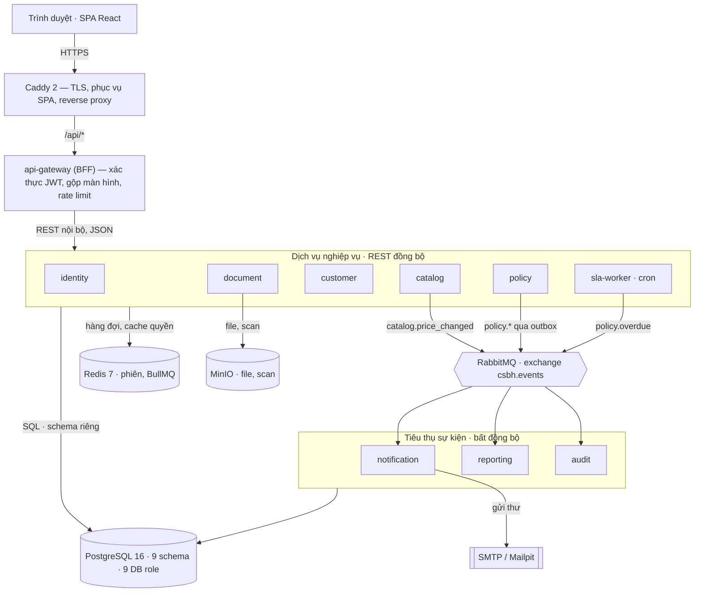

**Hình 1 — Đường đi của một request và của một sự kiện.** Chỉ Caddy mở cổng ra ngoài; mọi service
khác nằm trong mạng Docker nội bộ. Sơ đồ chỉ vẽ ba luồng sự kiện chính — trên thực tế `identity`,
`customer` và `document` cũng phát sự kiện nhật ký.
