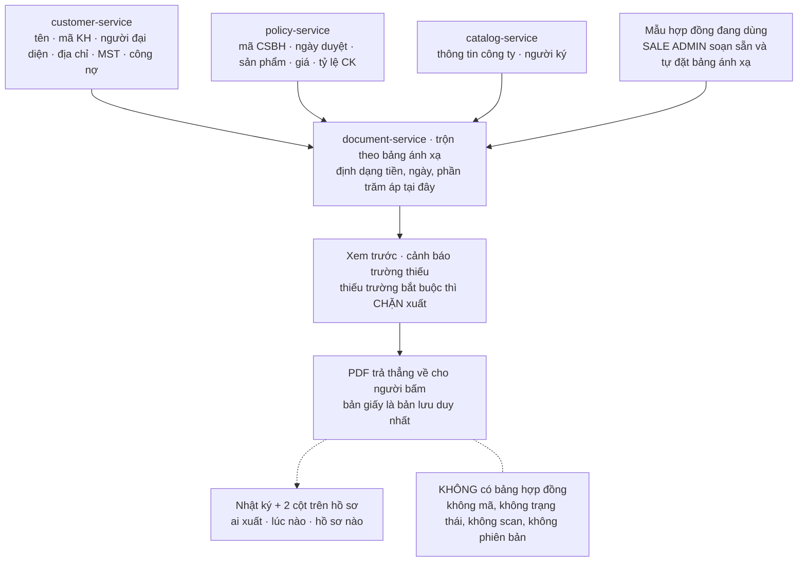

**Hình 4 — Xuất hợp đồng là một phép biến đổi, không phải một bản ghi.** Bảng ánh xạ trường là thứ
Sale Admin cấu hình, không phải lập trình viên hard-code. Toàn bộ nhánh này chạy lại từ đầu ở *mỗi*
lần bấm — nên bấm hai lần cách nhau một tuần có thể ra hai nội dung khác nhau nếu dữ liệu nguồn đã đổi.
