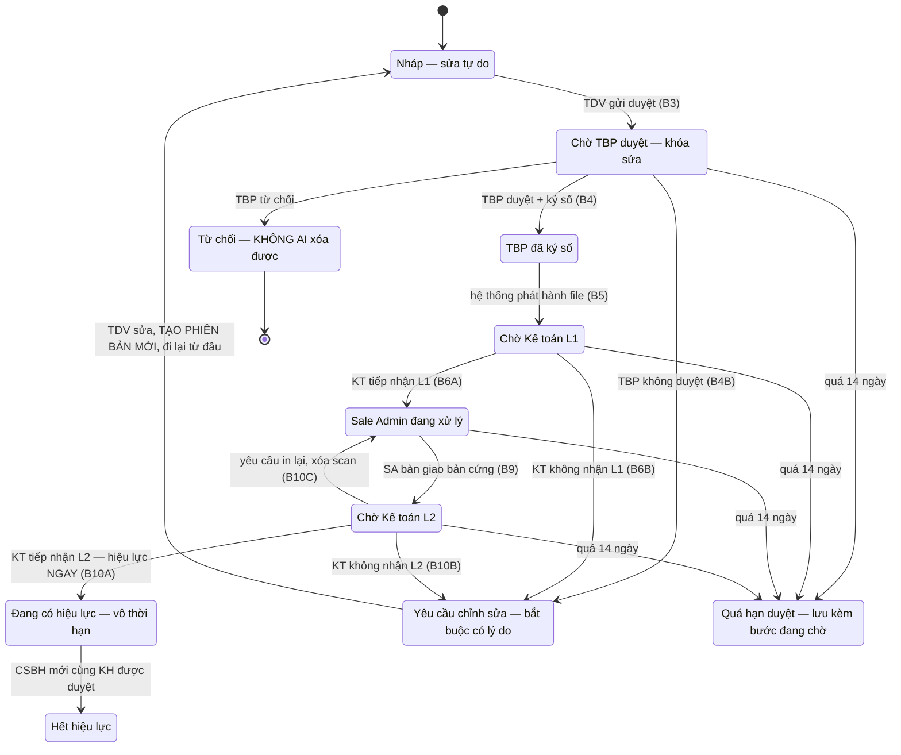

**Hình 2 — Toàn bộ đường đi hợp lệ của một hồ sơ.** Ba nhánh trả lại đều đổ về *Yêu cầu chỉnh sửa*
và đều tạo phiên bản mới, nghĩa là phải ký số lại từ đầu. Vòng in lại là ngoại lệ duy nhất: hồ sơ
quay về Sale Admin mà *không* phải ký lại. *Quá hạn duyệt* không phải một bước trong luồng mà là lớp
phủ lên bốn trạng thái chờ, nên bản ghi phải nhớ nó đang chờ ở bước nào.
