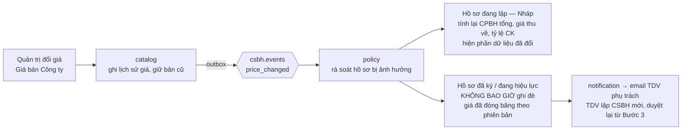

**Hình 3 — Vì sao đổi giá không được phép sửa số trên hồ sơ đã ký.** Nhánh trên tính lại được vì hồ
sơ chưa gửi duyệt; nhánh dưới chỉ được phép *thông báo*, vì con số trên hồ sơ đã ký là bằng chứng
của một lần phê duyệt đã xảy ra.
