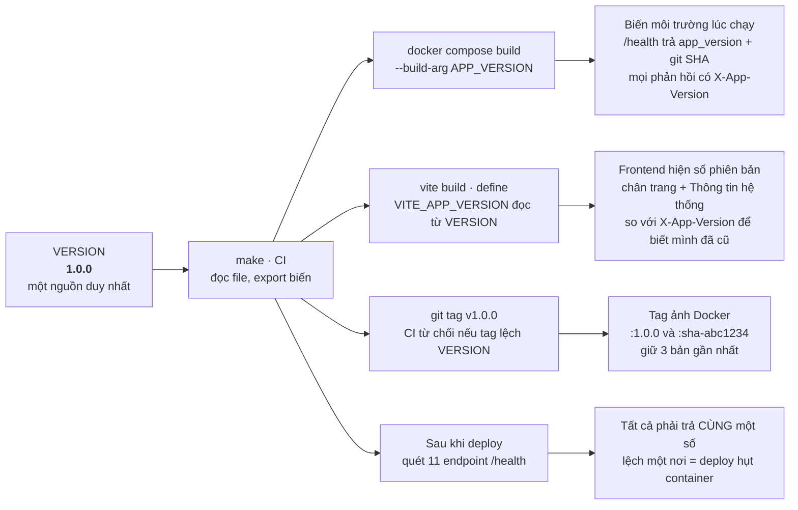

**Hình 6 — Một file, năm đích đến.** Điểm đáng giá nhất không phải việc lan truyền mà là *hàng
cuối*: sau mỗi lần deploy, quét toàn bộ `/health` và bắt buộc mọi nơi trả cùng một số. Với 10
container triển khai bằng Docker Compose, kiểu hỏng phổ biến nhất là một container không được tạo
lại và lặng lẽ chạy bản cũ — chỉ có phép quét này mới bắt được, còn nhìn giao diện thì không.
